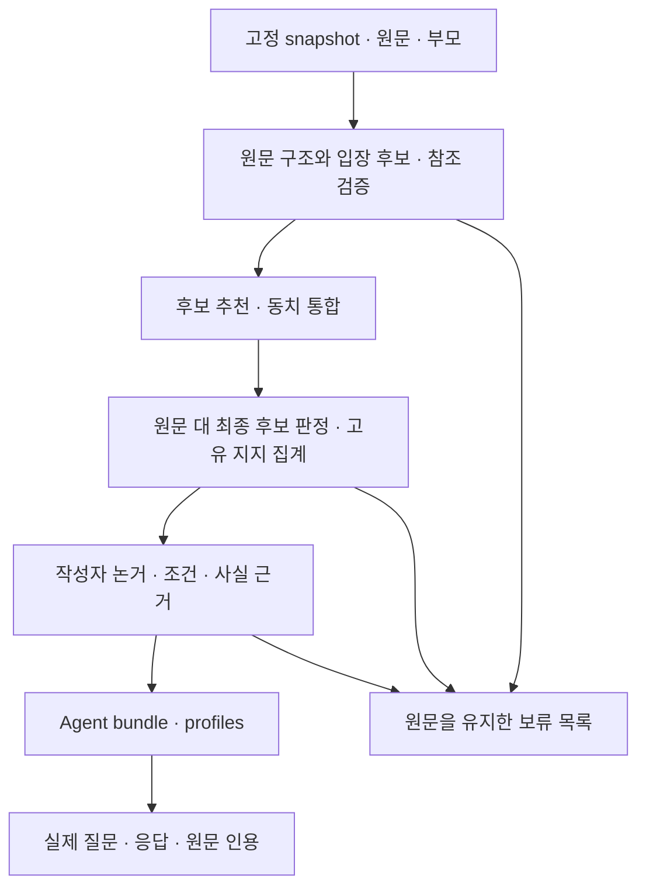

# Factory 재개 설계와 현재 상태

기준일: 2026-10-28. 실행 코드 기준 `c0eb0fd`, 공개 작업은 [PR #24](https://github.com/joowonkime/commentscope/pull/24)다. **이번 정리는 설계·상태 검토이며 모델 실험 재개가 아니다.** 실제 Goal 상태는 조회 당시 `blocked`다. 당시 자원 장애는 현재 관측에서 해소됐지만 사용자의 설계 검토 후 기존 작업을 재개한다.

이 문서는 현재 상태·실행 순서의 안내다. 완료 수치와 권한은 기존 Goal objective 및 승인된 r5 acceptance profile을 유지한다. 과거 문서의 당시 상태를 현재 완료 증거로 읽지 않는다. 구현 위치는 [모듈 설명](MODULE_OVERVIEW.md), API는 [대화 계약](COMPARE_BACKEND_API.md), 과거 실험은 [Codex 비교](CODEX_LOCAL_COMPARISON.md)를 참고한다.

## 1. 이번 Goal이 완성하는 결과

고정 댓글에서 관점을 자동 발견하고 유효한 지지·작성자 논거·사실 근거를 연결한 뒤, 검증된 관점별 Agent를 생성하고 질문에 실행 가능한 결과를 만든다. 결과물은 다음 다섯 가지다.

1. 입력·코드·모델·설정·평가 계약이 고정된 실행 manifest와 호출 장부.
2. 원문·부모를 추적할 수 있는 관점 지도: 후보, 고유 지지 댓글, 보류·희소 의견 포함.
3. 공유 입장과 작성자별 이유·필수 조건·인용·불확실성을 분리한 Agent bundle/profiles.
4. 각 Agent의 실제 질문 응답·원문 인용·근거 부족 보류·대화 이력 분리 기록.
5. 고정 분모·전수 검토·미해결 오류·사용량을 포함한 평가 결과와 조원용 재현 안내.

이 Factory 결과와 팀 제품 전체의 완성은 구별한다. 프론트의 영상 입력부터 대화까지 통합, Figma 흐름, 사용자 테스트, 온라인 Auditor/Reflection, 배포·논문 평가는 각각 별도 진행 항목이다. Factory 통과만으로 그 항목들을 완료 처리하지 않는다.

## 2. 현재 상태: 구현과 실제 품질은 다르다

| 영역 | 실제 구현/증거 | 현재 판단 |
| --- | --- | --- |
| 입력·원문 보존 | snapshot, canonical ID, 부모/영상 문맥 분리 | 구현됨. 원시1000행과 평가 canonical999를 구별 |
| 후보 발견 | free/literal/contextual/shared 경로, literal v5 참조 검증 | 구현됨. 이번 재개의 선택은 literal v5이며 다른 실험 경로와 혼합하지 않음 |
| 후보 통합·지지 | embedding 추천, 동치 병합, 원문과 최종 후보 직접 판정, 고유 지지 집계 | 구현됨. 최신 코드의 실제 품질 통과는 아직 없음 |
| 작성자 논거 | 고정 원문 구조와 이유·조건·양보·귀속, 타입·범위·후보 연결 | 구현됨. 최근 전체 G1에서 이 부분의 오류가 드러남 |
| 사실 검사 | 별도 NLI 모델, 외부 증거 packet, 보류 정책 | 고정40건의 과거 결과9/10·오승인0/30. 새 Agent의 사실 검토와 별개 |
| Agent·질문/API | bundle/profile 컴파일, 허용 주장 응답, 원문 조회, 세션 분리 | 과거 제한된 실제2Agent·6응답 확인. 새 Qwen 경로 전체 성공 증거는 아님 |
| 새 참조 검증 | 잘못된 대상/명령문 치환과 정상 명사 참조를 구별 | 관련38검사·Factory78검사, 실제 Codex2건 점검 통과. Qwen 검증 전 |
| Codex↔Qwen 비교 | 동일 합성8요청·첫 출력·장부·checkpoint | Codex8/8 완료, Qwen0/8. 비교 자체는 미완료 |
| 최근 전체 G1 | Qwen4B, 합성12원문, 96개 검토 과제 | 실행 완료했으나 잘못된 집계 지지3건, Agent0개로 실패 |
| G2/G3/G4 | 승인 계약과 단계 확대 검사 | 현재 수정 코드에서 통과 증거 없음 |
| GitHub | 실행 코드 `c0eb0fd`, Windows/Ubuntu CI 성공 | PR24 OPEN, main 미병합. clone의 main과 이 작업 브랜치를 구별 |

과거 실제2Agent 경로, 최근 실패한 전체 G1, 합성 검사의2Agent, Codex 개발 점검은 각각 다른 실행이다. 서로의 성공으로 실패를 상쇄하지 않는다. 개발 담당 에이전트의 직접 검토는 독립 human gold가 아니다.

### 최근 실패와 수정의 인과 관계

| 관측된 실패 | 적용한 수정 | 다음에 확인할 증거 |
| --- | --- | --- |
| 입장과 because 이유를 합친 후보에 그 이유를 말하지 않은 댓글까지 지지로 집계 | literal 입장·이유 분리, 복합 core 보류, FULL_SCOPE 판정 | 순수 의무화 입장의 A/B/C/I/J 지지와 각자 이유가 분리되는 fresh G1 |
| 자기 가치 이유를 `not_asserted`, 요청을 사실로 분류해 Agent 구성 실패 | 고정 원문 소유 관계, 타입·귀속 프롬프트 보완 | E/J 이유와 A/C 요청의 실제 Qwen 출력·논거·Agent 검토 |
| “그 절차”를 절차의 대상이나 명령문으로 치환 | literal v5 원문·부모·치환문 직접 대조, 실패/누락은 해당 문장 보류 | Qwen의 잘못된 치환 거부와 정상 참조 통과, 유효 입장·이유 유지 |

수정 코드가 존재한다는 사실과 오류 감소를 입증한 결과는 다르다. 표의 마지막 열이 나오기 전에는 해결 완료로 표시하지 않는다.

## 3. 처리 구조와 모듈 계약

| 경계 | 입력 → 출력 | 승인하지 않는 것 |
| --- | --- | --- |
| Source Registry | snapshot → canonical 원문·부모·사용 기한 | 부모·영상의 주장을 작성자 주장으로 가져오기 |
| Discovery/Scope | 불변 원문 구조 → 후보·선택 근거·참조 검증·보류 | 문자열이 원문에 있다는 이유만으로 의미 동일성 승인 |
| Consolidation | 후보·추천 쌍·동치 판정 → 최종 후보와 병합 근거 | 같은 주제/embedding 유사도를 동치로 간주 |
| Membership | 전체 원문·문맥·최종 후보 → 지지/반대/불확실·주소·검증 | 다른 문장의 이유를 공통 입장에 덧붙여 집계 |
| Owned Arguments | 유효 지지·원문 구조 → 자기 이유/조건/양보/추가 요청·타입 | 한 작성자의 이유를 모든 군집 구성원의 이유로 전파 |
| Fact Checking | 사실 주장·고정 외부 증거 → NLI 기록·검토·보류 | 댓글 지지 수를 사실의 진실성으로 해석 |
| Agent Compiler | 후보·지지·논거·검증 → bundle/profiles | 지지 수만으로 핵심·주요 논거 검증 생략 |
| Runtime | 검증 bundle·질문·각 세션 → 응답/보류·허용 인용·이력 | 다른 Agent의 근거 사용, 없는 사실·이유 생성 |
| Offline Evaluation | 동결 결과·원문·평가 참조 → 전수 판단·단계별 보고서 | 평가 라벨을 생성 입력에 넣거나 실패 출력을 수동 보정 |

전체 연결은 `minimal_pipeline.process`, 실행은 `experiments.minimal_factory_pipeline`, 평가와 확대 승인은 `experiments.minimal_factory_review` 및 `check_admission`이다. 단계별 입출력은 모듈화돼 있지만 공통 ID·계약 변경은 전체 연결에 영향을 준다.

### 재개 시 고정할 실행 선택

- 운영 후보: Qwen3-4B-Instruct-2507 Q4_K_M, GPU, thinking off, context8192. 모델·서버·런타임은 기존 deployment manifest로 고정한다.
- 새 본 실험: `discovery_mode='literal'`, `membership_mode='raw'`, `verification_contract=FULL_SCOPE`.
- 명령 기본값은 `free/scoped`다. portable 실행은 raw 외 방식을 거부하므로 두 모드를 명시하고 생성한 plan을 먼저 검사한다. 기본값을 보고 선택 경로를 추정하지 않는다.
- Codex는 개발 진단·구현·검토에 사용한다. Codex의 통과가 운영 Qwen의 통과가 되지는 않는다.
- OpenRouter·다른 유료 API는 사용하지 않는다. 단건 기본 지시문 교체 실험은 운영 설정으로 채택하지 않았다.

### 변경하지 않는 의미 규칙

공유 입장 P를 지지하는 서로 다른 작성자들이 이유 R/S를 말하면, 공통 입장은 P이고 이유는 각 원문에 남는다. `P because R` 전체를 모든 작성자가 지지한다고 집계하지 않는다. 필수 조건은 이유와 다르며 해당 입장의 범위에 포함한다. 조건부 P, 무조건 P, 타인의 인용, 반대·미결정은 구별한다. 희소 의견과 보류 문장은 보존한다.

## 4. 완료 조건과 필요한 증거

| 단계 | 고정 범위 | 통과 증거 |
| --- | --- | --- |
| 준비·G0 | 현재 계약·변경 부분 | 입력/모드/출처/판정/장부/부분 실패/컴파일 경계 확인. 코드 변경 시 관련 검사 |
| 개발 비교 | 같은 합성8요청 | Codex·Qwen 첫 출력과 요청 hash, 각 원문 대조. 품질 게이트의 대체가 아님 |
| G1 | 합성 A–L 12개 | mandatory A/B/C/I/J, voluntary E/G/L, 조건부 D/K 오가입0, F/H 보존. 서로 다른 Agent≥2·각 canonical 지지≥3·각 실제3질문 |
| G2 | 실제24개, 의미분모19 | 후보 보존≥12/19, 집계 오가입·노출 핵심 왜곡·호출 실패0, 해당 결과·논거·Agent 검토 |
| G3 | 별도 고정96개, 의미분모74 | 후보 보존≥45/74, 오가입·오병합·필수 조건 손실·호출 실패0, 전체 결과 검토 |
| G4 | 전체 canonical999, 의미분모755 | 올바른 공유군집 활용≥453/755, 집계 지지 전수 유효·미검토 승인0. 모든 생성 Agent의 내용·사실·출처·실제 로딩·각3질문 검증, 서로 다른 Agent≥2·각 지지≥3 |

공통으로 원문·부모·고정 분모·실패를 유지하고, factual benchmark는 supported≥8/10·비지원 오승인0/30을 충족해야 한다. G2/G3에서 생성된 Agent는 모두 검토하지만 부분 표본에서 새로 최소2Agent를 요구하는 조건을 임의로 추가하지 않는다. 최소2Agent는 G1과 최종 G4에서 확인한다.

**세 숫자를 구별한다.**

- 후보 보존: 의미 있는 canonical 댓글 중 최소 한 개의 충실한 실질 명제가 보존됐다고 검토된 고유 댓글 수. 후보/군집의 개수나 원문의 모든 명제 보존율이 아니다. 다른 누락도 별도로 기록한다.
- 최종 활용: 검토된 일관된 공유군집에 올바르게 기여한 의미 댓글 ID의 합집합. 같은 댓글이 여러 군집에 있어도 한 번만 센다. 공유군집의 유효 기여자≥2가 구조적 기준이며, singleton 보관만으로 활용을 만들지 않는다.
- Agent 적격성: 공유군집 기준과 별개로 각 Agent의 유효 canonical 지지≥3 및 내용·사실·실행 검증이 필요하다. 댓글 수를 사람 수나 여론 비율로 부르지 않는다.

### 사실40건 증거의 재사용

고정40건은 Qwen이 아닌 별도 DeBERTa NLI 컴포넌트 검사다. 기존 `replay_benchmark`는 사례·모델/가중치·판정 코드·임계값·관련 런타임을 확인한다. 이 동일성 검사를 통과한 과거9/10·0/30은 호환성 증거로 유지하며 `fresh_inference=false`를 명시한다. Qwen 교체만을 이유로 이를 무효 처리하지 않는다.

NLI 모델·임계값·판정 코드 등이 바뀌면 기존 증거를 그대로 승계하지 않고 고정40건을 새로 검증한다. 실제 Agent에 포함된 사실은 그 실행의 증거 packet·NLI 기록·원문과 별도로 대조한다. 사실 주장이 없어 새 사실 호출이0건인 경우도 그대로 보고하며 실제 사실 경로를 실행했다고 부르지 않는다.

### 평가 작업 단위

원문, 후보, 집계 지지 간선, 동치 판정, 작성자 논거, Agent, 질문 응답별로 검토한다. 각 판단은 원문/후보/결과/검토표 hash와 연결한다. 실패·불확실·미검토를 승인으로 바꾸지 않는다. 집계의 잘못된 간선 하나가 다른 올바른 간선으로 상쇄되지 않는다.

999개 전체를 거대한 한 번의 LLM 입력으로 보내지 않는다. 검토자가 필요한 원문·부모·후보·논거를 과제별로 읽고 결과를 저장하며, 단계 보고서는 코드로 집계한다. 파일 경로나 링크만 줬다는 사실은 본문 검토 증거가 아니다. 내용이 길면 원문 경계를 유지해 처리하고 용량 보류를 드러낸다. 필수 조건·인용·반대를 잘라 맞추지 않는다.

## 5. 재개 순서와 실험 의사결정

### R0 — 실행 준비, 추론0회

1. 최신 private progress와 checkpoint, 실제 Goal, git 상태·선택 branch, 현재 quota·자원·사용 기한을 확인한다.
2. 새 실행의 모델·모드·평가 계약·입력·코드·가설을 plan으로 고정한다. 계획서 작성만으로 통과 처리하지 않는다.
3. source/model/algorithm 변경 후 이전 G1 합격을 승계하지 않는다. 각 단계 승인은 같은 코드·모델·알고리즘 및 원문 결과에 묶고 기존 evaluator로 재계산한다.
4. 구현·평가기 변경이 필요한 부분은 G1 전에 정리한다. G1 통과 후 G4까지 실행 코드의 불필요한 변경으로 qualification을 계속 무효화하지 않는다.

### R1 — 남은 Qwen8건 비교 완료

기존 v8의 Codex8건을 재호출하지 않는다. 현재 소스는 그때와 다르므로 원래 실행의 `frozen-code` 작업 루트에서 원래 plan을 검증하고 Qwen backend만 실행한다. 원래 실행 경로·장부·배포·요청 hash를 그대로 유지한다. 정확한 개인 경로는 private progress에 있다.

기존8건은 이전 동결 코드의 개발 비교다. 새 literal v5의 품질을 검증한 것으로 이름을 바꾸지 않는다. Qwen 출력이 실패하면 원문 대조로 원인을 분류하고, 그 결과를 새 현재 코드의 진단에 사용한다.

### R2 — 현재 코드의 실패 가설 확인 후 fresh G1

최근 실패의 세 가설을 확인한다: (H1) 입장·이유 분리가 잘못된 집계와 B 누락을 해결하는가, (H2) 자기 이유·요청의 귀속/타입이 정확한가, (H3) 참조 검증이 잘못된 치환을 거부하면서 정상 참조와 다른 유효 입장을 살리는가.

추가 소규모 진단이 필요하면 기존 실패 사례와 정상·부정 대조군, 예상 관측·판단 규칙을 실행 전에 고정한다. 모든 항목을 거부하는 것이 개선은 아니다. 참조 감사 추가 자체도 채택 근거가 아니며 오승인 감소·정상 손실·호출 비용을 함께 본다. 치명적 실패가 그대로면 큰 실험부터 돌리지 않는다.

그다음 **현재 코드의 새 plan으로 G1 전체를 실행하고 사후 전수 검토**한다. 기존 G1v5를 고치거나 실패 간선을 지우지 않는다. 이 단계가 실제 개선 입증이며 부분 진단으로 대체할 수 없다.

### R3 — 통과한 설정으로 G2 → G3 → G4

각 단계는 이전 게이트의 plan/output/review/result와 같은 코드·모델을 admission 검사로 확인한 뒤 시작한다. G2/G3 후보 보존과 오류 조건이 통과하기 전999 실행을 시작하지 않는다. 실제 G2/G3에서 단계별 호출·토큰·시간·후보/지지 간선 수를 측정해 G4 비용을 예상한다. 완료는 G4 보고서와 전체 Agent 증거로만 판단한다.

### 실패 시 다음 행동

| 실패 종류 | 다음 행동 |
| --- | --- |
| 자원·quota 보호 | 새 호출 중단, 소유 작업 정리·현재 진행 기록. 자원/계정 상태를 바꿔 기준을 우회하지 않음 |
| 미확정 호출·전송 오류·429 | 원래 PID/장부/원문 응답부터 확인. 완료 응답과 모호한 intent를 구별하고 자동 재전송하지 않음 |
| 코드·출처·hash 불변조건 실패 | 해당 구현 수정·관련 검사 후 새 계획. 품질 기대값·분모를 낮추지 않음 |
| 의미 실패 | 원문→후보→지지→논거→Agent 중 최초 왜곡 경계를 찾고 가설·수정·정상 손실·비용을 비교 |
| 같은 원인3회, 제품 개선 없음 | 감사층이나 전체 실행을 반복 추가하지 않고 표현·문제 분해·검증 전략을 재검토 |
| 정책/범위 판단이 꼭 필요 | 근거가 되는 소수 사례와 선택 영향을 정리해 human loop. 일반 코드 실패마다 재승인을 요구하지 않음 |

독립 사람 gold와 사용자 테스트는 별도 증거다. 현재 개발 Goal의 모든 일상 판정을 사람 승인 대기열로 바꾸지 않는다. 실제 외부 장애가 세 Goal 턴 반복되고 의미 있는 독립 작업도 없을 때만 native blocked를 기록한다.

## 6. 비용·자원·compact 후 재개

2026-10-28 자원 관측은 RAM여유6446MiB, commit여유약7.39GiB, 디스크여유약7.57GiB, GPU여유6839MiB로 기존 시작 보호 기준을 충족했다. 관측은 실행 성공 보장이 아니므로 실제 시작 직전에 다시 확인한다. 시작 RAM4096MiB·commit4GiB·GPU3072MiB, 실행 중 RAM1536MiB·commit1GiB·디스크6GiB 기준은 그대로다. 다른 작업 종료·OS 설정 변경은 이번 재개의 전제가 아니다.

Codex8건은 native 입력92,988·출력260토큰을 사용했다. 단건 CLI 호출마다 기본 지시문 비용이 있어 G4의 모든 검토 행을 개별 CLI로 돌리는 비용을 가볍게 추정하지 않는다. 사용량은 정기 확인하고 주간 잔여40% 이하이면 새 구현·추론·의미 검토를 중단해 기록한다. 추가 총량 예산은 만들지 않는다.

최근 전체 G1의231 Qwen 호출을999개로 단순 선형 환산하면 약1.9만 호출이다. 실제 호출 수는 후보 수·검색/병합 쌍·논거·캐시에 따라 달라지므로 실행 시간 예측이나 새 예산이 아니다. G2/G3 측정 없이 G4가 저렴하거나 금방 끝난다고 판단하지 않는다.

압축 후에는 다음 네 가지만 먼저 읽는다.

1. private `progress.json`: 현재 단계·코드·실행 핸들·최근 관측·다음 한 작업.
2. progress가 지정한 가장 가까운 checkpoint.
3. 이 문서의 해당 단계와 승인 acceptance profile.
4. 그 작업의 코드·원문·실패 증거만 추가로 읽는다.

전체 대화·과거 인계 문서·장부 원문을 매번 다시 읽지 않는다. 상세 이력은 별도 checkpoint에 보존하고 progress는 짧게 유지한다. 각 실험은 가설, 고정 입력/버전, 예상 관측, 실제 결과, 원인, 다음 판단을 남긴다. 완료 응답 재사용은 같은 plan의 hash 일치 시에만 허용하며, fresh 실행에서도 같은 plan의 중단 후 이어가기는 가능하다. 다른 실행의 응답을 새 출력처럼 복사하지 않는다.

고정 snapshot의 사용 기한은 **2026-11-08T18:30:59.664629Z**다. 만료 전 실행 여부를 확인하고, 만료되면 기한을 임의 연장하거나 분모를 바꾸지 않고 자료 갱신과 비교 계약을 다시 정한다. 실제 댓글·원문 응답·ledger·모델·인증은 private에 남긴다.

재개 준비가 됐다는 것은 위 계획과 근거가 정리됐다는 뜻이다. 실제 품질은 R1/R2와 G1~G4가 답해야 할 미확정 사항이다.
