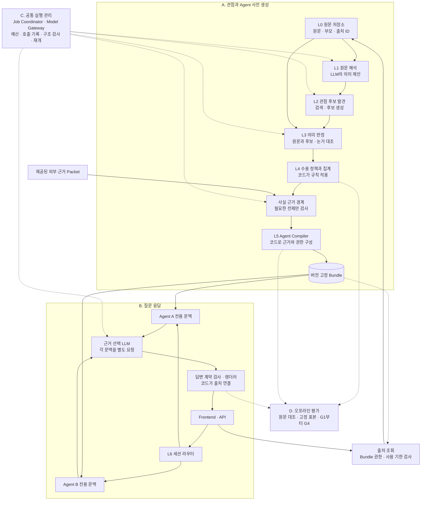

# 클러스터링 → Agent 생성 공동 개발 초안

기준일: 2026-10-24. 이 브랜치는 조원이 읽고 수정할 수 있는 개발 초안이다. 전체 댓글에서의 클러스터링 품질과 MVP 완료를 주장하지 않는다. 기존 실험 코드도 포함하므로 모든 모듈이 최종 채택된 것은 아니다.

## 역할과 계층의 재설계 제안 — 2026-11-03

이 절은 **현재 코드를 바탕으로 작성한 설계 제안**이다. 실행 코드를 변경하거나 새 모델을
채택한 기록이 아니다. 아래 기존 구현 설명과 구분한다. 각 역할은 논리적 책임이며,
역할마다 별도 Agent·모델·LLM 호출을 만들라는 뜻이 아니다.

현재 확인한 문제는 모델 역량과 구조의 책임 배분을 함께 비교해야 한다는 점이다.
`PipelineWork`는 호출·용량·오류·캐시뿐 아니라 `qualify`, `observe_world`, `judge`의
의미 판단 흐름까지 조정한다. 세계·귀속·원문 근거 등 여러 관찰을 별도 호출로 쌓아 왔지만,
각 호출의 추가 품질 효과와 정상 의견 손실·비용을 전체적으로 비교한 근거는 부족하다.
상위 모델의 같은 과제 비교 전에는 현재 모델이 구조 문제의 주원인이라고 단정하지 않는다.



독립 Mermaid 원본: [factory-proposed-architecture.mmd](examples/factory-proposed-architecture.mmd).
점선은 호출 관리나 평가 입력 관계이며, 평가 정답을 모델 입력에 전달하는 경로가 아니다.

### 각 역할의 책임과 권한

| 역할 | 입력 → 출력 | 책임과 제한 |
| --- | --- | --- |
| L0 원문 저장소 — 코드 | snapshot → `SourceRecord` | 원문·부모·정확한 구간·출처 ID·사용 기한을 보존한다. 부모는 별도 문맥이며 작성자의 이유로 승격하지 않는다. |
| L1 원문 해석 — 모델 | 원문과 허용된 부모 문맥 → `SourceInterpretation` | 자기 주장·인용·조건·부정·예측·이유·양보·세계 범위를 제안한다. 다른 후보를 보여 주기 전 원문을 해석한다. 지지 집계나 사실 인증 권한은 없다. |
| L2 후보 발견 — 검색과 모델 | 원문 해석 제안·embedding → `PerspectiveCandidate` | 공통 핵심의 후보와 비교할 원문을 찾는다. 유사도·제목·요약·후보 제안 자체로 지지를 승인하지 않는다. |
| L3 의미 판정 — 모델 | 원문·부모·후보·논거 연결 제안 → `SemanticDecision` | 각 원문이 후보를 실제로 지지하는지, 조건·귀속·범위를 보존하는지, 제안한 이유가 해당 입장의 이유인지 판단한다. 자기 확신이나 찬성 수로 검토를 대체하지 않는다. |
| L4 수용 정책과 집계 — 코드 | 결합이 유효한 판정·보류 → `SupportGraph` | 고정 정책을 적용하고 고유 출처별로 집계한다. 구조적으로 올바른 응답을 의미 정답으로 간주하지 않는다. |
| 사실 근거 경계 — 코드와 별도 검사기 | 필요한 사실 전제·제공된 증거 packet → `FactAssessment` | 원문 충실성과 외부 사실의 지지를 구분한다. 의견·예측을 확인된 사실로 바꾸지 않는다. 필수 전제의 근거가 부족하면 Agent를 보류한다. 검사할 전제가 없으면 추가 추론을 하지 않는다. |
| L5 Agent Compiler — 코드 | 후보·지지·출처별 논거·사실 상태 → `PerspectiveBundle` | 핵심 입장·허용 주장·자기 출처·조건·보류 항목을 고정한다. 새로운 이유·합의·개인 경험을 생성하지 않는다. |
| L6 대화 런타임 — 코드와 모델 | 고정 Bundle·질문·해당 세션 이력 → 답변 또는 보류 | 모델은 허용 항목을 선택하고 코드는 해당 항목과 출처를 렌더링한다. 초기 기준선은 기존 선택형 답변을 유지한다. 질문 때 관점 분석 전체를 재실행하지 않는다. |
| C 공통 실행 관리 — 코드 | 선언된 작업·모델 정책 → 원래 응답·실행 기록 | 예산·토큰·제공자 호환성·호출 ID·checkpoint·구조 검사·실패 상태를 관리한다. 의미 판정 정책과 집계 수를 결정하지 않는다. |
| D 오프라인 평가 — 개발 경계 | 원문·산출물·별도 검토 → 품질 보고 | 고정 기준으로 모델·구조의 효과를 비교한다. 평가 라벨은 생성 모델 입력에 넣지 않는다. 사후 평가는 사용자 질문 경로의 상시 호출층이 아니다. |

여기서 코드의 수용은 **검증된 정책에 따른 모델 판정의 적용**을 의미한다.
출처 ID·문자 구간·타입 검사는 결정적으로 수행할 수 있지만, 의미 함의·인용 해석·
조건 보존의 정확성은 별도 원문 대조와 실제 품질 평가가 필요하다.

### 단계 간 자료 계약

다음은 논리적 계약이다. 새로운 구현 파일을 각각 하나씩 만들라는 목록이 아니며,
기존 기록·ID·구간 구조에 대응시켜 재사용한다.

| 기록 | 필수 내용 | 다음 단계가 사용하면 안 되는 해석 |
| --- | --- | --- |
| `SourceRecord` | 출처 ID, 원문·부모의 개별 hash, 정확한 구간, 사용 기한 | 부모의 입장·영상 설명을 작성자의 근거로 사용 |
| `SourceInterpretation` | 출처·입장 ID, 자기/보고 발언, 정확한 근거 구간 ID, 조건·부정·세계·인식 상태, 이유의 소유 입장, 미해결 항목 | 원문 해석 제안을 이미 승인된 지지나 참인 사실로 사용 |
| `PerspectiveCandidate` | 후보 ID와 버전, 정확한 핵심 문장·범위, 제안 출처, 검색 정보 | 제목·공통 요약을 추가 원문 근거로 사용 |
| `SemanticDecision` | 원문·후보 버전, 관계, 근거 구간, 조건·귀속·범위 판정, 논거 역할·소유자, 보류 코드, 모델·요청·응답 식별자 | 후보를 먼저 받아들인 뒤 원문에 없는 이유나 세계를 보충 |
| `SupportGraph` | 고유 원문-후보 관계, 적용한 판정·정책 버전, 지지·반대·보류·실패의 별도 기록 | 같은 댓글의 여러 근거를 여러 표로 집계, 댓글 수를 사람 수로 표현 |
| `FactAssessment` | 주장·필수 전제 ID, 증거 문서와 구간, 제공된 근거에 대한 지지·충돌·불충분 상태 | 댓글에 등장했다는 이유만으로 외부 사실을 인증 |
| `PerspectiveBundle` | 고정 핵심·허용 주장·출처별 역할·필수 조건·사실 상태·미해결 항목·버전 | 한 작성자의 이유를 전체 지지자의 이유로 일반화 |
| `AnswerSelection` | Bundle 버전, 허용 항목 ID, 답변 가능 범위·보류, 요청·세션 ID | 다른 Agent의 근거·모델 자유 생성 문장·대화 이력을 새 사실로 사용 |

모든 모델 출력은 다음 역할에 들어가기 전에 공통 구조 검사와 해당 원문·후보에 대한
결합 검사를 거친다. 스키마와 검사기는 같은 계약 정의를 사용하고, 제공자가 강제하지
않는 제약과 필드 간 규칙을 명시한다. 자유 생성 설명문이나 거대한 문구 선택 목록은
실제 필요와 토큰 비용을 확인한 뒤 도입한다. 원래 응답을 절단·수정해서 통과시키지 않는다.

`proposed`·`structurally_valid`·`model_assessed`·`reviewed_for_gate`를 구분해 기록한다.
일반적인 의미 불확실성은 `held`, 계약·전송 실패는 `error`로 남긴다. 보류를 성공이나
실패 누락으로 바꾸지 않으며, 기존 품질 게이트가 요구하는 실패 수0도 그대로 검사한다.

### 반드시 보존할 경계

- 원문 해석 관찰은 후보를 보기 전에 작성한다. 후보 자체의 범위도 후보에 명시된
  내용으로 정의한다. 비교 단계가 빠진 조건·세계·발언자를 보충해 지지를 정당화하지 않는다.
- 이유는 작성자의 해당 입장에 연결한다. `P because R`와 `P despite C`의 R·C는
  다르게 유지하며, `P only if Q`의 Q는 공통 핵심에서 제거하지 않는다.
- embedding과 주제 군집은 비교 대상을 추천한다. 실제 지지는 원문-후보 판정과
  고정 수용 정책으로 결정하며, 필요 검토 전의 중간 긍정 판정만으로 집계하지 않는다.
- 후보 대표 문장이나 범위가 바뀌면 영향을 받는 지지·논거·Bundle을 다시 결합·검증한다.
  캐시는 정확한 입력·계약·모델·추론 설정에 묶는다. 공식 검증의 cross-run 재사용 금지는 유지한다.
- Agent는 고정된 근거 묶음·응답 규칙·격리된 세션으로 구성한다. 각 Agent에 별도
  모델 가중치나 상주 프로세스를 만들 필요는 없다. 하나의 모델을 별도 문맥으로 호출할 수 있다.
- 응답 렌더러는 해당 Agent의 허용 항목과 출처만 사용한다. 근거 부족 보류, request ID
  중복 방지, 전체 라운드 실패 시 이력 복구를 유지한다. 이력은 근거를 추가하지 않는다.
- 평가 정답·개발 검토는 생성 입력에서 분리한다. 필수 사실·내용·실행 검사와
  G2 12/19·G3 45/74·G4 453/755·최종 Agent 최소2개와 각 지지3개 기준을 유지한다.

합성 예를 들면 S1의 “공지를 표준화해야 한다. 접근성이 중요하기 때문이다”와
S2의 “공지를 표준화해야 한다. 비용이 들더라도”는 같은 핵심 입장을 지지할 수 있다.
접근성은 S1의 이유이고 비용은 S2의 양보다. S3의 “별도 예산을 지원할 때만 공지를
표준화해야 한다”는 조건부 입장을 별도로 보존한다. 이 예의 무조건 입장 지지는2개이므로
지지3개를 요구하는 Agent 생성 기준에는 아직 미달한다.

### 기존 구현과의 대응 및 변경 순서

| 제안 책임 | 재사용할 현재 구현 | 정리할 지점 |
| --- | --- | --- |
| 원문·출처 | `framed_corpus`, `explicit_discourse`, 원문 구간 구조 | 불변 원문과 모델 해석을 명시적으로 구분 |
| 원문 해석·후보 발견 | `compact_claims`, `source_context_observations`, `statement_worlds`, `candidate_consolidation` | 관련 선언을 공통 기록으로 정리하고, 별도 호출의 필요성은 실측 |
| 의미 판정 | `raw_membership`, `raw_membership_verification`, `owned_arguments`, `source_arguments` | 지지·조건·논거 역할을 담당하는 정책을 실행기에서 분리 |
| 수용·집계·컴파일 | `minimal_membership`, `minimal_agents`, `grounded_inputs` | 집계 권한과 순수 Compiler 경계 유지; 명시적인 판정·사실 상태 입력 |
| 실행 관리 | `PipelineWork.work`, providers, checkpoint·예산 장부 | `qualify`·`observe_world`·`judge`의 도메인 흐름을 단계 서비스로 이동 검토 |
| 대화·평가 | `grounded_runtime`, `grounded_web`, review packet·acceptance | 허용 항목 선택과 호스트 렌더링, 평가 입력 분리 유지 |

1. 기존 실패·정상 사례를 고정하고 같은 과제로 모델·추론 설정을 비교할 소규모 진단을
   설계한다. 토큰 상한·지원 파라미터·제공자·비용 상한을 먼저 선언하며, 이 문서 작성으로
   유료 호출을 시작하지 않는다.
2. 현재 구조의 진단과 단순한 기준선을 비교해 역할별 필요한 호출을 결정한다.
   세계·조건·귀속·독립 원문 관찰 등 보호 규칙은 유지하고, 통합 대안이 실제 품질과
   정상 의견 보존을 충족하기 전에는 기존 거부 검사를 삭제하지 않는다.

### 구현한 첫 전달 계약: 원문 해석 제안 보존

`compact-source-claims-20261104-v8`은 기존 v7의 요청·응답 형식을 그대로 사용하면서
호스트에서 각 추출 주장에 `SourceInterpretation`을 결합하는 선택적 계약이다.
`minimal_pipeline.process(..., extraction_protocol=compact_claims.TRACED_PROPOSALS)`로
사용한다. 기존 OpenRouter 실행기의 기본 추출 설정은 v7이다. 모델이나 추론 설정을
바꾸지 않으며, 추가 모델 호출·자동 재시도도 없다.

| 전달 내용 | 결합 및 사용 규칙 |
| --- | --- |
| 원문·부모·영상 문맥 | 전체 원문 객체와 hash에 결합한다. 부모와 영상은 참조 해석용이다. |
| 제안 문장·발언자 | 기존 정규화 문장·claim ID·추출 record ID와 발언자 제안을 보존한다. |
| 자기 근거·필수 조건 | 원문 구간 ID·시작/끝·텍스트를 그대로 검증한다. 부모를 자기 근거로 선택할 수 없다. |
| 관점 후보 | 같은 문장을 제안한 출처와 추출 ID는 모두 유지한다. 대표 문장의 해석 기록 하나를 출처 ID·추출 ID 순으로 결정해 보존한다. |
| 지지 판정 | 해석 기록 hash도 판정에 결합한다. 해석을 바꾸거나 제거한 후보에 이전 지지 판정을 재사용할 수 없다. |

일반 추출에서 후보로 넘어갈 때 소실되던 선택 근거·조건을 추적할 수 있게 한 변경이다.
`source_interpretation`은 후보의 뜻을 확장하는 정의나 승인된 지지·사실이 아니다.
조건·선택지·부정·수량·양보·세계·질문은 보존된 원문/제안 안에 남으며, 이 계약이
그 의미를 자동 분류하거나 잘못된 의역을 교정하지 않는다. 부모의 어느 구간을 실제로
참조했는지와 발화 유형을 독립적으로 판정하는 공통 계약은 아직 후속 작업이다.

원문-후보 비교에는 해당 원문이 대표 해석의 출처일 때만 자기 해석 제안을 함께 보낸다.
다른 작성자의 해석을 그 원문의 근거로 전달하지 않는다. 양방향 후보 동치 비교는
계속 완성된 후보 문장만 비교하며, 독립 근거 검사는 기존의 별도 입력 경계를 유지한다.
Core/논거 선언은 대표 해석의 문맥을 볼 수 있지만 작성자 소유·사실·최종 수용 검사는
그대로 필요하다. 원문 독립 관찰·세계 분류·조건 검사 등을 없애거나 합치지 않았다.

기존 v1~v7 요청·응답의 재현을 유지한다. 새 계약의 선택 근거가 올바르다는 뜻은 아니며,
오프라인 재결합과 합성 연결 검사는 실제 새 모델 실행이나 G1~G4 통과 증거가 아니다.
원문 해석 제안의 `semantic_approval`과 `factual_verification`은 항상 false다.

### 선택적 공통 의미 검토와 후보 등록

v8에 `review_interpretations=True`를 함께 지정하면 후보를 만들기 전에 같은 원문의
해석 제안을 최대8개씩 검토한다. 기존 `source_interpretation` 모듈의 별도 버전 계약을
사용하며, 원문·부모·제안 텍스트를 읽고 다음 선언을 반환한다.

| 선언 | 의미와 보류 기준 |
| --- | --- |
| 발화 유형 | 진술·요구·비판·질문·보고·명시적 불확실성·불명확. 질문/보고/불명확은 자기 입장 후보로 등록하지 않는다. 명확한 수사적 비판과 명시적으로 미정인 입장은 별도로 보존할 수 있다. |
| 인식 상태 | 진술·가능성·예측·조건부·상상·미정·불명확. 작성자의 미정 입장과 해석 불명확을 구별한다. |
| 세계와 프레임 | 기존 real/fictional/hypothetical/unclear 구분. 허구·가정 프레임은 자기/부모의 구간 ID를 선택하며 새 anchor 문장을 생성하지 않는다. |
| 참조 | 자기 표현 구간과 자기/부모/영상 제목의 선행 참조 주소. 부모는 참조 전용, 영상 제목은 주제명 참조 전용이다. |
| 범위 관계 | 조건·양보·이유·선택지·수량/시간·보고 발언을 자기 구간에 연결한다. 부모나 영상의 내용을 자기 이유로 선택할 수 없다. |
| 충실성 | 참조·귀속·발화·논리 범위·수량/시간·세계 각각을 preserved/changed/unclear로 판정한다. 모두 보존됐다고 판정해야 후보 등록을 허용한다. |

응답에는 자유 생성 의역·인용·설명문이 없다. 스키마와 호스트는 같은 닫힌 필드·선택 주소·
배열 한도를 검사하며, 관계·필드 간 제약도 검증한다. 잘못된 주소·중복·누락 응답은 오류로
기록한다. changed/unclear나 필요한 검토가 없으면 제안을 보류하고 원문·추출 기록은 남긴다.
순수 보고/불확실 귀속 제안은 원래부터 자기 입장 후보가 아니므로 검토 호출을 만들지 않는다.

이 검토는 추출된 제안과 원문의 비교이며, 후보를 보지 않는 독립 관찰이나 독립 gold가
아니다. 후보 등록을 허용해도 원문별 지지·세계·논거 소유·사실·Agent 검사는 모두 필요하다.
누락된 별개의 주장을 복원하거나 전체 추출의 완전성을 승인하지 않는다. 한 제안의 보류를
그 원문이 다른 올바른 후보를 지지할 수 없다는 판정으로 사용하지 않는다.

기본값은 false이며 OpenRouter 공식 실행기의 기본 설정에도 연결하지 않았다.
명시적으로 사용하면 자기 입장 제안 수 n인 원문마다 최대 ceil(n/8)회 검토 호출이 추가된다.
현재 추출 상한32개에서 원문당 최대4회, 호출별 출력 상한4096 tokens다. 빈 추출이나
보고 제안만 있는 원문에는 추가 호출이 없다. 자동 재시도·조건별 추가 호출은 없고
기존 runner의 용량·장부·재개 경계를 사용한다. 실제 사용 전 추가 비용·제공자 호환성과
검토 모델의 정확도를 확인해야 하며, 오프라인 모의 응답 검사는 이를 대신하지 않는다.

기존 world 관찰의 자유 anchor 160자 계약은 그대로다. 새 의미 검토의 구간 주소가 긴
프레임을 보존한다는 사실을 그 기존 오류의 해결이나 G2/G3 통과로 보고하지 않는다.
3. 동작 보존 리팩토링과 의미 알고리즘 변경을 나누어 기존 source/claim ID와
   과거 버전 재현을 유지한다. 저장 응답 오프라인 검사와 새로운 모델 출력 검증을 구분한다.
4. 모델·구조 선택과 변경을 모은 뒤 코드를 고정해 기존 G1부터 G4를 검증한다.
   이후 실제 HTTP·팀 프론트·제품 과업을 연결한다. 이 설계도만으로 품질 통과를 선언하지 않는다.

참고: [Key Point Analysis](https://aclanthology.org/2020.acl-main.371/),
[LLM 논점 요약 비교](https://aclanthology.org/2025.emnlp-main.1797/),
[ArgCMV 실제 토론 벤치마크](https://aclanthology.org/2025.emnlp-main.1110/),
[Talk to the City 현재 구현](https://github.com/AIObjectives/tttc-light-js).
주제 묶음·요약 성능을 원문별 지지 정확성이나 Agent 품질의 증거로 옮기지 않는다.

## 먼저 실행하기

Python 3.12 이상에서 저장소 루트를 기준으로 실행한다. pip 설치·GPU·모델·API 키가 필요 없다.

```bash
git clone https://github.com/joowonkime/commentscope.git
cd commentscope
python tools/check_factory_draft.py
```

이 명령은 **실제 파이프라인 코드에 합성 댓글과 미리 작성한 모델 응답을 넣어** 연결·출처 소유권·보류·집계 계약을 검사한다. 실제 Qwen 추론이나 실제 댓글 품질 평가는 아니다. 상세 항목은 `--verbose`로 확인한다. 생성되는 `runs/`는 Git에서 제외된다.

화면/API는 별도 확인한다.

```bash
cd src
python -m commentscope.agents.team_demo --session-dir ../runs/team-demo
```

브라우저: http://127.0.0.1:8766. 이 화면은 합성 Agent를 사용하는 API 연동 데모이며, 클러스터링을 실행하지 않는다. [API 계약](COMPARE_BACKEND_API.md)을 참고한다.

## 한 번의 파이프라인에서 무엇을 만드나

전체 연결 진입점은 [minimal_pipeline.process](../src/commentscope/factory/minimal_pipeline.py)다. 질문마다 Factory를 재실행하지 않고, 생성된 bundle을 대화 런타임에 넘긴다.

`process()`는 입력 범위를 검사하고 다음 네 단계를 순서대로 연결한다.
[pipeline_stages.py](../src/commentscope/factory/pipeline_stages.py)에 각 단계의 입출력을 나누었다.

| 단계 함수 | 받는 것 → 반환하는 내부 기록 |
| --- | --- |
| `discover` | 원문·embedding·추출 설정 → 원문별 후보·공유 제안·해석 엔진 |
| `memberships` | 초기 후보·원문·embedding → 최종 후보·지지 판정·통합 근거 |
| `arguments` | 최종 후보·지지·불변 원문 구조 → 출처 소유 논거·핵심 입장·검사 기록 |
| `compile_agents` | 지지·논거·입장·사실 검사 콜백 → bundle/profiles·사실 검사 기록 |

[pipeline_work.py](../src/commentscope/factory/pipeline_work.py)의 `PipelineWork`는 한 번의 실행에 속한
모델 작업·문맥 용량·오류/보류·검증 캐시를 관리한다. 서버 기동·장부·checkpoint는 호출자가 제공하는
기존 runner의 책임이다. 단계별 처리는 위 네 함수에서 기존 도메인 모듈을 사용한다.

단계 분리는 기존 요청 내용·순서·stage 이름·저장 산출물·원문 ID·최종 반환 계약을 유지한다.
`free/literal/contextual/shared` 경로와 실패·보류 기록도 유지한다. 코드 hash가 달라진 뒤의 실제 모델
검증에는 새 실행 계획이 필요하며, 이 리팩토링을 실제 품질 통과로 해석하지 않는다.

실행기 v16부터 새 계획은 `run_directory`를 계획 hash에 포함한다. 같은 계획을 원래 경로에서
재개하면 완료 응답을 다시 호출하지 않고 이어가며 `fresh_run=True`, `same_plan_resume=True`로
구분한다. 계획·응답을 다른 실행 경로로 복사하거나 cross-run 재사용을 허용한 경우에는 실행과
사후 검토를 거부한다. 과거 v15 이하 기록은 당시 계약으로 검토하고 바꾸지 않는다.

| 단계 | 입력 → 출력 | 주로 수정할 파일 |
| --- | --- | --- |
| 원문 등록 | snapshot → canonical 출처·부모 문맥 | `ingestion/`, `factory/framed_corpus.py` |
| 후보 추출 | 출처별 원문 → 관점 후보·출처 연결 | `factory/minimal_claims.py` |
| 후보 통합 | 후보·embedding → 같은 의미 후보 통합 | `factory/candidate_consolidation.py` |
| 소속 판정 | 원문·후보 → 지지/반대/보류 관계 | `factory/raw_membership.py`, `raw_membership_verification.py`, `minimal_membership.py` |
| 논거 분해 | 지지 원문 → 자기 이유·조건·양보·추가 요청 | `factory/owned_arguments.py`, `source_arguments.py` |
| 사실 검사 | 사실 주장·제공된 근거 문서 → 확인/보류 | `factory/fact_checks.py`, `nli_fact_records.py` |
| Agent 구성 | 후보·관계·논거·검토 → map·bundle·profiles | `factory/minimal_agents.py`, `agents/grounded_inputs.py` |
| 대화 연결 | bundle·질문 → 허용 주장 답변 또는 보류 | `agents/grounded_runtime.py`, `grounded_web.py` |

표의 파일은 `src/commentscope/` 아래다. embedding은 유사 후보를 찾는 데 쓰며, 유사도만으로 유효 지지를 확정하지 않는다. map에 나타나는 클러스터와 대화 가능한 Agent의 승인 조건도 다르다.

`process()` 반환값에서 먼저 볼 항목:

- `candidates`, `memberships`: 후보와 출처별 판정.
- `arguments`, `cores`, `audits`: 출처 소유 논거와 검사 기록.
- `agent_inputs.map`, `agent_inputs.bundle`, `agent_inputs.compiled.profiles`: 지도, 런타임 입력, Agent 입력.
- `errors`, `capacity_holds`: 처리 실패·문맥 용량 때문에 보류한 항목.

`save(name, value)` 콜백으로 중간 산출물을 저장할 수 있다. `quality_gate_passed=False`는 실행 완료만으로 의미 품질을 승인하지 않는다는 뜻이며, 테스트 통과만으로 True로 바꾸지 않는다.

## 모델 실행과 연결되는 경계

`process()`는 모델 서버를 직접 띄우지 않는다. 호출자가 다음 콜백을 제공한다.

공통 실행 기능은 아래 제품 모듈에서 관리한다. 이전 실험 파일도 같은 함수를 가져다 쓰므로
기존 import 이름과 실행 기록을 유지한다.

| 실행 기능 | 공통 모듈 |
| --- | --- |
| 중복 실행 잠금 | `providers/execution_lock.py` |
| 코드·파일 hash | `file_integrity.py` |
| 호스트 자원 관측·보호 | `providers/host_resources.py` |
| LLM·보조 모델 전환과 호출 기록 | `providers/sequential_runner.py`, `exclusive_models.py` |
| 고정 질문 실행·이력 분리·결과 검증 | `agents/runtime_probe.py` |
| 기존 무제한 ledger cycle 검사 | `factory/acceptance.py`의 `cycle_check` |

OpenRouter 실행기 v12는 자원 중단 시 새 LLM·embedding·NLI 호출을 막는다.
이미 시작한 원격 호출 한 건은 기존 worker 제한 시간 안에서 응답·비용·동일 계획
checkpoint를 저장한 뒤 중단한다. 재개할 때 이 완료 응답을 재사용하며 다시 과금하지
않는다. 로컬 모델 작업은 기존처럼 즉시 중단한다. 자원 기준, 원래 요청 제한 시간,
전송 실패의 미확정 비용 처리와 전체 의미 품질 기준은 유지한다. 이전 실행의 유실
응답을 복원하거나 다른 계획에 옮기지 않는다.

현재 Factory 실행기는 import 시 과거 실험 모듈을 함께 불러오지 않는다. G1 합성 자료나 기존
8B 경로가 실제로 필요할 때만 해당 실험 코드를 불러온다. 고정 질문·요청·산출물·잠금·자원 기준은
유지하며, 공통 모듈로 옮겼다는 사실을 실제 모델 품질 통과로 취급하지 않는다.

| 경계 | 역할 |
| --- | --- |
| `runner.call(stage, request)` | system·data·schema·max_tokens 요청 실행; output·raw·errors 등 실제 응답 반환 |
| `embed(stage, texts_by_id)` | 출처/후보 ID별 embedding 반환 |
| `inspect(request)` | 요청 해시·입력 토큰·문맥 적합 여부 확인 |
| `fact_check(request)` | 근거 문서에 대한 사실 검사 결과 반환 |

정확한 호출 예시는 [test_minimal_pipeline.py](../tests/test_minimal_pipeline.py)의 `ScriptedRunner`와 `MinimalPipelineTests.process`에 있다. 이 runner는 테스트용이며 실제 모델 어댑터가 아니다.

이전 전체 G1 검증은 `free/raw/ALIGNED`에서 실패했다. 현재 새 실행기는 `FULL_SCOPE` 검증 계약을 요구하며, 공유 입장과 작성자 이유를 분리하는 `discovery_mode='literal'`도 연결했다. 새 코드의 실제 모델 품질은 fresh G1부터 다시 검증해야 한다. 명령의 기본 추출 방식은 여전히 `free`이므로 literal 실험에서는 `--discovery-mode literal`을 명시한다. `contextual`·`shared`는 별도 실험 경로이며, 이전 계획과 새 계약을 섞지 않는다.

### 원문 참조 치환의 경계

literal v5는 `source_scope.py`의 원문 span 선택 뒤 `scope_reference_review.py`로 원문·부모 문맥·원래 문장·치환문을 대조한다. 예를 들어 “다리를 수리하라. 그 절차는 투명해야 한다”에서 “그 절차”를 “다리”나 “다리를 수리하라”로 바꾸는 것은 다른 의미 또는 잘못된 문법 역할이다. 원문에 등장한 문자열이라는 사실만으로 후보를 승인하지 않는다.

검증 결과가 같은 명사적 지시 대상일 때만 해당 치환문을 후보에 사용한다. 다른 대상·비명사·불확실·응답 누락은 해당 문장을 보류하고 원문·이유·다른 유효한 입장을 유지한다. 해석기가 처음부터 미해결로 남긴 참조에는 추가 검증 호출을 하지 않는다. 판단과 그 원문·선택 결과·요청 hash를 산출물에 묶으며, 바뀐 원문이나 다른 선택의 판단을 재사용하지 않는다. 이 검증도 모델의 제안이므로 독립 의미 검토와 실제 모델 G1~G4 검증을 대신하지 않는다.

과거 literal v4 산출물은 기존 계약으로 재현할 수 있다. 새 실행의 v5 검증을 통과한 것으로 바꿔 표시하지 않는다. 합성 회귀 검사에서는 잘못된 참조를 보류한 뒤에도 유효한 두 입장·각3지지·6질문 경로가 유지되는지 확인한다.

[experiments/minimal_factory_pipeline.py](../experiments/minimal_factory_pipeline.py)는 작성자 환경의 고정 실행 계획·ledger·모델 경로를 사용하는 연구 실행기다. 필요한 `runs/`와 실제 자료는 공개 저장소에 없으므로 clone 직후 실행할 수 있는 명령으로 취급하지 않는다. 조원이 실제 모델을 붙이려면 위 콜백의 어댑터와 비공개 입력을 별도로 준비해야 한다.

## 현재 확인 범위와 남은 일

- 합성 검사: 후보 추출부터 Agent 2개·출처별 논거·각 3질문까지의 연결, 원문 소유권, 보류, 고정 분모 집계 계약.
- 제한된 실제 자료: UBI 한 영상에서 Agent 2개·각 유효 지지 3개와 실제 6응답/HTTP 경로 확인. [현황과 검증 한계](TEAM_STATUS.md) 참고.
- 전체 Factory 목표: 고정 분모 755에서 453개 이상 활용, G2 12/19·G3 45/74 후보 보존, 집계 지지 전수 유효, 최소 Agent 2개·각 지지 3개와 기존 사실·내용·실행 검증. **전체 달성은 미완료**다.
- 새 전체 검증 실행은 첫 embedding 이후 모델 시작 전 메모리 commit 여유 검사에서 중단됐다. 이는 공동 코드 수정의 선행 조건은 아니다.

평가 계약은 [factory-acceptance-r5.json](../tests/fixtures/factory-acceptance-r5.json)과 [acceptance.py](../src/commentscope/factory/acceptance.py)를 따른다. 합성 검사 결과를 실제 활용률로 보고하지 않는다. 모델 판정도 독립 정답으로 간주하지 않으며 실제 원문·부모·후보 대조가 필요하다.

검토 목록은 [review_packets.py](../src/commentscope/factory/review_packets.py)의 같은 함수로 생성·재구성한다.
평가 시 실행 산출물 전체에서 원문·후보·집계 지지·동치·논거·Agent·질문 목록을 다시 만들고,
고정 사실 검사 요약도 저장 기록에서 재계산한다. 목록의 해시만 다시 맞춰서는 지지 삭제·내용 치환·
중복 과제·질문 누락·사실 요약 변경을 승인할 수 없다. 검토 의견은 별도 `review.json`에 기록하고
`packet.json`을 고쳐 검토 대상을 줄이지 않는다. 이 무결성 검사는 검토 판단 자체의 의미 정확성을
보장하지 않으며, 유효한 과거 검토 결과와 기존 품질 기준을 유지한다.

Factory의 고정 질문 실행 기록은 바깥 Agent/질문 ID뿐 아니라 실제 응답의 Agent ID·질문 원문·
이력 분리 확인·응답 상태를 함께 검사한다. `answered`와 적절한 `abstain`을 허용하고,
다른 Agent 이력의 변경·미확인, 다른 질문/Agent 응답, 실행 오류는 승인하지 않는다.
사후 검토의 통과 표시도 이 조건을 덮어쓸 수 없으며 원인은 `runtime_contract_errors`에 남긴다.
과거 실행은 해당 계획에 고정된 질문을 사용한다. 이는 Factory 검증용이며 사용자 API의 질문을
세 고정 문장으로 제한하는 기능이 아니다.

## 조원이 수정하는 방법

OpenRouter로 기존 합성 요청을 검사하려면 [원격 개발 검사](OPENROUTER_FACTORY.md)를 따른다.
원격 Client/Runner는 같은 처리 모듈에 주입할 수 있으며 모델·제공자·비용 기록은 별도 계획에 고정한다.
현재 개발 검사와 기존 G1~G4 실행기의 로컬 모델 계약은 구분한다.

최신 `main`에서 개인 작업 브랜치를 만든다. 코딩 에이전트는 [AGENTS.md](../AGENTS.md)와 [조원 시작 안내](TEAM_START.md)의 절차를 따른다.

```bash
git switch main
git pull --ff-only
git switch -c feat/my-factory-change
# 위 표의 담당 모듈 수정
python tools/check_factory_draft.py
git add <수정한_파일>
git commit -m "Describe the pipeline change"
git push -u origin feat/my-factory-change
```

PR 대상은 `main`으로 지정한다. 제목과 본문에 수정 단계, 기대하는 동작, 실행한 검사, 실제 모델 검증 여부를 적는다. 쓰기 권한이 없으면 fork로 참여한다. 소유자는 Settings → Collaborators에서 조원 계정을 초대할 수 있다.

팀 분담 예시는 후보 추출/통합, 원문별 소속·논거, Agent/runtime·프론트 연결이다. 출력 필드·출처 ID·판정 의미를 바꾸면 연결 단계와 테스트도 함께 수정한다. 실제 댓글·ledger·모델 응답은 기존 정책대로 Git에 올리지 않는다.
