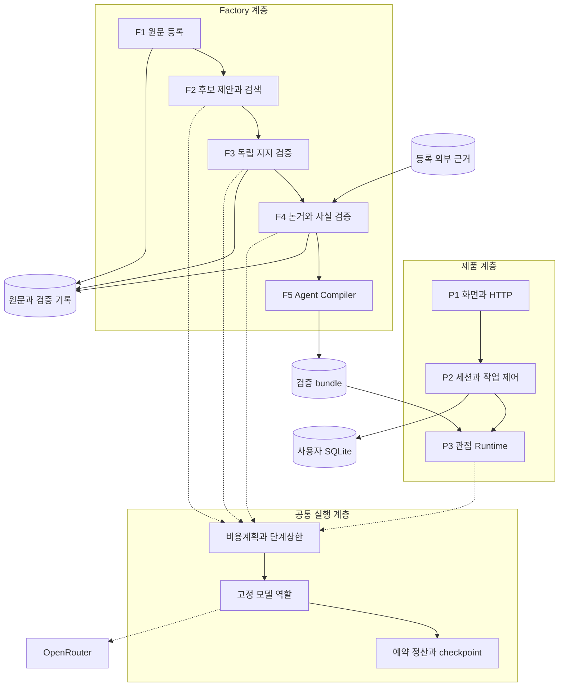
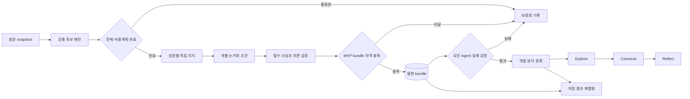

# CommentScope 구조 v1

구조 ID: `commentscope-architecture-v1`, 2026-11-10. DEC-008, TASK-017, REQ-001~010.
사용자의 “괜찮으면 현재 구조를 고정하고 Mermaid로 계층 분리” 요청에 따라 책임과 입출력을 고정한다.
실제 코드·PR81까지의 동작을 대조한 결과다. 전체 Factory 재작성이나 새 Agent 계층을 도입하지 않는다.

**고정하는 것은 논리 책임과 데이터 경계다.** 실제999개 품질, 현재후보 생성의 충분성,
세부protocol·model 영구채택, 현재의 개별전송 원가가 승인됐다는 뜻은 아니다. 실제96개는
예산중단 상태이며 최소2개 적격 Agent·모든논거/사실/실제응답 검증이 남았다.

현재 구현과 신규 추천 흐름/모델 배정의 자세한 비교는 [Factory 구조 정본](FACTORY_STRUCTURE.md)을 먼저 읽는다. DEC-009의 제안은 아래 책임v1의 수락 범위를 변경하지 않는다.

## 구조 검토의 결론

원문에서 Agent를 만드는 Factory와, 완성된 bundle로 사용자와 대화하는 Runtime을 분리하는
구조는 유지한다. 원문보존→후보제안→독립지지/논거검증→host조립의 권한 분리도 유지한다.
이는 실제 모듈과 맞고, 출처귀속·질문마다 재분석 방지·비용/실패추적에 필요한 경계다.

원가 문제는 현재 원문/후보 pair와 원문 node를 개별 전송하는 방식에 크다. 그 전송을
최적화하더라도 위 책임을 다시 섞지 않는다. 캐시와원문관측 재사용은 이미 구현됐다.
원문별 chat batch는 PR81에서 opt-in으로 구현됐으나 실제 원가/품질은 미검증이다. 역할계층 고정만으로 비용이 줄었다고 보고하지 않는다.

## 고정 계층과 권한

| 계층 | 책임·입력 → 출력 | 현재 코드 | 넘을 수 없는 경계 |
| --- | --- | --- | --- |
| P1 화면·HTTP | 사용자 의견/질문/수정 → 세 과업 화면·요청 | `product/mvp.*`, `product/web.py` | 지지수·출처·Agent 자격을 만들지 않음 |
| P2 제품 서비스 | session/opinion/room/job/revision → Controller·비교·그룹·성찰·저장 | `product/app.py`, `product/store.py`, `product/contracts.py` | 사용자 글을 댓글 지지로 집계하지 않음; 다른사용자/room 이력 분리 |
| P3 관점 Runtime | 자기 bundle·질문·해당이력 → 허용 claim/출처를 참조한 답변·보류 | `agents/grounded_runtime.py`, `agents/grounded_inputs.py` | 상대Agent 발언·유저주장을 자기 출처로 승격하지 않음 |
| F1 원문 등록 | snapshot/부모/영상/기한 → canonical source·literal span/graph | `ingestion/`, `factory/framed_corpus.py`, `factory/explicit_discourse.py` | 원문불변; 의미평가 분모/답을 생성입력에 쓰지 않음 |
| F2 관점 제안·검색 | 전체 원문·embedding → common 후보·nominee·검토 pair | `factory/shared_claims.py`, `factory/candidate_consolidation.py` | nominee/유사도는 지지 아님; 고정관점수·가짜찬반 생성 금지 |
| F3 독립 의미 검증 | 실제 원문·최종후보·자기근거·조건 → 지지/조건부/반대/불확실 | `factory/raw_membership.py`, `factory/raw_membership_verification.py`, `factory/pipeline_work.py` | 제목/부모는 지칭문맥; 이유/조건/찬성의 기증자 아님 |
| F4 논거·사실 검증 | 지지원문·core·node·외부근거 → source별 이유/전제/귀속/사실·보류 | `factory/owned_arguments.py`, `source_arguments.py`, `argument_observations.py`, `argument_dependencies.py`, `remote_fact_records.py` | 개인이유를 군집전체로 확장하지 않음; 원문함의와 외부사실참을 구별 |
| F5 Agent Compiler | 검증된지지/논거/사실·의존 closure → 허용 bundle·profile/보류 | `factory/minimal_agents.py`, `agents/grounded_inputs.py` | 지지3개만으로 승인하지 않음; 실패필수전제를 삭제하지 않음 |
| X 공통 실행 | 고정request·model 역할·costplan → 실제 호출·예약/정산·원본응답·checkpoint | `providers/remote_verification.py`, `openrouter_budget.py`, `checkpoint_calls.py`, `factory/cost_planning.py`, `tools/shared_factory_trial.py`, `tools/serve_mvp.py` | 금융/시간/상한은 host만 제어; 재시도/모델fallback/예산초기화 금지 |

각 코드 경로는 `src/commentscope/` 기준이다(명시한 `tools/` 제외).
F1→F5는 [pipeline_stages.py](../../src/commentscope/factory/pipeline_stages.py)가 조율한다.
각 역할은 논리 책임이며 LLM Agent 프로세스 하나를 추가한다는 뜻이 아니다.
Controller·검색·Compiler·비용/상태 제어는 Python 코드다.

## 계층 구조도

[Mermaid 원본](diagrams/architecture-v1.mmd). 논리 모듈의 의존 관계이며 별도 microservice 배포도가 아니다.

## 실행 흐름과 실패 경계

[Mermaid 원본](diagrams/factory-runtime-v1.mmd). 처음분석과 재열람/대화를 구별한다.

그림의 “비용계획 유효”는 금전권한이나 완료보장이 아니다. 실제 요청마다 원trial/owner/총50,
기간·wire예약·정산·호출상한을 적용한다. 의미/금액/기한 실패와 미평가 결과는 기록한다.
개발 등록은 `experimental`이며 formal G1~G4 통과나 독립 사용자효과 승인으로 바꾸지 않는다.
저장된 분석의 GET/재열람은 모델0회다. Explore/대화/성찰의 새생성은 별도비용으로 과금한다.

## 현재 배포 형태와 모델

현재는 Python Factory CLI와 Python 제품 HTTP 서버, JSON artifact/SQLite 저장소다.
제품 작업은 단일worker로 실행한다. 별도 queue 서버·분산 Agent 서비스·자동실시간 YouTube 분석
API가 배포된 것처럼 그리지 않는다. 현재 제품은 등록한 개발 bundle을 사용한다.

최근고정plan은 generation/interaction=`openai/gpt-5.2`, verification/common discovery=
`openai/gpt-6.1-sol`, embedding=`openai/text-embedding-3-small`이다. model/provider/가격/schema/
reasoning은 매실행plan의 배정이다. 이 이름들을 구조v1의 영구 API로 고정하지 않는다.
현재 opt-in 원격경로의 논거검증은 Sol HTTP이며 Jev 전용API나 로컬 Qwen을 실행하지 않는다.

## 변경 규칙

구조변경은 새 DEC/명세수정으로 이유·영향입출력·정상/부정사례·비용을 먼저 남긴다. 오류를
수정할 때 역할을 매번 다시 나누지 않는다. 파일분리·동일계약 구현개선·배치전송은 현재역할 아래
수행하되, 새request/receipt/protocol과 실제품질 비교가 필요하면 별도증거로 관리한다.

원문·target·구간·필수조건·model/contract hash를 잃는 전송통합, 작성자이유 혼합,
모델이 자기후보/사실/예산을 승인하는 변경은 구조v1에서 허용하지 않는다.
구조/CI 합격과 실제96/999개 품질·서비스단가·경쟁력·사용자효과를 별도로 보고한다.

[현재전송의비용검토](FACTORY_COST_RESULT.md)는역할고정과별개로개별호출의원가가미해결임을기록한다. Mermaid두원본은로컬Mermaid파서로구문검증했다.

원문별 [membership batch](SOURCE_MEMBERSHIP_BATCH.md)는 이 구조 안의 선택 전송 방식이다. 독립 관측·긍정 근거검사·사실·Compiler·runtime 책임을 유지한다. 실제 원가/품질 채택은 별도다.
