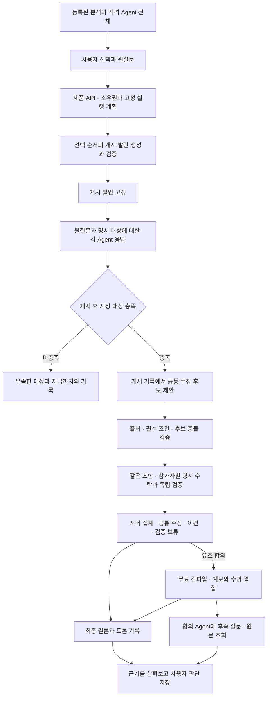

# 자동 토론 백엔드와 통합 안내

2026-11-20 · TASK-032~035 · REQ-011·012 · DEC-029·030

사용자가 선택한 댓글 관점 2~3개로 한 번 시작하면 턴제 토론, 결론, 유효한
합의 Agent까지 진행한다. 사용자가 선택하는 전체 관점 목록은 기존 분석 API에서 읽는다.
이 브랜치는 DEC-030의 흐름을 DS-v2 기술 상세로 구현한 기본 비활성 검토본이다.
기술 계약 수락과 실제 영상의 답변 품질은 별도 확인 항목이다.

## 계층과 산출물

| 계층 | 입력 → 출력 | 책임과 검증 경계 |
| --- | --- | --- |
| Factory·분석 등록 | 준비된 댓글 bundle → 적격 관점, 근거와 조건 | 기존 Factory·`product/analysis.py`가 관점·원댓글 지지·허용 문헌을 확정한다. 토론에서 관점 수와 지지를 다시 계산하지 않는다. |
| 제품 API | 소유 세션, 사용자 선택, revision → 토론/결론/Agent와 상태 | `product/app.py`와 `product/debate_service.py`가 세션 권한, 같은 분석 revision, 유효한 참가 정원, 요청 ID와 재열람을 처리한다. 일반 방에서 자동 토론을 시작하는 경로를 막는다. |
| 진행 제어 | 고정 plan과 시점별 상태 → 턴, 합의 단계, 최종 저장 | `DebateService`가 사용자 순서대로 개시 발언을 게시하고 이를 한 번 고정한다. 응답은 원질문과 상대별 지정 point를 본다. 응답이 빠지면 부족한 대상과 앞선 기록을 남긴다. 생성과 검증 사이의 일시정지에서 완료한 호출을 재사용한다. |
| 발언 생성·검증 | 관점, 조건, 정확한 근거, 질문·대상 → 게시 가능한 point | `agents/structured_debate_runtime.py`가 생성 제안, 문단별 Jev 관측, 서버의 ID·출처·과업 충족 계산을 결합한다. 상대 발언은 응답 문맥이다. 원댓글 선택, AI 추론, 준비 문헌을 별도 origin으로 저장한다. |
| 합의 | 게시한 기록 → 제안, 개별 수락, 공통 주장과 이견 | `agents/debate_synthesis.py`가 최대 세 후보와 쌍별 충돌을 평가한다. 같은 초안을 모든 참가자에게 제시하며 각자의 결정을 따로 검증한다. 전원 수락 근거가 있는 후보만 합의로 올리고, 나머지는 이견·보류·미평가로 남긴다. |
| 파생 Agent와 성찰 | 수락한 주장과 전제·조건·계보 → 불변 Agent, 후속 방 | `agents/synthesis_agent.py`는 새 모델 호출 없이 다시 근거를 대조해 컴파일한다. 직접 댓글 지지 수 0과 실제 근거 원문 수를 구분한다. 후속 질문은 합의된 주장만 자기 입장으로 사용한다. 게시한 대화는 기존 Reflect에서 참조할 수 있다. |
| 실행·정산과 저장 | 단계별 요청, gateway 영수증 → 비용·체크포인트·불변 결과 | `product/debate_execution.py`가 단계와 요청 digest, 정산, 실행 중단을 결합한다. 기존 worker와 공유 장부를 사용한다. `product/debate_store.py`가 기존 세션·방·메시지를 재사용하고 합의·Agent를 한 트랜잭션으로 저장한다. |

## 팀에서 바로 확인하는 방법

브라우저만으로 기능을 확인하는 팀원은 [MVP 사용 안내](../MVP_PREVIEW_GUIDE.md)를 먼저 봅니다.
아래는 API와 연결을 확인하는 개발자용 절차입니다.

1. 이 백엔드 PR의 브랜치를 기준으로
   `python -m experiments.mvp_browser_fixture runs/debate-local --automatic-debate`를 실행한다.
   출력된 로컬 주소가 I6 연결용 서버다. 합성 API를 사용하므로 실험 키가 필요 없다.
2. `GET /api/v1/analyses`에서 분석과 관점 ID를 얻는다. 세션의
   `capabilities.structured_debate`를 확인한 다음 [API 계약](DEBATE_SYNTHESIS_API.md#A-02-새-endpoint)의
   `POST S/debates → POST D/start → GET job / GET D`를 호출한다. 세션 방 목록의
   `kind=structured_debate`, `debate_id`로 기존 토론의 주소를 복원할 수 있다.
3. `conclusion`을 기록 뒤에 놓고 `synthesis_agent`가 있는 경우에만 Agent 카드와 질문을 연다.
   `POST A/rooms` 다음 기존 방 시작·메시지 API를 쓴다. `GET D?after_seq=N`은 새 메시지만
   반환하고 결론과 상태는 매번 반환한다. 동일 요청 ID와 본문으로 다시 호출하면 시작 job을 재사용한다.
4. 별도 실행 디렉터리에서 `--debate-result no-consensus`, `--debate-result hold`로
   이견과 검증 보류를 확인한다. 합성 응답은 I6 화면 연결과 Q1 상태 재현을 위한 자료다.
   `metrics.json`에서 유료 호출 0을 확인할 수 있다.
5. 회귀 검사는 `python -m unittest discover -s tests -p test_automatic_debate.py -v`로 실행한다.
   2인·3인 순서, 처음 컨텍스트 고정, 부분 후보 충돌, 틀린 수락 관측, 부족한 응답,
   소유권·기한·idempotency, pause/close, 기존 DB 이관, 파생 Agent 1:1/Reflect를 확인한다.

3인 최대 20회, 2인 최대 14회는 자동 토론 단일 실행의 물리 호출 상한이다.
각 단계에서 추가 호출을 생략할 수 있다. 완료 보고서 저장과 파생 Agent 컴파일은 모델 호출 0회다.
새 준비 계획에서만 `tools/serve_mvp.py prepare --automatic-debate`로 opt-in할 수 있다.
기존 모델·가격·공유 장부·기한을 결합하고, 전체 최대 금액을 시작 전에 확인한다.
정산을 알 수 없는 경우 `needs_reconciliation`으로 남긴다. 실행 도중 프로세스가 종료되면
자동 재전송 없이 기존 제품 재시작 규칙을 적용한다. 정산 후 운영자 무료 복구 API는 별도 작업이다.

## 품질 인계 범위

로컬 HTTP에서 합의 성공과 후속 질문, 합의 없음, 검증 보류를 각각 재현했다.
별도 모의 테스트에서 2인 14회와 3인 20회의 상한, 비용과 기존 기록 보존을 확인했다.
선정 영상에서 다른 두 관점과 다양한 자유 질문이 실제로 유용한 결과를 만드는지,
첫 발언 및 최종 결론까지의 시간과 실청구는 통합 후 검증한다. 합의 Agent가 단일 Agent보다
유용하다는 결론은 같은 근거와 질문의 독립 비교에서만 평가할 수 있다.

I6 화면, I7 댓글 용량, Q1 초행 사용 QA는 [팀 분담](../MVP_IMPLEMENTATION_HANDOFF.md#5-팀에-전달할-i6i7q1)을 따른다.
현재 프로토타입의 실제 약점인 구별되는 관점과 이유·자유 질문 유용성은 TASK-027에서 추적한다.

## 사용자 화면에서의 완주 조건

TASK-036 / REQ-012. 기존 `/mvp`의 Explore, Converse, Reflect 화면을 사용한다.
서버의 자동 토론 기능이 열린 세션에서 두세 관점을 고르면 질문 제출 한 번으로
토론을 생성하고 시작한다. 참가자, 질문, 조건과 결과의 의미는 기존 API 계약을 따른다.
브라우저는 참가자 선택, 대화 상태와 기록, 결론의 조건 및 이견, 합의 Agent와
원문 링크를 표시한다. 합의 Agent는 별도의 후속 질문방을 열고 기존 성찰에서 그 발언을 선택할 수 있다.

확인 기준은 새 Chromium에서 화면의 버튼과 입력으로 최종 결론, 합의 Agent 원문,
후속 질문, 성찰 저장·재열람을 거치는 것이다. 동일 시작을 오래 누르거나 새로고침해도
추가 실행이 생기지 않아야 한다. 합의 없음·검증 보류에서도 결론과 남은 행동을 볼 수 있어야 한다.
모델 품질 평가는 실제 선정 영상과 별도 실행으로 확인한다.

Chromium에서 선택한 두 관점의 순서와 발언 4개, 자동 결론, 조건부 수락,
합의 Agent 원문 열기와 자유 질문, 성찰 저장·새로고침을 실제 화면으로 확인했다.
합의 없음과 검증 보류에서는 결론이 남고 합의 Agent가 생성되지 않았다.
합의 성공 실행의 SQLite에는 같은 초안에 대한 유효 수락 2개, 공유 주장 1개,
별도 `derived_consensus` Agent 1개가 저장됐고, 같은 Agent ID로 후속 답을 게시했다.
모든 응답과 판정은 합성 transport를 사용했으며 유료 호출은 0회였다.

브라우저 증거를 다시 만들려면 Chromium과 Node의 `ws`를 설치한 환경에서
`node experiments/mvp_browser_check.cjs PYTHON CHROMIUM 새출력경로 --automatic-debate consensus`를 실행한다.
마지막 인자를 `no-consensus` 또는 `hold`로 바꾸면 같은 화면에서 다른 결과를 점검한다.

## 그룹 대화에서 아이디어와 합의를 읽는 화면 (REQ-006·009·012, TASK-027·036)

그룹 대화는 사용자의 질문을 모든 발언에 그대로 전달한다. Agent는 자기 입장·필수 조건·이전 발언을 바탕으로 제안 또는 이견과 이유를 짧게 말한다. 생성된 판단과 출처 귀속을 구별한다. 검증된 설명이 없으면 보여줄 수 있는 입장과 아직 답하지 못한 부분을 구분한다.

Converse 본문은 발언과 결론을 먼저 보여준다. 원문·외부 문헌·필수 전제는 각 발언에서 펼쳐 확인할 수 있다. 사이드바에는 선택한 Agent의 출발 입장과 조건, 마지막으로 게시된 생각을 둔다. 진행바는 해당 라운드에서 실제 게시한 발언 수와 전체 발언 수를 사용한다. 합의 검토 시간은 가변적이므로 별도 단계로 표시한다.

그룹 대화의 합의 요청은 같은 세션과 참여자들의 기존 방을 참조하는 자동 토론으로 이어진다. 서버는 시작 시점까지의 사용자 주제와 각 참여자의 최근 발언을 동결해 토론 맥락으로 제공한다. 원 대화는 계속 열람 가능하다. 이전 발언은 추가 댓글 지지나 수락 표로 계산할 수 없다. 후보별 검증된 전원 수락, 부분 응답, 합의 없음과 보류는 기존 규칙을 따른다. 특정 Agent에게 보내는 질문은 개별 답변으로 이어진다.

합의가 보류되면 결론 화면에서 게시를 통과한 참가자별 아이디어 또는 근거를 다시 읽을 수 있다. 출발 입장만 확인된 답변에서 원문에 명시된 이유나 기대 효과가 있으면 함께 보여준다.

설득력 비교는 별도 평가로 남긴다. 같은 새 질문에 대해 초기 단일 Agent, 같은 자료를 한 번에 읽은 단일 Agent, 토론 후 합의 Agent의 답변을 수집한다. 질문·모델·자료 범위·답변 길이를 맞추고 조건과 제시 순서를 가린다. 독자가 실제로 채택할 아이디어와 그 이유를 고르게 하고 답변별 설득력·실행 가능성·근거 밖 사실 주장을 별도로 집계한다. 합의 실패로 파생 답변이 없는 사례도 전체 실행 분모에 포함한다. 여러 영상과 평가자의 비교 전에는 설득력 향상을 연구 가설로 둔다.
