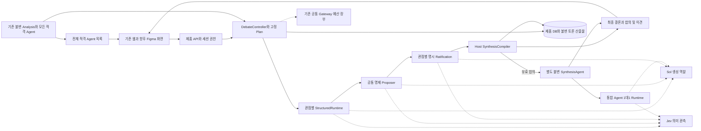

# 전체 Agent 탐색 → 자동 토론 → 최종 결론·합의 Agent 설계안 v2

2026-11-19 / TASK-031 / REQ-011·012 / DEC-030 제품 흐름 **accepted**, DEC-029 기술 상세 **proposed**.
기준 구현: main `65be949ade3b29d70640361c276aa0bbe460e086`.
사용자는 구현 담당자에게 넘기기 전 이 설계·인계 작성을 요청했다.
사용자가 아래 제품 흐름을 명시했다. 참가 정원·라운드/판정/자료형 등 나머지 기술 선택은
검토 가능한 중앙 설계안이며, 전체 기술안의 최종 수락·구현·품질 합격은 아니다.

## 0. 사용자가 확정한 제품 흐름 — DEC-030

**근거 제약을 통과한 Agent 전부 제공 → 사용자가 토론 참가자 선택 → 턴제 자동 토론 →
기록 열람과 마지막 결론·유효한 합의 Agent 확인 → 추가 질문·자기 판단 정리의 사용 가치.**

- 초기 댓글 기반 Agent 생성/목록 수는 적격 산출물 전부다. 토론 정원2~3이나 화면 카드 수를 생성 수에 적용하지 않는다.
  여러 페이지/검색을 쓰더라도 적격 Agent를 숨기지 않는다. 검증하지 않은 후보까지 통과했다고 말하지 않는다.
  적격Agent가0/1개면그수를그대로보여주고그룹토론불가를안내한다. 최소2개를맞추려고가짜Agent를추가하지않는다.
- 사용자가 전체 목록에서 직접 고른다. 서버가 다른 참가자로 대체하거나 몰래 일부를 제외하지 않는다.
- 시작 후 Controller가 정해진 순서로 자동 진행하고 사용자는 기록을 보며 기다리거나 일시정지할 수 있다.
  매 턴·합의 정리·Agent 생성마다 추가 버튼을 누르는 절차를 필수로 두지 않는다.
- 마지막에는 결론·공통 주장·조건·이견을 보여 주고,유효 합의가 있으면 합의 Agent도 자동 제공한다.
  합의가 없거나 실행이 불완전해도 상태와 남은 기록을 제공하며 가짜 합의는 만들지 않는다.
- 평가는 내부 Agent 수나 합의율만이 아니라,사용자가 다른 주장/근거를 이해하고 질문하며
  자신의 판단을 정리할 수 있는지를 본다.

## 읽는 순서와 산출물

1. 이 문서: 목적·대안·계층·중앙 결정표.
2. [프로토콜·자료형·판정·비용](DEBATE_SYNTHESIS_PROTOCOL.md).
3. [API·저장·프론트 연결](DEBATE_SYNTHESIS_API.md).
4. [구현 분담·검증·실험·인계](DEBATE_SYNTHESIS_HANDOFF.md).
5. [계약 schema](contracts/debate-synthesis-v2.schema.json)와
   [합성 정상/부정 예시](contracts/debate-synthesis-v2.examples.json).

기존 [구조](IMPLEMENTED_STRUCTURE.md), [실제 실패](PREPARED_VIDEO_WEB_RESULT.md),
[구현 보존 기준](../IMPLEMENTATION_BASELINE.md)을 대체하지 않는다.
새 문서는 미래 기능의 설계다. `src/`·DB·API·Figma·실제 실행은 변경하지 않았다.

## 1. 사용자에게 제공할 결과

등록 분석의 근거 적격 Agent를 모두 제공하고 사용자가 참가자와 질문을 선택하면 다음을 제공한다.
토론 정원2~3은 이번 기술안의 별도 제안 범위이며 전체 생성 수나 사용자 요구의 숫자가 아니다.

- 각 Agent가 자기 근거로 답하고, 다른 Agent의 특정 주장에 대응하는 토론 기록.
- 각 Agent가 수락한 공통 명제·명시 조건과 수락하지 않은 제안·남은 이견.
- 유효한 공통 명제가 있으면 그 범위에 답하는 별도의 통합 Agent.
- 원 Agent·원댓글·외부 발췌·AI 추론으로 돌아갈 수 있는 계보와 출처.
- 진행 중과 종료 후에 읽을 수 있는 순서 있는 기록,마지막 결론과 후속 질문 진입.

통합 Agent가 원 Agent보다 더 유용한지는 [동일 근거 대조](DEBATE_SYNTHESIS_HANDOFF.md#5-실제-비교-실험)를
실행해 판단한다. AI들끼리 동의한 것은 원댓글 작성자의 동의·다수 여론·외부 사실의 증명이 아니다.

## 2. 현재 코드와 바꿀 부분

| 대상 | 현재 | v2에서 추가할 것 |
| --- | --- | --- |
| Factory | 댓글→관점/허용 근거→불변 bundle | 생성 파이프라인 유지. 토론 때 재분석하지 않음 |
| Agent 목록 | 현재 Analysis는 compiled profile을 순회해 노출 | 적격 결과 전부 제공. 화면/토론 정원을 근거로 top-K 제한하지 않음 |
| 그룹 | opening/reply,직전 다른 Agent 문맥 | 별도 structured debate. 원질문·고정 opening 문맥·명시 대상·게시 후 응답 충족 |
| Agent 입장 | 자기 core/조건 유지 | 원 Agent 유지. 합의는 별도의 파생 산출물 |
| 합의 | 없음 | 후보 명제→각 Agent의 명시적 수락→별도 검증→Host 집계 |
| Compiler | 댓글 기반 admission | 별도 SynthesisCompiler. 댓글 Agent 자격 검사를 속여 재사용하지 않음 |
| 웹/API | 기존3과업·개발 화면 | 선택→자동토론→마지막 결론/합의Agent→통합1:1. 확정 Figma에 adapter로 연결 |

## 3. 중앙에서 검토할 선택

| ID | v1 제안 | 대안과 선택 이유 |
| --- | --- | --- |
| DS-01 | 적격 catalog 전부 중 사용자가 같은 분석의2~3개·질문1개 선택 | 생성총수와동시토론정원분리. 정원초과선택은명시안내하고조용히제외하지않음 |
| DS-02 | 시작1회에서 opening N회+reply N회→합의→무료compile/결론까지자동 | phase별동일문맥·고정종료. 매턴/합의/생성의수동확인없음. 무한토론은제외 |
| DS-03 | Sol이 합의 후보 최대3개 제안 | 새 공통 논거 생성은 생성 역할. Host/Jev가 문장을 발명하지 않음 |
| DS-04 | 각 Agent가 Sol로 명시 수락/조건요구/거절/미결정,다른 Agent의 수락은 보지 않음 | Jev의 관점 적합 판정을 Agent의 동의로 대신하면 역할을 혼동함 |
| DS-05 | Jev는 발언·초안·수락의 유형/귀속/조건/근거/과업 적합성을 관측 | 실제 의견 생성·수락은 Agent,Host는 결정 규칙. confidence 문턱·자동 승격은 추가하지 않음 |
| DS-06 | 명제별 전원 accept + 유효 검증일 때만 공통 명제 | 다수결/요약만으로 합의라 표시하지 않음. 한 후보 실패를 다른 독립 후보로 전파하지 않음 |
| DS-07 | 유효 공통 명제1개 이상이면 통합 Agent 자동생성,모든완료결과에최종결론 | 합의0이면결론/이견과Agent없음을표시. 사용자에게가짜합의로보이지않음 |
| DS-08 | 통합 Agent는 새 kind·새 ID·불변 계보,원 Agent 보존 | 모델 가중치 병합이나 원 bundle 수정으로 구현하지 않음 |
| DS-09 | 통합 Agent1:1만 지원,추가 외부검색·재귀 통합 제외 | 근거 범위/운영을 먼저 확인. 필요하면 별도 다음 계약 |
| DS-10 | 호출 상한 2인14회/3인20회 + 기존 공유 예산/기한 | 각 단계 생성1회·검증1회,반복 수선 없음. 합의 없는 실행 비용도 남김 |

`accept_with_condition`이라는 이름으로 누락된 조건을 암묵 승인하지 않는다.
원래 후보에 조건이 빠졌다면 `needs_condition`이며 해당 후보는 통합하지 않는다.
이미 승인된 내용을 다시 승인받는 절차가 아니라, 위 새 선택을 확인하기 위한 표다.

## 4. 역할·의존 방향

모두 기존 Python 제품 프로세스 안의 논리적 모듈이다. 별도 microservice나 학습 모델을 만들지 않는다.
아래는 미래 역할 흐름이며 현 구현 그림과 구별한다.

원본: [역할 흐름 Mermaid](diagrams/proposed-debate-synthesis-v2.mmd).
모듈별 클래스/함수·수정 소유 파일은 [인계표](DEBATE_SYNTHESIS_HANDOFF.md)에 고정했다.
Gateway·기존 DB를 교체하지 않으며 새 상태/자료만 추가한다.

| 책임 | 생성/결정 권한 | 가지지 않는 권한 |
| --- | --- | --- |
| Controller | 참여자·순서·phase cutoff·실행/중단·정산 | 입장·합의 문장 생성 |
| Perspective Runtime | 자기 관점의 발언·논거·명시 수락 생성 | 원댓글/원 Agent 덮어쓰기 |
| Proposer | 게시된 근거로 공통 명제 후보 작성 | 타 Agent 동의 확정 |
| Jev | 지정 문단/수락에 대한 닫힌 판정 관측 | 동의 발언 생성·사실 인증·최종 제품 승인 |
| Host | ID/quote/dependency·조건목록·집합·만장일치·계보·수명 결합 | 모델 응답을 독립 의미 정답으로 선언 |
| Synthesis Runtime | 합의 범위 답변·확인된 이견 설명 | 원댓글 지지 증가·새 사실/합의 발명 |
| 웹 | 상태·각 출처·합의/이견 표시 | 별도 분석/검증·모델/금액 정책 결정 |

## 5. 이미 겪은 실패를 설계에 반영

| 과거 근거 | 이번 계약에 넣은 대응 | 아직 증명하지 않은 것 |
| --- | --- | --- |
| reply가 quote만 남거나 상대 논거에 대응하지 않음 | 원질문·명시 target·phase snapshot·문단 제거 후 target coverage | 새 프로토콜의 실제 의미 개선 |
| 전체 제안 적합성을 보고 문단을 제거 | 문단별 과업 적합 관측을 보존하고 생존 문단으로 완료 여부 계산 | Jev 적합 판정의 독립 정확도 |
| 후보별 실패가 전역으로 전파 | 합의 명제별 판정·투표를 분리. 공통 입력 무결성 실패만 전역 | 모든 후보가 통과할 수 있다는 보장 |
| 원문 source와 AI 논거 혼동 | direct_comment_support_count=0인 새 명제,별도 계보·origin | AI 논거가 사실이라는 보장 |
| 999/1000/3000 및 과거 CI 오해 | 기존 용량 결함/품질은 별도 TASK027. 토론 추가로 해결했다고 쓰지 않음 | 3000원가/속도·전체MVP |

## 6. 연구 참고와 적용 한계

[Du et al.](https://arxiv.org/abs/2305.14325)은 여러 모델 인스턴스의 답변·비판·수정으로
일부 추론/사실 과제에서 개선을 보고했다. 상호 근거 검토를 시도할 근거로 참고하지만,
정책·가치가 섞인 YouTube 관점의 합의나 우리 Agent 품질을 증명하는 결과로 이전하지 않는다.

[Choi et al.](https://aclanthology.org/2025.findings-acl.265/)은 논쟁적 주제의 모델 토론에서
집단 동조를 관찰했다. 이 설계의 비공개 수락 입력·이견 보존은 이를 고려한 선택이며,
오류 상관이나 동조를 제거한다고 주장하지 않는다.

[Kaesberg et al.](https://aclanthology.org/2025.findings-acl.606/)은 의사결정 프로토콜의
효과가 과제에 따라 다름을 보여준다. 여기서는 진실의 다수결 대신 해석 가능한 공통 명제를
만드는 목적에 만장일치를 제안한다. 논문의 정확도 수치를 우리 성능·비용 추정에 사용하지 않는다.

## 7. 구현 배정 전 수락할 범위

DEC-030의 전체목록/선택/자동완료/사용가치 흐름은 사용자 명시 요구로 확정돼 있다.
남은 검토 대상은 그 흐름을 구현하는 DS-01~10의 기술 선택과 세부 프로토콜/API/검증·작업표다.
수락 시 DEC-029에 사용자/위임 담당자의 근거와 고정 commit을 기록한다.
수락되지 않은 부분은 미결정으로 남기고 해당 구조 구현을 배정하지 않는다.
문서 PR 병합은 보관/공유이며 DEC-029의 수락이나 TASK032~037 구현 개시를 자동 승인하지 않는다.
홈/URL/개인 기록·외부 지속 배포는 별도의 상세 계약으로 남는다.
