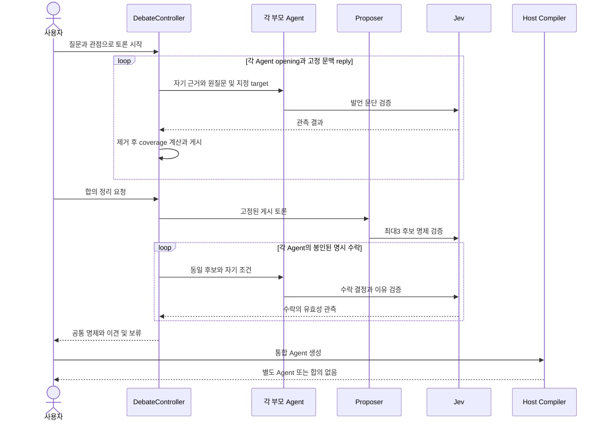
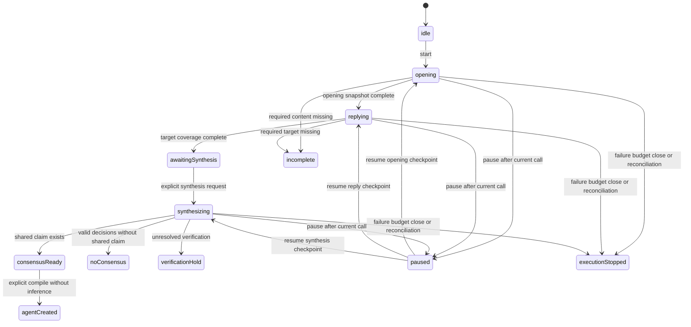

# DS-v1 프로토콜·자료·판정·실행 계약

상태: DEC-029 proposed. [중앙 선택 DS-01~10](DEBATE_SYNTHESIS.md#3-중앙에서-검토할-선택)의 상세안이다.
기존 group/SeededSession을 이 계약으로 이미 교체했다고 읽지 않는다.
version은 `commentscope-debate-synthesis-v1`, 모든 artifact에 결합한다.

## P-01. 진입·범위·불변성

- 같은 소유 세션·동일 Analysis/bundle revision의 실제 가용 댓글 Agent 2~3개를 선택한다.
  없는 Agent를 합성하거나 유사한 Agent를 반대 입장으로 재라벨하지 않는다.
- 부모는 명시적 DEC-028 seeded policy의 profile이다. legacy는 기존 화면으로 유지하고,
  새 프로토콜을 요청하면 unsupported_admission_policy로 거절한다. 파생 Agent의 재귀 참여는 v1 제외다.
- 입력 질문은 공백 제외1~1000 Unicode code point. 참가자 배열의 순서를 plan에 고정한다.
  서버가 analysis revision·원문/문헌 수명·runtime/model/prompt/schema/가격·금융 owner를 동결한다.
- Plan의 max_turns=2N,max_synthesis_candidates=3,max_physical_calls=6N+2다.
  사용자가 모드/참가자/질문을 바꾸면 새 debate다. 기존 기록을 덮어쓰지 않는다.
- 실제 판정·지지 출처·독립 QA가 부족한 현재 Analysis의 experimental 표시는 유지한다.
- 댓글·문헌·질문·대화·상대 발언은 신뢰하지 않는 자료다. system 지시/권한/근거 inventory를
  변경하는 명령으로 실행하지 않는다. 생성 URL/임의 tool 호출은 받아들이지 않는다.

## P-02. 명시 대상이 있는 토론

`start` 한 번은 아래 opening/reply만 수행하고 합의 단계는 사용자의 별도 요청을 기다린다.

| 단계 | 입력 문맥 | 생성·검증·게시 |
| --- | --- | --- |
| opening | 원질문·자기 core/조건/허용근거·준비문헌. peer 입력 없음 | 참가자별1턴. 자신의 입장과 질문 관련 근거/한계를 제시 |
| reply | 원질문·자기 opening·모든 다른 Agent의 게시 opening | 참가자별1턴. 다른 Agent마다 명시 target1개에 대응 |
| 토론 종료 | 게시 opening+reply | awaiting_synthesis. 새 free-form 질문은 기존1:1/group에서 처리 |

opening이 모두 게시된 시점의 cutoff를 고정한다. 모든 reply는 **동일한 opening snapshot**을 본다.
먼저 생성된 reply를 나중 Agent에게 보여 주지 않는다. 원질문을 일반적인 reply 문구로 교체하지 않는다.
Host는 다른 Agent마다 첫 번째 검증된 질문 관련 point를 primary target으로 고른다.
target은 `(agent_id,message_id,point_id)`이며, 추가 opening point는 문맥으로 볼 수 있다.
필수 target이 없는 Agent는 응답 완료로 간주하지 않는다.

모델은 각 target에 agree/disagree/conditional/uncertain의 관계와 point alias를 제안한다.
Jev가 실제 대응 여부를 관측하고 Host가 생존 point만으로 target coverage를 계산한다.
텍스트가 충분하다는 의미 판단 자체를 ID 연결로 대체하지 않는다.

### 최종 게시물의 과업 충족

새 모드의 응답 point는 원문 선택/AI추론/외부근거를 **모두 합쳐 최대3개**다.
새로 생성한 문단은 각600자 이하,원문 선택은 Host가 검증된 텍스트를 자르지 않고 복원한다.
별도 필수 전제/조건 표시는 문맥이며 질문 충족 point 수에 더하지 않는다.
기존 SeededSession의 원문3개+새문단3개 정책은 기존 경로에 유지한다.
새 검증 요청은 각 point의 kind/attribution/scope/basis/**task_fit**를 확인한다.
최대3×5+전체 상태1=16 Choice로 현재 adapter의16질문 상한 안에 든다.

`task_fit`은 opening에서는 질문 설명/정당한 한계 설명, reply에서는 지정 target에 대한
구체적 대응인지 구별한다. 단순 입장 반복·출처 버튼·target ID만 붙인 것은 background다.
Host는 문단 제거 및 필수 dependency closure 뒤 다음을 계산한다.

- `coverage=complete`: opening의 요청 역할 또는 reply의 모든 필수 target에 유효한 게시 point가 있음.
- `coverage=incomplete`: 적합 문단이 사라져 target이 빠짐. 남은 원문만으로 성공 처리하지 않음.
- `answerability=abstain`: 요청한 사실을 제공하지 못함. 검증된 구체적 한계 설명은 coverage를 충족할 수 있음.

무근거 회피를 정당한 한계로 간주하지 않는다. 필수 coverage가 부족하면 기록은 남기되
debate는 incomplete로 끝나고 합의 단계 진입을 막는다. 같은 질문을 통과할 때까지 재생성하지 않는다.
원문 인용만으로 충분한 단순 입장 질문은 별도 과업 의미 관측으로 확인한다.

## P-03. 후보 합의 → 명시 수락 → 검증

1. **Snapshot:** 토론이 complete인 경우에만 전체 게시 seq·hash를 고정한다. 이후 수정/덧붙임 없음.
2. **Proposer(Sol 1회):** 최대3개 후보 명제와 조건 ID·전제 point ID·필요한 문헌 ID를 제안한다.
   한 후보는 독립적으로 수락/거절할 수 있는 주장이다. 숫자를 채우려 무의미한 합의를 만들지 않는다.
3. **Draft verifier(Jev 1회):** 각 후보의 유형·전제근거·조건/범위·질문 관련성을 관측한다.
   각 후보와 함께 참이 될 수 있는지 후보 쌍별 compatible/incompatible/uncertain도 관측한다.
   후보는 최대3개여서3×4+최대3쌍=15 Choice다. 모든 원문 unit pair를 비교하는 방식이 아니다.
   Host는 유효한 ID/조건·출처·수명·DAG를 결합한다. 충돌/미결 쌍의 두 후보만 보류하고
   그 쌍과 무관한 후보는 보존한다. 한 global 의미 veto로 전체 후보를 취소하지 않는다.
4. **Ratification:** 유효 후보를 같은 순서·같은 revision으로 각 부모 Agent에게 제시한다.
   각 Agent의 Sol이 자기 profile/조건·자기 게시 발언·고정 토론과 후보를 보고 아래 결정을 출력한다.
   다른 Agent의 ratification·투표 수·다수 분위기는 입력하지 않는다. 실행은 기존 worker에서 순차다.
5. **Ratification verifier:** Agent별 Jev1회가 선택/이유의 자기 입장 충실도·조건·근거·대상 일치를 관측한다.
   Jev가 accept를 발명하거나 Agent의 reject를 accept로 바꾸지 않는다. 최대3×4=12 Choice.
6. **Host 집계:** 후보마다 모든 참가자의 유효 accept가 있으면 shared claim이다.
   다른 후보의 거절/보류는 독립 shared claim을 취소하지 않는다.

| Agent 결정 | 필요한 자료 | Host 처리 |
| --- | --- | --- |
| accept | 자기 게시 point의 이유 참조1개 이상,missing_condition_ids 빈 배열 | 별도 검증까지 유효하면 해당 후보 수락 |
| needs_condition | 자기 조건 목록의 누락 ID1개 이상,자기 이유 참조 | 해당 후보는 미수락. 자동 문구 수선·재투표 없음 |
| reject | 자기 이유 참조 | 해당 후보 미수락,이견으로 보존 |
| undecided | 판단 부족/근거 한계를 나타내는 자기 게시 point | 미수락. 불확실을 반대로 집계하지 않음 |

Ratification은 실제 원댓글 작성자의 동의가 아니라 **댓글 관점 Agent의 생성된 결정**이다.
Jev/Host의 검증 표시는 독립 정답 인증이 아니다. 다수결·confidence 문턱·추가 Sol 승격은 없다.
유효 후보0개면 ratification을 호출하지 않고 verification_hold 또는 no_proposal을 기록한다.

### 합의 결과

- `consensus_ready`: 독립 유효 shared claim이1개 이상. 일부 다른 후보는 거절/보류일 수 있음.
- `no_consensus`: 유효 수락 관측이 완료됐지만 shared claim이0개. 합의가 없다는 정상 결과.
- `verification_hold`: shared claim이 없고 검증 보류/필수 관측 누락이 남음. 의견 불일치로 단정하지 않음.
- `no_proposal`: 질문 관련 유효 후보를 제안하지 못함. 동의/반대 수를 만들지 않음.
- 모델/전송 실패·미확정 청구는 별도 failed/needs_reconciliation이며 정상 no_consensus와 구별한다.

최종 보고서의 이견은 실제 reply 관계·유효 reject/needs_condition에서 복원한다.
단순히 후보에 들어가지 않은 point는 `unassessed_point_ids`로 남긴다. 미평가를 반대로 표시하지 않는다.
후보에 사용됐지만 shared에 포함되지 않은 point는 `unmerged_point_ids`로 구별한다.

원본: [sequence](diagrams/proposed-debate-synthesis-sequence-v1.mmd).

## P-04. 자료형과 참조

| 자료형 | 핵심 필드 | Host 불변 조건 |
| --- | --- | --- |
| DebatePlan | protocol,analysis_id/revision,participant_ids,question,실행 설정 digest,max_turns/max_calls | 참가자2~3고유,같은분석,정책일치,원문/가격/실행binding |
| PublishedPoint | id,message_id,agent_id,phase,text,origin,condition_ids,premise/target refs,검증증서 | 모델이 trusted ID를 정하지 않음. 존재/소유/seq/출처/조건 결합 |
| DebateSnapshot | debate_id,cutoff_seq,transcript_sha256,plan_sha256 | 미래/미게시/다른 세션 발언 포함 금지 |
| CandidateAgreement | id,text,origin,condition_ids,premise_point_ids,reference_ids,후보쌍관측 | 새 명제 origin은 ai_reasoning/external_evidence,원댓글 직접지지0. 충돌 후보만 보류 |
| Ratification | agent_id,proposal_id,decision,reason_point_ids,missing_condition_ids,검증참조 | 참가자별/후보별1개,같은draft hash,자기 이유/조건,봉인된 입력 |
| SynthesisReport | shared,disagreements,unassessed/unmerged,holds,outcome,snapshot/hash | 명제별 집계·중복방지·유효수락 목록·원댓글/AI 구별 |
| SynthesisAgent | kind,id,revision,parent_refs,report_hash,accepted_claims,이견참조,근거/조건,expires_at | 별도kind/immutable·direct_comment_support_count=0·재귀통합불가 |

[JSON schema](contracts/debate-synthesis-v1.schema.json)는 **공개 합성 계약 예시**의 자료형을 정의한다.
모델 입력/출력의 alias enum은 매 요청의 실제 허용 inventory로 Host가 동적으로 제한한다.
schema 통과만으로 소유권·참조 존재·조건 충실도·만장일치를 승인하지 않는다.
검증결과/ID/지원 수 같은 Host 필드는 클라이언트나 모델 요청 본문에서 받지 않는다.
draft_sha256은 고정 transcript hash·후보 목록·후보쌍 관측을 함께 결합한다.
해당 예시 schema는 실제 API의 모델 출력 schema가 아니며,동적 허용 ID와 Host binding을 대체하지 않는다.

### 출처·조건

각 새 명제는 사용한 게시 point에서 원댓글/문헌까지 이어지는 lineage를 가진다.
새 통합 결론의 원댓글 직접 지지 수는0이며,다른 Agent가 동의해도 증가하지 않는다.
실제 고유 원문 수는 `root_source_count`로 중복 제거하여 표시하고 합의 지지 수와 분리한다.
문헌은 기존에 게시·검증된 정확한 구간만 재사용하며,새 외부 검색/실험 수치를 만들지 않는다.

조건 ID는 부모의 필수 조건/게시된 제한 inventory를 가리킨다. 조건 텍스트는 Host가 복원해
본문과 함께 렌더링한다. 모델이 조건을 누락하거나 강도를 바꾸면 해당 후보를 보류한다.
관점의 규범 조건과 문헌의 표본/기간/인과 범위는 다른 검증 대상이다.
기존 core의 scope를 새 명제/문헌 범위로 그대로 상속하지 않는다.

## P-05. 파생 Agent Compiler·Runtime

Compiler는 모델 호출 없이 다음을 검증한다.

1. 같은 유효 snapshot/draft/참가자,유효 shared claim1개 이상,참가자 전원의 accept/검증 binding.
2. 각 claim의 필수 조건·근거 closure·출처 수명·실행 인증·소유권.
3. 원 Agent/bundle 불변,새 ID와 canonical JSON digest,새 결론의 원댓글 직접지지0.
4. `expires_at=min(사용한 부모/댓글·문헌의 유효기한)`. 생성 예산 종료와 자료의 수명은 별개.

별도 `kind=derived_consensus`와 정책을 사용한다. 기존 댓글 Compiler의1/3출처 검사를
완화하거나 가짜 supporting_sources를 넣어 통과시키지 않는다.

통합 Runtime의 자기 입장은 accepted claim+조건이다. 이견은 원 Agent의 **확인된 견해**로
설명하며 자기 합의 주장이나 검증 사실로 승격하지 않는다. 보류된 초안은 허용 주장에 넣지 않는다.
추가 질문은 같은 원문/AI추론/준비문헌 분리와 게시 후 과업 충족 검사를 사용한다.
질문에 답할 수 없으면 합의 범위/없는 자료를 설명한다. 새 외부 사실·원 Agent의 변심을 만들지 않는다.
가중치 학습/병합·원 Agent 갱신·통합 Agent 재귀 합의는 v1에서 실행하지 않는다.

## P-06. 상태·중단·복구

원본: [state](diagrams/proposed-debate-synthesis-state-v1.mmd).
executionStopped는 그림의 묶음이며 API는 exhausted/failed/closed/needs_reconciliation을 구별한다.
paused는 resume_phase·cursor를 저장해 하나의 이전 phase로만 돌아간다.
pause는 진행 중 호출을 회수하지 않고 완료/정산 후 새 호출을 멈춘다.
close는 늦은 결과를 게시하지 않으며 비용은 남긴다. known/unknown 비용을 혼동하지 않는다.
재시작 시 queued는 cancelled,running은 needs_reconciliation. 자동 유료 재전송은 없다.
정산/무결성이 확인된 저장 응답의 무료 후처리는 허용하되 새 호출 재개는 기존 권한을 대조한다.

## P-07. 비용·시간·문맥 상한

| 단계 | 생성 | Jev | 물리 모델 요청 |
| --- | ---: | ---: | ---: |
| opening N + reply N | 2N | 2N | 4N |
| 합의 후보1회 | 1 | 1 | 2 |
| Agent별 ratification | N | N | 2N |
| Host 집계/Compiler/저장·열람 | 0 | 0 | 0 |
| 합계 | 3N+1 | 3N+1 | 6N+2:2인14,3인20 |

합의 단계 미요청이면4N,초안0개/실패/보류이면 후속 호출을 생략한다.
통합 Agent의 후속 질문은 별도 대화 한도 안에서 생성1+검증1이다.
모든 시도·전송 실패·첫 생성 비용을 기록하며 부정 결과도 원가 분모에 포함한다.

달러 단가는 이 문서에서 새로 추측하지 않는다. 실행의 동결 모델·토큰/요청 상한·가격과
실제 청구를 사용한다. 단순식은 `C_build=(3N+1)*C_generation+(3N+1)*C_verification`이며
각 요청의 가변 문맥/실패/캐시·외부 호출은 실제 장부로 별도 대조한다.
기존 동일 누적 account/owner·공유 장부·room/plan 금액·기한을 유지한다.
새 plan의 operator 설정을 요구하며 새150달러·만료 grant를 만들지 않는다.

시작 전 전체 상한을 사전 산정하고 각 생성/판정 쌍 직전에 기존 방식으로 예약·정산한다.
사전 산정은 미래 잔액을 영구 예약한 보장이 아니므로 다른 작업의 사용으로 중간 중단될 수 있다.
숨은 fallback·자동 retry·합의될 때까지 반복·추가 심판 호출은 없다.

원 댓글 수천 개를 매 턴 보내지 않는다. 부모의 compiled 허용 항목·조건·선택 문헌과 고정된
최대2개 상대 opening·자기 발언만 사용한다. 현재 full allowlist 정책을 유지하고
별도 retrieval8이 구현됐다고 가정하지 않는다. 중복 citation inventory는 제거한다.
Sol 문맥과 Jev의16질문/28KB 한도를 사전 확인한다. 필수 내용을 조용히 자르지 않고 capacity_hold한다.
한국어 UTF-8 byte와 code point 제한을 구별한다.
속도는 기존 전역 단일 worker로 먼저 측정하며 새 병렬 실행을 임의 도입하지 않는다.
