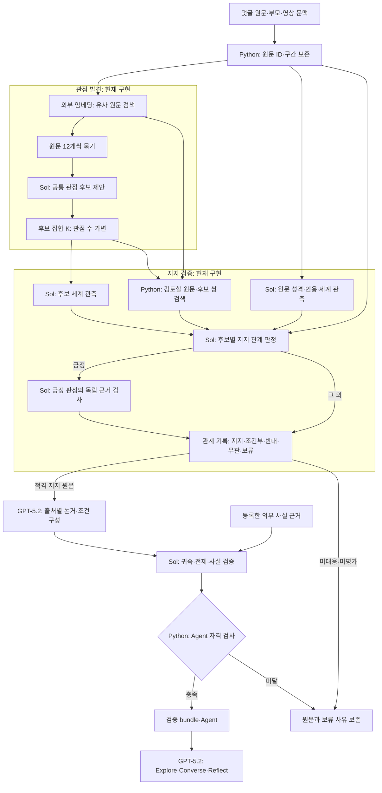
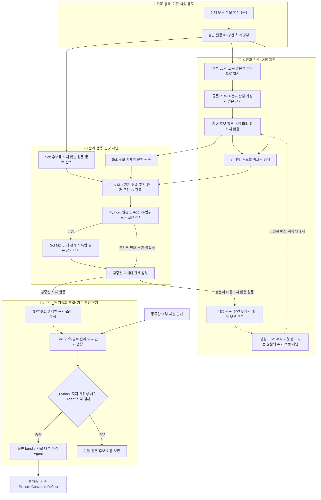

# 관점 수를 모르는 상태에서 댓글을 Agent로 만드는 구조

설계 ID: `open-perspective-factory-proposal-20261110-v1`.
연결: TASK-005/017, REQ-001/002/003/008/010, DEC-007/009.
**상태: 추천 설계안. 문서화 요청을 수행한 것이며 신규 알고리즘·Jev 배정의 채택이나 유료 실행 승인이 아니다.**
대조 코드: main `a4983122b622adcb9b8b90a4e35e13f05df6a071` / PR81.
책임 경계는 [구조v1](ARCHITECTURE_BASELINE.md)의 F1~F5/P/X를 유지한다.
이 문서를 구조 논의의 진입점으로 삼는다. 현재 코드, 변경 제안, 구현 순서와 미검증 사항을 아래에서 구분한다.

2026-11-10 후속 사용자 승인: 선정 영상을 사전 분석하고 저장 Agent로 TA 과업을 지원하며,
노이즈 전수 분류보다 관점 발굴을 우선한다. 최신 운영·thread/embedding·선택 검증/규모 계약은
[발굴 중심 MVP](PREPARED_VIDEO_MINING.md)에 연결한다. 아래 원래 구조안의 모든 알고리즘이 구현됐다는 뜻은 아니다.

## 1. 추천하는 구조와 그 이유

**전체 원문에서 관점을 제안하는 생성 작업과, 각 원문이 제안된 관점을 실제로 지지하는지 판정하는 작업을 분리한다.**
관점은 처음부터 정해진 분류표가 아니다. 발견할 때마다 후보 장부에 추가하고, 댓글과 후보 사이에는 여러 관계를 기록한다.
충분히 대응되지 않은 원문 중 발견 누락 가능성이 있는 것을 제한적으로 다시 읽는다.

권장 배정은 관점 문구를 제안하는 생성 LLM, 원문↔후보 관계를 관측하는 Jev,
긍정 관계의 근거를 독립 검사하는 Sol, 자격·비용·상태를 제어하는 Python이다.
Jev는 첫 이전에서 가장 비중이 큰 raw membership만 맡는 후보로 둔다. 원문 문맥·외부 사실·자유 문장 생성까지 한 번에 이전하지 않는다.

이 분리가 필요한 이유는 다음과 같다.

- 관점 발견에는 새 문구가 필요하다. 생성된 후보는 검증할 가설이며 작성자의 실제 지지가 아니다.
- 관계 판정에는 후보가 주어진 뒤의 선택이 필요하다. 후보가 새로 생겨도 지지/조건부/반대/무관/불확실이라는 관계 형식은 유지된다.
- 검색은 검토할 쌍을 줄인다. 유사도만으로 지지나 의미 동치를 승인하지 않는다.
- 한 댓글은 여러 관점에 지지·반대·조건부 관계를 가질 수 있다. 댓글마다 하나의 군집을 강제하지 않는다.
- 관점 후보 보존과 Agent 생성은 다른 조건이다. 원문 하나에만 나온 관점도 후보로 보존하지만, Agent에는 기존 최소3개 유효 지지와 모든 검증을 요구한다.

따라서 관점 수 K를 정하는 별도 모델이나 Agent 계층을 추가할 필요는 없다.
K는 후보 발견과 중복 정리의 결과이며, 후보 수·군집 수·공개 Agent 수는 각각 다를 수 있다.

첫 MVP에서는 기존 코드를 재사용해 발견 결과의 소수 가설/미처리 표현과 Jev M1 adapter 두 지점부터 검증한다.
추가 발견 자동 반복은 처음 R=0으로 두고 필요성과 원가가 확인된 계획에서만 연결한다.
새 서버·분산 Agent 계층·프론트 재작성은 이 설계의 구현 항목이 아니다.

## 2. 현재 코드가 하는 일과 하지 않는 일

| 항목 | 현재 구현 | 추천하는 변경 |
| --- | --- | --- |
| 원문 보존 | ID·원문·부모·영상·literal 구간 보존 | 유지 |
| 발견 단위 | 임베딩으로 묶은12원문, 묶음당 최대4개 공통 후보 | 묶음 호출은 유지하고 공통/소수/조건부 가설과 명시적 미처리 목록 보존 |
| 후보 제안 조건 | 같은 묶음의 원문 최소2개에 공통인 후보 | 정확한 근거가 있는 원문1개 이상의 후보도 보존; 집계 지지는 별도 검증 |
| 후보 정리 | shared 경로는 정확한 문구 병합 중심 | 초기에는 유지; 의미 병합은 별도 등가성 계약/비교 후 적용 |
| 관계 판정 | Sol raw 판정과 별도 원문 근거 검사 | raw 부분만 Jev typed adapter 비교, 독립 Sol 근거 검사 유지 |
| 전송 최적화 | 원문별 최대6후보의 chat batch opt-in | Jev 전용 envelope는 별도 버전; chat 영수증을 재태깅하지 않음 |
| 미대응 원문 | 보존, 기존 후보 비교 확장은 있으나 새 후보 재발견 자동 반복 없음 | 보류 원인을 나눠 발견 누락 대상만 제한적으로 재발견 |
| 논거·사실·조립 | 생성 GPT-5.2, 검증 Sol, Compiler Python | 첫 이전에서 유지 |
| 제품 대화 | 불변 bundle을 기존 제품 API/화면에서 사용 | 유지 |

현재 `shared_claims.COMMON_TYPED`는 묶음 안의 공통 입장을 찾는다.
같은 소수 입장의 원문들이 서로 다른 묶음에1개씩 흩어지면 후보를 놓칠 수 있다는 것이 코드상 위험이다.
이것을 실제 코퍼스의 누락률로 측정한 것은 아니다. 이미 생성한 후보의 판정 정확도를 높이는 것만으로 이 발견 누락이 복구되지는 않는다.

다음은 **코드에 연결된 흐름**이다. 실제96 실행은 지지 판정 중 예산으로 중단돼 그 실행의 논거/Agent/runtime 검증은 미도달이다.
Mermaid 원본: [factory-current-20261110.mmd](diagrams/factory-current-20261110.mmd).



## 3. 추천 흐름과 계층별 책임

다음 전체 흐름은 **변경 제안**이다. 점선의 추가 발견은 미구현이다. Jev M1은 별도 opt-in prototype으로
구현/소규모 비교됐고 기본 배정은 Sol이다. 제안 전체를 현행 실행으로 해석하지 않는다.
원본: [factory-proposed-jev-20261110.mmd](diagrams/factory-proposed-jev-20261110.mmd).



| 기존 계층 | 책임 | 입력 → 출력 | 맡기지 않는 일 |
| --- | --- | --- | --- |
| F1 Source Registry | 출처와 상태 보존 | snapshot → 불변 원문·구간·처리 장부 | 관점·지지 창작 |
| F2 Discovery/Registry/Retrieval | 가설 발견·중복 관리·비교쌍 검색 | 전체 원문/잔여 원문 → 버전 있는 후보·nominee·검토쌍 | 유사도·nominee를 지지 수로 승인 |
| F3 Relation Assessor | 관계 관측과 독립 근거 검사 | 원문·최종 후보·문맥 → 관측 영수증·검증 관계 | 새 관점 문구 생성·외부 사실 참 판정 |
| F4 Arguments/Facts | 출처별 논거와 필수 전제 검증 | 유효 지지원문·외부 근거 → 논거·조건·사실 상태 | A의 이유를 B/군집 전체에 전파 |
| F5 Compiler | 공개 가능한 근거 묶음 조립 | 검증 기록 → bundle 또는 보류 | 실패 필수 전제 삭제·가짜 Agent 보충 |
| X Execution | 비용·상태·복구 | 고정 plan/request → 예약·정산·영수증·checkpoint | 모델 판정에 지출/재시도 권한 부여 |
| P Product | 완성 bundle로 세 과업 실행 | bundle·사용자 입력 → 비교·대화·성찰 | 대화마다 전체 Factory 재실행 |

여기서 source는 고정 snapshot의 canonical 댓글 단위다. 서로 다른 source 수를 서로 다른 실제 사람 수로 보고하지 않는다.
작성자 귀속 검사는 각 원문이 누구의 주장을 담는지 검사하는 별도 책임이다.

각 계층은 Python 모듈의 책임이며 새로운 LLM Agent 프로세스를 하나씩 만든다는 뜻이 아니다.
모든 외부 호출은 X를 지난다. 위 그림에서 생략한 공유 금융/기한/복구 경계도 유지한다.

## 4. 관점 발견: 원문을 전부 보되 후보는 가설로 유지

1. 고정 snapshot/plan의 canonical scope 전체에 ID/부모/영상/구간을 결합하고 임베딩을 만든다. 임베딩은 검색용이다.
2. 전체 원문을 작은 묶음으로 읽는다. 첫 후보 생성 비용을 아끼려고 일부 대표 댓글만 읽고 나머지 관점을 없다고 처리하지 않는다.
3. 생성 LLM은 공통 입장과 추가로 보존할 소수/조건부 가설을 제안한다. 각 가설은 하나의 주장과 원문 근거를 가진다.
4. 묶음의 출력 용량이 부족하면 처리하지 못한 source IDs를 명시한다. 잘라 쓰거나 묵시적으로 버리지 않는다.
5. 정확한 문구 중복을 정리하고 후보 장부에 기록한다. 후보 제안 수/최소지지 수를 채우도록 요구하지 않는다.

현재 발견 비용은 actual96 전체 부분 지출의7.53%였다. 이 한 사례에서 먼저 줄일 대상은 관계 판정이었다.
따라서 최초 추천안은 모든 원문을 읽는 발견 경로를 유지하고, 대량 원문↔후보 판정의 모델과 전송을 개선한다.
이 결정은 다른 영상의 원가를 검증한 결과가 아니며, 모든 원문을 읽었다고 모든 의미를 발견했다고 보고하지 않는다.

예시 발견 산출물의 논리 필드는 다음과 같다. wire schema는 구현 전에 별도 버전으로 동결한다.

| 산출물 | 필요한 필드/규칙 |
| --- | --- |
| Hypothesis | 불변 candidate ID/전체문구, assertion kind 제안, 필수 조건, 원문·구간 anchor, 제안 요청 hash |
| SourceOutcome | source ID, 제안된 후보 참조 또는 제안 없음/용량 보류/해석 보류, 사유 |
| CandidateRegistry | 원문 근거·nominee·정확한 별칭·후보 버전·관계 관측 참조; semantic approval 없음 |

필수 조건은 후보 문구 자체에도 보존한다. “P에 찬성”과 “Q일 때만 P에 찬성”을 같은 후보로 덮지 않는다.
개인의 이유가 다르다는 이유만으로 같은 입장까지 불필요하게 쪼개지 않되, 개인 이유를 공통 후보에 붙이지 않는다.
`assertion_kind`와 anchor는 제안이며 독립 귀속·범위·근거 검사에서 다시 확인한다.

### 후보 병합과 버전

첫 이전에서는 현재 정확한 문구 병합을 유지한다. 의미가 비슷한 후보는 우선 related 후보로만 검색한다.
의미 병합은 서로의 조건·모달리티·부정·세계·주체가 동등한지 확인하는 별도 과제다.
관계가 broader/narrower/overlap/uncertain이면 합치지 않는다. 두 후보를 합쳐 새 문장을 만들고 지지 수를 옮기지 않는다.

후속 의미 병합을 적용할 때에도 원래 문구·anchor를 보존한다. 기존 문구 하나를 대표로 선택하며
변경된 최종 문구에 대한 지지는 다시 검증한다. nominee 이전은 가설 이전일 뿐 지지표 이전이 아니다.
중복된 후보를 유지한 상태에서 최종 Agent가 의미상 서로 다른지도 기존 전체 검토에서 확인해야 한다.

문구·필수조건·meaning context가 바뀌면 기존 candidate contract에 따른 새 identity로 취급한다.
기존 응답에 이름만 바꿔 붙이지 않고, 이전 버전과 그 보류를 장부에 남긴다.

## 5. 관계 검색과 미대응 원문: 후보가 늘어도 전체를 다시 곱하지 않기

원문↔후보 관계는 다대다다. 한 댓글의 두 주장이나 조건부 입장이 서로 다른 후보와 연결될 수 있다.
한 후보를 모든 댓글에 강제로 배정하거나, 가장 가까운 후보 하나를 무조건 정답으로 고르지 않는다.

- 최초 비교쌍은 기존 검색 폭·nominee 포함 규칙을 유지해 비교한다. 검토하지 않은 쌍은 unassessed다.
- 새 후보가 추가되면 해당 후보의 nominee와 역방향 검색으로 찾은 원문, 필요한 미대응 원문을 추가 평가한다.
- 기존의 정확한 source/candidate/context/protocol 증거는 동일 실행에서만 재사용한다. 입력이 바뀐 증거는 무효화한다.
- 후보가 추가됐다는 이유만으로 모든 기존 후보의 완료 관계를 다시 결제하지 않는다.
- 검색되지 않은 후보가 없다고 단정하지 않는다. residual과 별도의 고정 탐색 표본으로 검색 누락도 평가한다.

| 원문이 대응되지 않은 이유 | 다음 처리 |
| --- | --- |
| 검토한 후보에 모두 무관 | 새로운 입장 가능성 점검; 불필요한 원문이라는 판정과 구별 |
| 필수 조건이 후보에 없음 | 원문에 실제 표현된 조건부 가설 제안 가능성 점검 |
| 관계/귀속/세계 해석이 불확실 | 해석 보류; 새 관점을 생성하면 해결됐다고 처리하지 않음 |
| 모델/형식/근거 검사 실패 | 실패 원본과 사유 보존; 재발견이라는 이름의 재시도 금지 |
| 호출/검색/발견 용량 또는 예산 미처리 | 미평가로 보존; 의미 없음이나 반대로 표시하지 않음 |
| 유효 지지원문이1~2개 | 후보와 원문 보존; 현재 Agent 최소지지 조건은 미달 |

추가 발견은 고정한 최대 회차·원문 수·신규 후보 수·질문 수·금액 안에서만 수행한다.
첫 계획에서 R=0이면 추가 발견을 수행하지 않는다. 이후 R>0을 별도 검증할 수 있지만 무제한 반복하지 않는다.
새 후보가 없는 한 회차는 그 범위의 관측 결과이며 “모든 관점을 찾았다”는 증명이 아니다.
종료 상태는 no_new_hypothesis_in_scope / round_limit / budget_limit / unresolved / quality_failure처럼 사유로 남긴다.
전체 r5 완료 여부는 종료 사유와 별도로 판정한다.

## 6. Jev는 어디에, 어떻게 연결하나

### 첫 적용은 F3 M1, 원문↔후보 raw 판정

현재 raw membership은5가지 관계 외에도 귀속·범위·기여·구간 ID를 받는다.
Jev에 yes/no 한 개만 묻고 나머지 관측이 통과했다고 채워 넣으면 기존 검사와 같은 작업이 아니다.
아래 관측을 빠짐없이 typed 질문과 host 결합으로 대응시킨다.

| 기존 raw 출력 | Jev adapter의 대응 제안 |
| --- | --- |
| relation | supported / conditional / opposed / unrelated / uncertain의 choice |
| authorship·candidate interpretation·scope·contribution | 기존 각 enum에 대응하는 별도 choice; 미관측을 통과로 채우지 않음 |
| population/predicate scope·descriptor attribution·source use | 기존 WORLD_CONTEXT가 요구하는 각 관측의 choice |
| reported descriptor uses | 독립 source-context가 제공한 각 descriptor ID에 대한 사용 관측 |
| evidence segment IDs | 고정 원문 segment마다 필요/불필요/불확실의 choice; host가 원래 ID/구간만 복원 |

각 질문은 전체 원문·부모·영상의 문맥 경계와 정확한 최종 후보를 읽는다. 근거는 해당 작성자의 원문 구간만 쓴다.
한 원문에 여러 후보를 전달하더라도 후보마다 별도 질문/ID를 사용한다. 후보 중 하나가 반드시 승리하는 choice로 만들지 않는다.
Jev는 관점 문구, 새로운 근거 인용문, 세계 anchor 문자열, 자유로운 설명을 생성하는 역할로 쓰지 않는다.

원문 성격/보고된 표현과 세계 anchor를 관측하는 기존 Sol source-context/world는 첫 이전에서 유지한다.
이 부분까지 Jev로 옮기려면 자유 문자열을 원문 후보 구간으로 바꾸는 별도 계약과 검증이 필요하다.

### 실제 모델 배정은 판정 자리 하나부터 분리한다

| 계약/호출 | 첫 비교의 배정 | 현재 배정과의 차이 |
| --- | --- | --- |
| 관점 후보 제안 | 현재 고정 Sol | 유지해 M1 모델 효과와 분리 |
| source-context / source-world / candidate-world | 현재 고정 Sol | 유지 |
| raw membership M1 | 별도 Jev membership deployment | 이 자리만 새 Decisions protocol로 비교 |
| 후보 적격성 / own-evidence M2 | 현재 고정 Sol | 유지 |
| 논거 구성 / position alignment | 현재 고정 GPT-5.2 | 유지 |
| 논거 귀속·전제 / 외부 사실 검증 | 현재 고정 Sol | 유지 |
| Agent Compiler / 비용·상태 | Python | 유지 |
| 제품 응답 / 임베딩 | 현재 고정 GPT-5.2 / 외부 embedding | 유지 |

현재의 `verification_deployment` 전체를 Jev로 바꾸는 방식으로 구현하지 않는다.
기존 Sol 배정은 두고, M1만 선택하는 신규 protocol과 별도 typed deployment binding을 plan에 둔다.
Jev는 Decisions endpoint이고 Sol의 chat JSON/receipt binder와 형식이 다르므로, 요청 생성·배정·영수증 검증을 함께 분기해야 한다.
이 배정표는 신규 plan의 비교안이며 현행 기본값의 변경은 아니다.

### 기존 transport 제한과 새 membership adapter

기존 `providers/openrouter_decisions.py`에는 실제 논거 실험용 Decisions·예약·정산 어댑터가 있다.
그러나 첫 trial용으로 choice만, 질문당 최대8선택지, 최대16질문,28kB wire를 고정했다.
현재 source-use enum은9개이므로 이 raw schema 전체를 그 validator에 그대로 넣을 수 없다.
이것은 Jev 서비스가 지원하지 않는다는 뜻이 아니라 **저장소의 기존 첫 trial 계약 제한**이다.

새 membership protocol은9개 값을7개+other와 나머지+other의 두 질문으로 완전히 덮는다.
정확히 한 질문에서만 실제 값을 선택해야 하며 모순/누락은 pair 전체를 보류한다.
질문16개·선택지8개·wire28kB와 기존 최대 문맥 예약은 유지한다. 입력/질문 크기에 따라
packet을 나누되 원문이나 필수 질문을 자르지 않는다. 질문·선택지 순서·입력 hash와 모델/provider의 원본 영수증을 저장한다.
기존 Sol raw/chat batch나 논거 Jev 영수증을 새 membership 결과로 재태깅하지 않는다.

이 첫 adapter와 pipeline opt-in은 [Jev membership 계약](JEV_MEMBERSHIP.md)에 구현 범위를 기록한다.
기본 경로는 Sol이다. 구현·합성 회귀와 제한 component의 비용/정확도 측정을 구별하며,
DEC-009 전체의 production 채택이나 새 발견 알고리즘의 구현 완료를 뜻하지 않는다.

### 질문 수와 근거 구간의 비용

지지 여부 한 질문만의 비용을 전체 membership 대체 비용으로 보고하지 않는다.
소수 후보를 보존하면 K/검색/질문/중복 정리 비용이 증가할 수도 있다. 그 증가까지 같은 처리량의 총비용에 포함한다.
source의 segment 수와 descriptor 수가 늘면 원문·후보당 필요한 질문도 늘어난다.
physical packet은 고정한 질문/문맥 한도에 맞춰 나누고, 원문이나 질문을 잘라내지 않는다.
모든 필수 질문이 있어야 하나의 pair 관측이 완성된다. 구간24개 상한을 넘는 근거는 조용히 자르지 않고 용량 보류한다.

같은 state를 요청에 한 번 넣었다고 청구 입력이 질문 수와 무관하다고 가정하지 않는다.
실제 전체 질문 구성의 usage.cost·입력 토큰·질문 수·물리 packet 수를 측정한다.
한 원본 영수증을 여러 행에 연결해도 실제 과금은 한 번만 합산한다.

### M1 이후의 권한

- Python은 입력/영수증/질문 완전성/ID/원문 구간과 기존 scope/world/descriptor guard를 검사한다.
- M1이 긍정인 관계만 기존 후보 적격성과 독립 Sol own-evidence 검사를 거친다. M2는 M1이 선택한 원문 근거 구간과 전체 원문·후보를 읽지만, M1의 지지 라벨·확률·설명이나 다른 후보를 근거로 받지 않는다.
- 새 비교의 M2는 현행 `QUALIFIED_CONTEXT` v4의 정확한 원문·부모·영상 지칭문맥·최종후보 전달을 고정한다. 영상은 지칭 해석 전용이고 작성자 근거가 아니다. v4의 실제 효과도 미측정이므로 M1 모델 변경과 구분해 기록한다.
- 최종 지지로 인정된 원문에만 기존 논거·조건·사실·Compiler 정책을 적용한다.
- confidence는 저장하되 정답 확률이나 임의 자동 승인 문턱으로 쓰지 않는다.
- 불확실/실패는 보류한다. 최초 비교에는 자동 Sol 재판정 fallback을 넣지 않는다. 기존 긍정 근거 검사와 fallback은 다른 일이다.

현재 Sol scalar, Sol source batch, 새 Jev typed membership은 서로 다른 명시적 protocol이다.
첫 Jev 구현에서는 기존 chat `membership_batch_protocol`과 동시 선택을 거절하고, typed packet grouping을 새 envelope가 소유하게 한다.
기본 배정과 기존 plan은 그대로 유지한다. Jev를 선택했다고 현재 Sol 전용 receipt binder를 우회하지 않는다.

## 7. 논거·Agent·제품은 유지한다

검증된 원문마다 자신의 이유·조건·필수 사실 전제를 구성하고 기존 source/owner/core 검사를 수행한다.
개인 이유가 공통 입장의 모든 지지자에게 공유된다고 가정하지 않는다.
필수 사실은 등록 외부 근거로 검증하며 실패한 사실이나 해당 전제를 삭제해 Agent를 구제하지 않는다.

후보의 제안자 수, Jev confidence, M1의 지지3개만으로 Agent를 공개하지 않는다.
기존 최소 유효 지지3개, 논거·조건·주요 사실·완전성·서로 다른 Agent 조건과 실제 runtime 검증을 유지한다.
전체 고정755분모/453유효활용, G2 12/19·G3 45/74와 G1/G4의 최소2 Agent 조건은 바꾸지 않는다.
적격 bundle은 기존 제품 API/저장/Runtime에 연결하며 대화마다 후보 발견을 다시 실행하지 않는다.

## 8. 비용: 줄일 항목과 아직 모르는 항목

실제96 부분 실행의 확정 $1.34735548 중 raw membership350건은 $0.7961591(59.09%),
source context96건은 $0.2347210(17.42%), source world96건은 $0.149604(11.10%)였다.
Jev가 현재 맡았던 논거 전제 판정은 이 실행의 중단 지점보다 뒤다. 여기에만 Jev를 켜서는 앞단 병목을 직접 바꾸지 못한다.
이 비율은 한 영상·부분 실행의 결과이며 다른 영상/999개의 실제 원가가 아니다.

전체 비용은 다음을 분리한다.

```text
발견 + 임베딩/후보 관리 + 원문/후보 문맥 관측
+ Jev 전체 질문/packet + 긍정 후보/독립 근거 검사
+ 출처별 논거/전제/사실 + 모든 Agent runtime
+ 허용한 추가 발견 + 별도 개발 평가 비용
```

350쌍을137개 chat packet으로 구성한 무료 결과는 전송량 비교이며 Jev 비용 자료가 아니다.
새 Jev의 전체 질문 구성·긍정 비율에 따른 Sol 비용·후속 논거 비용은 미측정이다.
같은 처리량/품질을 달성하는 총 확정 청구로 비교하며, 값이 없는 단계를0으로 넣지 않는다.

원문 N/후보 K 외에 실제 비교쌍 P, segment 수, 질문 수, packet 수, M1 긍정 수 E,
검증 source/node 수와 추가 발견 원문 수를 workload에 고정한다. P=N×K를 항상 실행하지 않되,
검색 폭이 작아 누락되는 의미를 무료로 해결했다고 가정하지 않는다.

기존 총50·원owner/trial·과거 차감·기한·예약/미확정 중단은 유지한다.
현재 유료 시간은 만료됐으며 추가 한도는 논의만 했고 승인되지 않았다. 이번 문서화는 모델 호출0회다.
추가 지원 필요액은 전체 계획의 미측정 항목을 밝히고 산정해야 하며, 모델 단가만으로 정하지 않는다.

## 9. 기존 코드에서 무엇을 재사용하고 바꾸나

| 코드/영역 | 처리 |
| --- | --- |
| `framed_corpus`, `explicit_discourse`, ingestion | 유지: 원문 ID·구간·기한 |
| `shared_claims`와 `pipeline_stages.discover` | 별도 opt-in 발견 protocol: 소수 가설·source outcomes·capacity deferred; 기존 COMMON_TYPED 보존 |
| `candidate_consolidation`/retrieval | 기존 검색/정확 문구 병합 재사용; 가변 후보 추가와 영향받는 pair 계획 확장 |
| 새 Jev membership adapter | 신규: 기존 raw 필드의 질문 manifest·원본 typed receipt·전체 행 proof |
| `raw_membership`, `raw_membership_verification` | 기존 guard와 M2 재사용; 새 provenance를 명시적으로 검증하는 adapter 추가 |
| `pipeline_work`, stage routing | 명시적 model/protocol 선택·동일실행 캐시·실패 재과금 차단; M1 한 자리부터 변경 |
| `source_membership_batch` | 기존 Sol chat 전송으로 유지; Jev typed response를 받도록 이름만 바꾸지 않음 |
| `cost_planning`/shared development runner | Jev 별도 비용 stage/질문 상한/프로필; 원래 trial/owner에 결합 |
| 논거·사실·Compiler·제품 API/프론트 | 첫 이전에서 유지 |

구현 순서는 영향을 분리한다.

1. **무료 계약 확정:** 아래 정상/부정 사례로 발견 결과/관계 manifest/상태/비용 형식을 먼저 고정한다.
2. **Jev M1 부품 비교:** 후보와 논리 입력을 고정하고 Sol raw와 같은 작업을 Jev가 수행할 수 있는지 검사한다. 당시 기대값·기존 모델 답은 입력에서 숨긴다.
3. **발견 변경 비교:** 모델과 원문을 고정하고 공통 후보만 만드는 방식과 소수/조건부 가설을 보존하는 방식을 별도 비교한다. M1 모델 변경과 발견 변경을 한 실험에 동시에 섞지 않는다.
4. **한 번의 전체 통합:** 선택된 발견/M1 배정으로 fresh G1→G2→G3를 기존 조건으로 진행한다. 추가 발견은 처음 R=0으로 연결한 뒤 필요성과 비용을 입증한 제한 계획에서만 R>0으로 확대한다.
5. **999/제품 확인:** 전체 비용 계획·금융 권한·선행 gate가 충족될 때 G4와 적격 bundle의 제품 E2E를 확인한다.

2~5의 유료 실행은 아직 승인/시작하지 않았다. 코드·원문·model/provider·질문/선택지·평가·시간/총최대비용을 먼저 동결한다.
과거 raw350응답은 부품 진단의 비교 자료일 수 있지만 새 fresh 전체 gate의 응답으로 재사용하지 않는다.

## 10. 성공/실패를 판정할 고정 사례

| 사례 | 기대 동작 |
| --- | --- |
| 같은 소수 입장의 원문3개가 서로 다른12개 묶음에1개씩 존재 | 후보를 보존할 수 있어야 함; 최종 지지는 각 원문을 독립 검사 |
| 한 댓글이 노동과 재정의 서로 다른 두 주장을 표현 | 두 후보 관계를 허용; 한 군집 선택 강제 금지 |
| 동일 입장·서로 다른 개인 이유 | 공통 입장은 묶을 수 있으나 이유는 원문별 소유 |
| 무조건 찬성과 only-if 찬성 | 필수 조건을 지운 병합/지지 승인 거절 |
| 요구·예측·개인 계획·보고된 타인의 주장 | 같은 키워드라는 이유로 동치/자기 지지로 승격하지 않음 |
| 실제와 가상/부모-only 주장/없는 금액 | 기존 world·귀속·조건·근거 guard가 계속 거절 |
| Jev가 지지라 했지만 한 필수 질문이나 근거 ID가 없음 | 완성된 긍정 proof로 결합하지 않음 |
| 검색에서 못 찾은 source/후보 | unassessed로 보존; 의미 없음/반대로 표시하지 않음 |
| 신규 후보·문구 수정 | 영향 범위만 새 평가; 과거 증거의 입력 identity 위조 금지 |
| 추가 발견에서 신규 후보0 또는 회차/예산 종료 | 관측 범위와 중단 사유 기록; 전체 관점 발견 완료로 보고하지 않음 |

품질은 후보 숫자가 아니라 기존 원문 의미 보존·유효 공유 활용·지지 전수 유효성·서로 다른 적격 Agent로 평가한다.
읽은 원문 수나 지지원문1개인 후보 보존을 유효 공유군집 활용 수에 더하지 않는다.
Jev-Sol 일치율은 진단 지표이며 정답률이 아니다. 독립 원문 대조와 사전 고정 기대값을 함께 쓴다.
한 영상의 실제 비교는 그 영상 범위의 증거다. 다른 주제 합성 통제는 회귀이며 실제 다른 영상 일반화와 구별한다.

## 11. 참고 근거와 적용 한계

- [From Arguments to Key Points, ACL2020](https://aclanthology.org/2020.acl-main.371/): argument와 key point의 대응을 별도 과제로 다룬다. 이 프로젝트의 조건/귀속/Agent 검증을 대신하지 않는다.
- [Cross-Domain Key Point Analysis, EMNLP2020](https://aclanthology.org/2020.emnlp-main.3/): key point의 자동 추출과 대응을 함께 다루는 참고다. 댓글 전체 관점 수나 우리 예산 내 성능을 보장하는 근거는 아니다.
- [Jev 공식 사용 안내](https://openrouter.ai/blog/tutorials/how-to-use-jev/): state에 대한 choice/noul/score 형식을 제공한다. 첫 제안은 choice를 사용하고, 질문 구성·확률·청구는 우리 과제에서 검증한다.
- [현재 구조v1](ARCHITECTURE_BASELINE.md), [실제 비용 결과](FACTORY_COST_RESULT.md), [batch 결과](SOURCE_MEMBERSHIP_BATCH_RESULT.md)는 각각 현재 책임·비용 관측·전송 비교의 근거다.

## 12. 이번 문서화의 완료와 남은 결정

문서 산출물은 현재/추천 Mermaid 원본, 계층 책임, 입력·출력·모델 배정, 발견/미대응 처리,
Jev 질문/근거/영수증 계약, 비용/종료 조건, 기존 코드 변경 지도와 검증 순서다.
DEC-009는 proposed다. 위 기본값·wire schema·신규 후보 추가 정책·Jev 품질/원가 채택은 아직 결정되지 않았다.
문서 완성과 실제 구현 완료, 부품 성공과 전체 MVP 완료를 구별한다.
