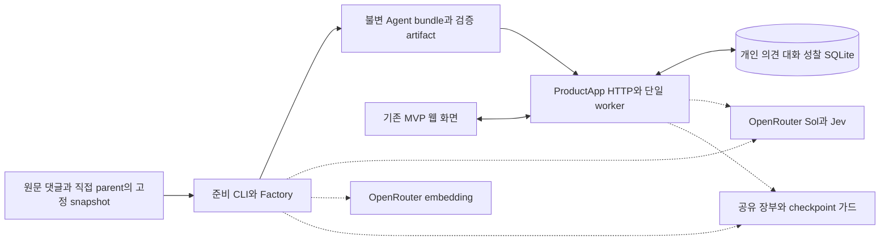
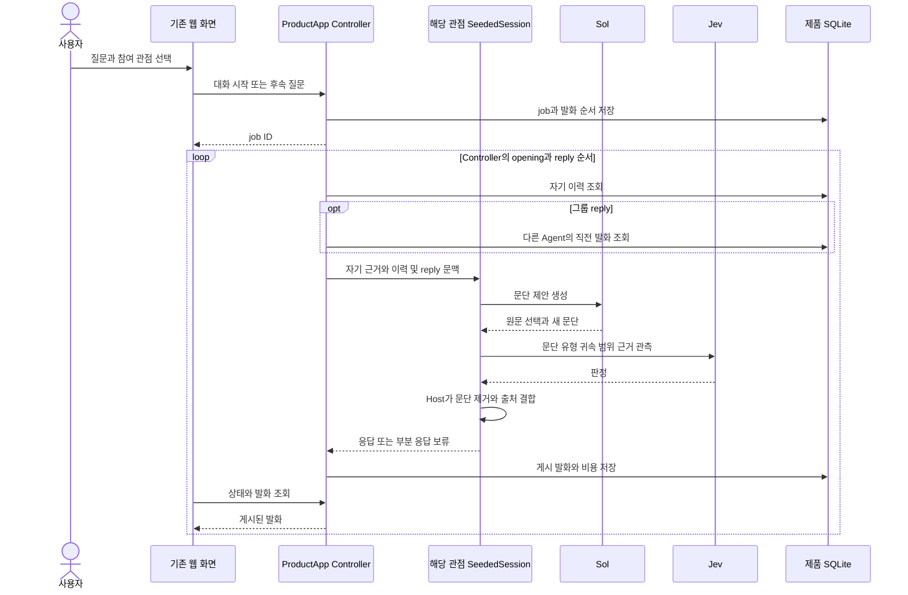

# 현재 구현 구조와 한계

2026-11-18 / TASK-029 / REQ-001·005·006·007·008·009·010 / DEC-028.
기반: main `ab6a34d`와 실제 실행 소스 `b7738275`.
추천 재설계 그림이 아니라 현재 파일·호출 경로를 대조한 구조다.
인계·실행 진입점은 [HANDOFF](../HANDOFF.md)다.

## 1. 전체 구조

Factory는 준비 CLI이고,웹 요청이 전체 Factory를 즉석 실행하는 구조가 아니다.
ProductApp은 HTTP 처리·Controller·단일 worker를 가진 Python 애플리케이션이다.
아래의 내부 역할은 별도 배포 microservice나 별도 학습 모델을 뜻하지 않는다.



같은 도표의 편집 원본: [implemented-structure.mmd](diagrams/implemented-structure-20261118.mmd).
실제 댓글·불변 분석 artifact·사용자 상태 DB·금융 장부는 서로 다른 자료다.

## 2. 댓글에서 Agent까지

| 순서/책임 | 담당 코드 | 입력→출력과 지켜야 할 경계 |
| --- | --- | --- |
| 수집 | `ingestion/youtube.py`,`cli.py` | 공식 API의 root/reply→snapshot. 화면의 임의 URL 분석 API와는 별도 |
| 원문 등록 | `factory/framed_corpus.py`,`position_frames.py` | 중복/canonical·ID·자기 원문·직접 parent·영상 문맥. parent 이유를 자기 이유로 세지 않음 |
| 벡터화·발견 | `providers/remote_verification.py`,`factory/shared_claims.py` | 본문 embedding과 묶음별 Sol 후보 제안. 묶음은 최종 관점 군집이 아님 |
| 검색 | `factory/perspective_mining.py` | 후보별 관련 원문/parent 벡터→검사할 관계. 검색 순위는 의미 승인 아님 |
| 관계 판정 | `factory/jev_membership.py`,`raw_membership_verification.py`,`pipeline_work.py` | Jev 최초 관측→Host 제약→긍정의 Sol 독립 검증. 미평가/조건부/반대를 구별 |
| core·원문 증거 | `factory/pipeline_stages.py`,`source_evidence_adapter.py`,`source_evidence_graph.py` | core 유형/fidelity·전체 원문 그래프·후보 연결 certificate. 불일치 보류가 아직 넓게 전파됨 |
| 사실·의존성·Compiler | `factory/minimal_agents.py`,`agents/grounded_inputs.py`,`agents/seed_policy.py` | 준비 문헌의 사실 판정·필수조건/출처/지지 검증→불변 bundle/compiled profiles |
| 제품 등록 | `product/analysis.py:from_factory` | 원래 snapshot·parent·hash와 자동 산출물 일치 확인→Analysis |

이 파일들은 `src/commentscope/` 아래에 있다. 연결 실행기는
[`tools/prepared_video_trial.py`](../../tools/prepared_video_trial.py)의`prepare/run/serve`다.
정책 없는 legacy3출처 경로와 명시적인 새1출처 정책을 구별한다.
새 이유는 토론 중 생성할 수 있지만 댓글의 지지 수로 더하지 않는다.

## 3. Agent 상호작용은 이미 있다

| 기능 | 현재 구현 | 실제 증거와 한계 |
| --- | --- | --- |
| Explore | 초기 의견과 허용 주장 비교·인용 연결 | 기본2비교는 빈 결과. 별도 관련 의견에서 차이1건 |
| 사용자↔Agent | 1:1 질문·후속 질문·자기 이력 | 최신 영상8질문. 이유 질문1/2와 연구 설명0/2로 유용성 부족 |
| Agent↔Agent | Controller의2~3인 opening/reply·상대 발언 문맥 | 최신2인 그룹4턴. reply 대상은 연결되나 실질 대응이 약함 |
| 원문/문헌 | 원문 drawer·직접 parent·외부 근거 표시 | 실제 인용·문헌 구간 결합 확인. 실시간 웹 검색이 아님 |
| Reflect | 네 범주 제안·직접 작성/수정·관련 대화·저장 revision | 실제 revision2 저장/재열람. 텍스트 품질·초행 사용 검증 미완료 |

그룹은 자율 Agent들이 서로 도구를 호출하는 구조가 아니다.
`product/app.py:_work_room`이 순서를 정하고,reply에서는 직전의 다른 Agent 발언을 문맥으로 준다.
각 발화는 자기 bundle과 이력을 사용하는 `agents/seeded_runtime.py:SeededSession`에서 생성한다.
상대 발언은 새 사실의 출처나 원댓글 지지가 되지 않는다.



[sequence 편집 원본](diagrams/implemented-interactions-20261118.mmd).
생성과 판정은 같은 공유 장부·원 금융owner를 사용한다.
현재 약점은 제안 전체의 질문 적합성을 검사한 뒤 일부 문단을 제거한다는 것이다.
그 결과 최종 게시물이 입장만 남아도 질문에 충분히 답하지 못할 수 있다.
Jev 판정에 따른 제거와 독립적으로 확인된 의미 정답을 혼동하지 않는다.

## 4. 댓글 capacity: 서로 다른 숫자

| 수치 | 뜻 | 현재 근거 |
| --- | --- | --- |
| 999 | 과거 실험의 중복 제거 후 canonical 원문 수 | 해당 실행 raw1000→canonical999;고정 코호트 검사에999가 명시됨 |
| 수집 기본1000/설정 최대9999 | 수집 CLI의 raw댓글 수 | `CollectionConfig` 설정 범위. 최종 분석/제품 용량 보증 아님 |
| registry 기본1000 | `framed_corpus.sources()`의 raw입력 검사 | 1001개를 기본 인자로 부르면 거절. 중복 제거 전에 raw개수를 검사 |
| 명시적3000 | registry/search 모듈이 허용하는 설정 범위 | 기본값을 명시적으로 넘긴3000 registry·검색 합성 검사는 있음 |
| 최신 prepare의 실효1000 | 일반 실행기에서 그 기본값을 전달하지 않는 결함 | `prepare`가1001개에서 `MVP snapshot cap exceeded`로 중단됨을 무료 재현 |
| 384관계/96원문/후보당12 | 최신180댓글 실행의 상세 검색·검증 범위 | 발견 입력180과 상세 판정 범위가 다름;전체999 실험은1536관계/120원문 설정 |

따라서 **999 고정 상한도 아니고,3000 end-to-end 지원 완료도 아니다.**
`prepared_video_trial.prepare`에는3000 조건이 있지만 그 앞의`source_registry` 호출이 기본1000을
쓴다. 같은 기본 호출이`guard`·`Session`과`product/analysis.py:from_factory`에도 있다.
상한 한 줄만 바꾸면 전체 경로가 해결된다고 쓰지 않는다.

무료 재현: [`check_snapshot_capacity.py`](../examples/check_snapshot_capacity.py).

```bash
python docs/examples/check_snapshot_capacity.py --output runs/handoff-capacity/result.json
```

확인 결과: default1000는1000통과/1001거절,explicit3000는1001/3000통과,
실제 일반`prepare`는1001거절. provider preflight/model 호출0.
이는 코드 경계 재현이며 실제3000개 처리 비용·속도·관점 품질을 측정한 것이 아니다.

## 5. 데이터·API·모델 책임

| 경계 | 내용 |
| --- | --- |
| `artifacts/agent-inputs.json` | `bundle`과`compiled`. 원문·claim·관계·후보·문헌·검사·정책을 유지 |
| `Analysis` | 불변 bundle revision,실제 가용 profile,원문 조회;정식 품질 승격 없음 |
| 제품 SQLite | 세션·초기/현재 의견 revision·room·message·job·request idempotency·성찰 revision |
| 금융 SQLite | 계정/실행 owner별 누적 예약·청구·보수 차감·미확정. 제품 DB와 별개 |
| OpenRouter | 이 실행에서는 Sol 생성/검증,Jev 관측,외부 embedding. 로컬 생성 가중치는 로드하지 않음 |

Sol은 새 논거/비교/성찰·원문 의미 검증을 담당하고,Jev는 membership과새 문단의 유형·귀속·범위·
근거를 관측한다. Host가 ID/구간·dependency·지지 수·기한·비용·게시 상태를 결합한다.
새 문단의`original_comment / ai_reasoning / external_evidence`를 화면과 저장본에서 구별한다.
현재 새 문단`scope` 필드는 core 범위를 상속한다. 문헌의 표본/기간 범위를 별도로 검증한 메타데이터라고
설명하지 않는다.

API 상세는 [PRODUCT_API](../PRODUCT_API.md)다.
`/api/v1/analyses`,세션/의견,비교,room/start/messages/control,job,source,성찰 분석/저장 경로가 있다.
홈·임의 영상 분석 요청/대기열·여러 개인 세션의 기록 목록은 현재 API에 없다.
웹은 첫 가용 분석을 자동 선택하고 localStorage의 한 세션을 복원한다.

## 6. 운영 상태와 미구현 경계

- 실제 latest trial의 새 AI 기한은 종료됐다.11/17 재열람 시 제품 서버는`cycle_deadline`을 반환했다.
- 저장된 실제 결과를 보는 정적 기록과 새 질문을 처리하는 live 서비스는 다르다.
- 사용자 세션 인증은 해당 plan에서24시간이었다. 단일 세션 복원은 다중 기록/장기 복원이 아니다.
- 홈/URL/개인 기록은11/17에 논의한 제안이다. Figma 원본과 현재 코드를 구현 완료로 바꾸지 않는다.
- 공개 지속 배포·TA 초행 사용·독립 의미 평가·실제3000 실행·합의 후 새 Agent 생성은 미완료/미검증이다.
- 예산·기한·source hash 검사를 제거해 인계나 제품 체험을 가능하게 만들지 않는다.

후속의 품질/비용 근거와 각 실패는 [실제 결과](PREPARED_VIDEO_WEB_RESULT.md)에 보존했다.
코드 구조,무료 회귀,제한된 실제 응답,전체 MVP 품질을 각각 보고한다.
