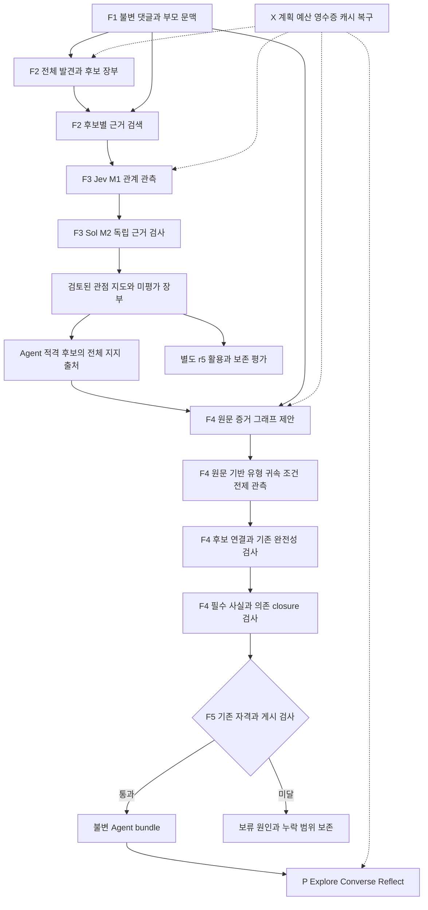

# 실제 댓글에서 유용한 Agent를 만들기 위한 설계 검토

검토 기준: main `3b4069ab9d88dd2f88ac21da2a0ce094523d5849`, 2026-11-11.
연결: TASK-019~024, DEC-013/014, REQ-001~010.
상태: **구현에 넘길 추천 기준안. 새 알고리즘 채택·품질 합격·유료 실행 승인은 아니다.**
현재 실행은 종료됐고, 이번 검토에서는 구현과 OpenRouter 모델 호출을 하지 않았다.

## 1. 결론과 이번에 고정할 경계

**전체를 다시 만들지 않는다. F1~F5/P/X 책임을 유지하고, F4의 원문 의미 단위·논거 표현을
버전 있는 계약으로 교체하는 B1을 먼저 비교한다.** 현재 파이프라인은 이미 Jev M1,
독립 Sol M2, 유형·귀속·전제 검사와 Compiler를 사용한다. 검증기를 더 붙이는 것만으로
고정된 복합 단위의 표현력 부족이 해결되지는 않는다.

구현용 계약은 [원문 증거 그래프](SOURCE_EVIDENCE_GRAPH.md), 검증·비용·작업 순서는
[구현 및 검증 계획](MVP_REDESIGN_PLAN.md)을 따른다. 하위 모델은 이 두 문서와 TASK ID를
기준으로 구현하며, 실패 사례 하나를 이유로 기준·모델·표본을 즉석 변경하지 않는다.

| 이번 기준안에서 고정 | 실제 비교 뒤 결정 |
| --- | --- |
| 선정 영상 사전 분석 → 불변 bundle → Explore·Converse·Reflect | B1의 의미 보존·이유 생성 개선 여부 |
| 가변 관점, 원문/부모/조건/귀속/불확실성 보존 | GPT-5.2 생성과 Sol 생성 중 품질 대비 비용 |
| 검색·membership·논거·Compiler·실행 제어의 책임 분리 | 검색 배분 개선의 실제 희귀 관점 보존 효과 |
| 새 artifact와 opt-in adapter, 기존 영수증 재태깅 금지 | Jev packet 최적화·병렬화의 비용/지연 효과 |
| 기존 r5·전체 eligible-support 심층검사·필수 사실 기준 | B2의 source admission 세분화: 별도 보류 |
| 이유 유용성과 초행 사용·복구를 완료 증거로 확인 | 전체999/3000의 실제 원가와 배포 준비 여부 |

같은 역할 이름을 다시 나누는 리팩토링이 아니다. **원문을 보존하는 단위와 의미를 판정하는
단위를 분리하고, 누락·보류를 측정 가능한 계약으로 만드는 변경**이다. 모델이 임의로 원문을
다시 쓰도록 허용하는 것도 아니다. 새 단위의 텍스트는 여전히 원문의 정확한 구간이다.

## 2. 관측한 사실과 아직 모르는 것

| 구분 | 근거와 의미 |
| --- | --- |
| 관측 | 실제999 전체 발견 →303 가설 →120 상세 원문/1536쌍 →52 검증 map 관계/39원문 →6 중간 core →최종1 Agent. 원문3개, VALUE 항목4개, 실질 이유 없음 |
| 관측 | 이유 질문은 abstain. 사실 검증 호출0회이므로 사실 정확도 향상을 입증하지 않음 |
| 관측 | 논거17 record/96단위 중 aggregate13 unresolved. 후보별 projection9회가 이미 있어13개 전부 폐기라고 해석하면 틀림 |
| 관측 | PR89가 Sol chat에 잘못 적용하던 Jev28KB 제한을 분리. 기존13 요청 세트 동일,4 입력 구성 가능. **수정 후 fresh Agent 증가는 미측정** |
| 관측 | 양OS CI Python2562개씩 실행, Windows12개 POSIX 검사 제외, 신규4개 양OS 통과. Node7개씩 통과. 실제 `/mvp` 브라우저 검사는 CI에 없음 |
| 코드상 원인 후보 | parser가 복수 접속·조건·질문 등을 unresolved로 두고, 고정 node의 혼합 유형을 uncertain으로 판정. 일부 문제를 source 전체 hold로 집계 |
| 코드상 원인 후보 | 후보당 검색 예산을 먼저 소진해 앞선 후보가120 source 상한을 점유할 수 있음. 후보81개는 선택쌍0개였으나 모두 유효 관점이라는 뜻은 아님 |
| 미검증 | 정당한 보류/과도한 보류 비율, 각 원인의 Agent·이유 손실 기여, 다른 영상 전이, 실제3000 비용·속도, 초행 사용자 과업 완수 |

수치의 정본은 [전체999 결과](WIDE_MINING_EXPERIMENT_RESULT.md)다. 실험 완료와 MVP 완료는 다르다.
PR89 CI: [run42955364796](https://github.com/joowonkime/commentscope/actions/runs/42955364796),
검사 head `bf47d35`와 merge `3b4069a`는 tree `9d3932ca118b68ed66392f69315b4976baa53b27`이 같다.
현재 코드 기준이 원실험 의미 코드 `096cb98`과 같다는 뜻은 아니다.

## 3. 구현·제안·과거 설계를 구별하는 지도

| 책임/모듈 | 현재 상태 | 이번 판단 |
| --- | --- | --- |
| ingestion, immutable source, thread/parent, 외부 embedding | 구현 | 유지. parent는 지칭 문맥이고 자동 자기 지지·이유가 아님 |
| `shared_claims`, `perspective_mining` | 전체 발견·정확 문구 정리·선택 검색 구현 | 유지 기준선. 의미 중복과 검색 배분은 별도 TASK-023 |
| Jev M1, `raw_membership_verification` M2 | 실제999에서 사용 | 유지. Jev 출력 형식 유효성은 의미 정확도가 아님 |
| `explicit_discourse`, `owned_arguments` | 결정적 parser의 고정 literal 단위에 판정 | B1 교체 대상. parser는 legacy/진단 seed로 보존 |
| `source_interpretation`, `source_semantics` S1/S2 | 과거 opt-in 구현·실제 진단 실패 | 그대로 재채택하지 않음. PR59 음성 사례를 새 계약에 포함 |
| `source_discourse` | 별도 인접 관계 제안 구현,999 주경로 연결 안 됨 | 존재를 보존. 새 해결책으로 이름만 바꿔 재제안하지 않음 |
| `candidate_source_coverage` | 두 alignment hold만 후보별 구제 | B1 유지. 범용 local hold 구제는 B2 별도 검증 |
| owner/dependency/audit | 여러 관측·누락 검사 구현 | 의미 의무 유지. 새 graph adapter가 대응한 호출만 대체 |
| optional reason omission | `grounded_inputs`에 이미 구현 | 기존 기능 유지. 이전 단계 source admission 완화와 구별 |
| budget/reservation/checkpoint/recovery | 구현·회귀·실행 복구 증거 있음 | 유지. 최적화는 의미 변경과 별도 비교 |
| 제품 API/개발 화면 | 세 과업 구현·합성 및 제한 모델 확인 | 유지·보강. 조원 프론트 완성/실제 초행 사용 검증과 구별 |

핵심 코드 근거:

- `explicit_discourse.parse/validate`: 소수 문법만 지원하며 `parse(source)==graph`를 요구한다.
- `owned_arguments.META/declare`: node 경계 불변, 혼합 유형 uncertain, 모든 node 해석과 own-position×candidate 판정 요구.
- `pipeline_stages.arguments`: node600자 상한과 eligible 후보 전체 supporting source 처리.
- `candidate_source_coverage.SCOPABLE`: alignment 두 종류만 분리.
- `argument_dependencies`: unit×target 관계 및 누락 coverage 검사.
- `minimal_agents._source_reasons`, `grounded_inputs`: semantic source admission과 최종 optional omission은 서로 다른 경계.

## 4. 과거 실패 때문에 달라져야 하는 부분

| 과거 결과 | 반복하면 안 되는 설계 | 이번 계약의 차이와 한계 |
| --- | --- | --- |
| PR59:8 통제군 통과 후 실제 감소→낮은 상태 변형 승인 | 자유 paraphrase를 만들고 reviewer의 preserved만 신뢰 | 원문 span·predicate·변화/상태·비교기준·scope 연결. 기존 실패와 새 동형 사례를 함께 검사. 그래도 의미 판단 오류 가능 |
| PR59:1인칭 이유를 보고 문장으로 바꿔 보존 실패 | 원문과 해석을 같은 텍스트 칸에 저장 | 원문은 고정, 해석·귀속은 별도 필드. 게시 텍스트 원문 연결 |
| PR62:필수 factual premise 누락 승인 | 선언된 fact0개를 전제0개로 취급 | 전체 원문에서 선언에 빠진 전제·조건을 별도로 관측. 누락이면 보류 |
| 과거 batching:8호출보다2호출이 더 비쌈 | 호출 수 감소를 원가 절감으로 보고 | 동일 완료 범위의 모든 실제 청구·시간 비교 |
| 같은 합성 설정에서1/2 Agent 변동 | 한 번 성공한 설정을 일반 성공으로 고정 | 고정 기준선·통제·미사용 전이·최종 전체 결과 구별 |

상세 근거: [S1/S2 결과](SOURCE_DIAGNOSTIC_RESULT.md), [기준선](BASELINE.md),
[소규모 mining 결과](MINING_EXPERIMENT_RESULT.md), [PR62](https://github.com/joowonkime/commentscope/pull/62).
PR85개 설명·명세 변경 이유47개·DEC12개는 private 인계에서 추적했으나,85개 모두의
인과적 품질 개선을 재검증한 것은 아니다. 종료 PR7~17은 PR18 통합 이력이 있으므로 실패로 분류하지 않는다.

## 5. 비교할 대안과 추천

| 대안 | 변경 | 장점 | 위험/선택 조건 |
| --- | --- | --- | --- |
| A 현행 최소수정 | PR89 포함 현재 코드, 기존 표현/모델/검색/검증 | 가장 작은 구현, 용량 수정의 효과 분리 | 복합 표현 제약 지속 가능. fresh 결과 없으므로 비교 기준선 필요 |
| B1 원문 증거 그래프 | exact span 단위·scope·edge와 대응 observer/adapter | 일반 문법과 여러 주장·이유를 표현, 판정 책임 통합 가능 | boundary/edge 환각·누락 위험. 기존 admission·사실 기준 유지하며 실제 보존 향상 필요 |
| C 강한 생성 모델의 단순한 그래프 경로 | B1과 동일 계약·검토기·입력, 생성만 Sol 비교 | 구조 변경 효과와 생성 모델 효과를 분리 | 모델명이 품질 보장 아님. 전체 청구·보존 개선으로 선택 |
| B2 세분화 admission | 불명 내용이 필수가 아님을 검증한 경우 후보별 구제 확대 | 무관한 난해 문장 때문에 직접 입장까지 버리는 문제 완화 가능 | 의미 누락으로 지지를 늘릴 위험. **첫 구현/비교 제외**, 별도 DEC·증거 필요 |

추천은 B1을 opt-in으로 구현해 A와 비교하고, 같은 B1 입력의 생성만 바꾼 C를 작은 factor로 비교하는 것이다.
개별 parser 예외를 무한 추가하거나, Jev를 모든 역할에 배정하거나, 모델만 강하게 바꾸는 결론은 채택하지 않는다.
A가 유용성·비용을 충분히 만족하면 작은 변경으로 남을 수 있다. B1이 안전 의무나 보존에서 실패하면 승격하지 않는다.

## 6. 추천 역할 구조

아래는 **B1 구현 목표**이며 현재 구현 도식이 아니다. 논리 역할은 Python 모듈 경계이고
각각 별도의 자율 Agent 프로세스를 뜻하지 않는다. 모든 외부 호출은 X 실행 제어를 지난다.
원본: [Mermaid](diagrams/evidence-architecture-review-20261111.mmd).

F4의 graph proposer는 **후보를 보지 않는 원문 해석**이다. observer는 proposer의 유형·귀속·edge
판정을 숨긴 원문·구간 목록에서 관측한다. 후보 연결 단계에서만 최종 후보 문구를 본다.
동일 제공자의 별도 요청은 통계적 오류 독립이나 사람 gold를 뜻하지 않는다.

## 7. 댓글 활용과 심층 논거의 분모

120개 상세 원문 상한이면 유효 활용의 최대도120개다.999개를 발견에 읽어도453/755를 증명하지 못한다.
이 제한 실행은 진단으로 끝내고, 정식 G4에는 충분한 원문별 membership/coherence 검토 범위를 계획해야 한다.

반대로453개 활용 댓글 모두가 Agent의 깊은 논거 graph를 요구하는 것도 아니다.
`comment_utilization`은 검토된 coherent map의 기여를 집계하고 Agent 승인은 별도다.
**현행 r5 `selection.detail_analysis`는 Agent-eligible 후보의 모든 집계 지지 출처를 심층 검토한다.**
따라서 그 합집합을 D로 계산한다. D가453과 같다고 가정하거나, eligible 후보에서 좋은3개만 골라
검사해 현행 계약을 충족했다고 말하지 않는다. D가 크면 실제 비용도 커진다.

고정999/755 r5와3000개 확장 검증은 별도 scope다. `comment_utilization`의 현행1000 상한을
몰래 올려 기존 gate의 분모를 바꾸지 않는다.3000 확장은 별도 versioned 진단 계약으로 처리한다.

## 8. TA 평가에 따른 제품 보강

사용자가 전달한2026-11-11 TA 메일은 초행 사용자가 핵심 기능과 시연 밖 행동을 직접 시험하며,
과업을 막는 사용성 문제를 중시한다고 명확히 했다. 새로운 배점·참여자 수·임의 영상 무제한 지원 조건은 아니다.
공식 범위는 [M4 검토](../M4_PROTOTYPE_REVIEW.md)와 원본 강의를 따른다.

현재1 Agent·이유 abstain은 핵심 유용성 문제다. 다음은 별도로 발견한 **코드상 결함 후보**이며
브라우저 재현을 먼저 해야 한다.

| 위험 | 코드 | 검증/수정 계약 |
| --- | --- | --- |
| 이전 방의 지연 응답이 새 선택을 덮음 | `product/mvp.js`의 `refreshRoom` | room ID·view epoch 고정, 오래된 응답은 해당 방 캐시에만 반영 |
| 전송 중 방/입력 변경으로 다른 대상 전송·새 초안 삭제 | `mvp.js`의 interject/control | 전송 의도에 대상·본문·revision·request ID 고정, 성공한 원래 초안만 정리 |
| pending 비교/성찰 후 새로고침·재제출 시 중복 job | `product/app.py`의 succeeded-only reuse, `mvp.js` UUID | 동일 의도의 queued/running 재사용·복구, 새 의도와 구별, 자동 과금 재시도 금지 |
| error 복구 API가 화면에 연결되지 않음 | `acknowledge_error` API와 화면 control 목록 | 기존 복구 동작 연결, failed generation을 자동 재실행하지 않음 |
| 통신 장애에도 저장 세션 삭제 | `mvp.js` enter의 catch | 만료/권한 오류와 일시 통신 장애 구별, 저장 작업 보존 |

pause/close/late-output/revision/ownership/idempotency의 backend 계약과 검사는 이미 있다.
다시 만들지 않고 adapter/UI의 누락과 실제 경쟁 조건을 보강한다.
현재 CI의 legacy Node smoke와 `mvp.js` syntax 검사는 이 경쟁 조건의 검증을 대신하지 않는다.

## 9. 구현 인계의 정지선

문서와 테스트 통과로 새 의미 품질을 승인하지 않는다. 첫 작업은 TASK-020의 실패 영향도·평가 표본·계약 통제 고정이다.
그 다음 TASK-021에서 B1만 구현한다. TASK-022 비교 전에는 새 기본값을 켜지 않는다.
모델/검색/admission을 한 번에 바꾸지 않고, 필요한 변경은 DEC와 표본·예산에 연결한다.
이전15달러 단계의 기한은 만료됐다. 새 유료 실행을 과거 RUNNING 메모나 남은 금액으로 재개하지 않는다.
