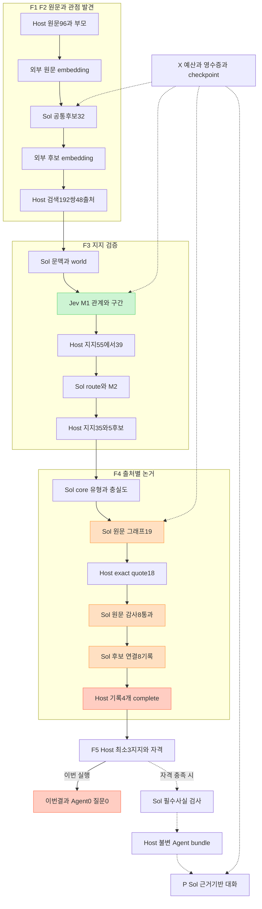

# 과거 시행착오·현재 구조·Jev 비용/품질 감사

TASK-022 / REQ-001·002·003·008·010 / DEC-009·013·027 proposed.
2026-11-13 사용자 요청: 기존 시행착오와 현재 구조를 먼저 대조하고 Jev의 비용·정확도 배정을 판단한다.
분석 기준은 main `3ac2251`/실행 소스 `8f07ab0`와 저장된 결과다. **이번 감사의 새 모델 호출/비용은0이다.**
구현 변경·새 benchmark·모델 채택을 수행한 문서가 아니다.

## 판단

과거 변경과 실패는 확인 가능한 상태였고 실제 설계 검토도 있었다. 그런데 알려진 한계가
새 프로토콜의 필수 회귀/완료 조건으로 이어지지 않았고, 일부는 제안·보류 상태로 남은 채 실행을 이어갔다.
최근 결과에서 처음 발견한 것처럼 다룬 검색 누락·후보별 실패 전파는 과거에 이미 관찰한 실패 유형이다.
전체 F1~F5를 다시 만드는 것보다 **기존 의미 의무를 유지하면서 검증 대상·실패 범위·모델 배정을 정리하는 일**이 우선이다.

현재 Jev M1의 낮은 비용은 확인됐다. 그러나 전체 서비스의 비용·정확도 곡선이나
Jev가 후반 검증을 충분히 대체할 수 있다는 증거는 없다. 현행은 강한 모델을 조건부로 호출하는
cascade보다 **Jev 판정에 여러 Sol 검증을 직렬로 결합한 구조**다. 검사 증가만으로 정확성이
좋아졌다고 입증하지 않았으며, Agent0 결과로 Jev가 틀렸다고 결론낼 수도 없다.

## 1. 이미 했던 수정과 남은 한계

| 기존 시도/근거 | 실제 확인한 효과 | 반복하면 안 되는 해석/현재 상태 |
| --- | --- | --- |
| [S1/S2 원문 해석](SOURCE_DIAGNOSTIC_RESULT.md), PR59 | 통제8개 통과 후에도 감소→낮은 상태 변형을 승인한1건 확인 | 합성 통제나 검토 모델의 동의를 실제 충실도/유용성으로 승격하지 않음 |
| [Jev 전제 검증 연결](JEV_AUDIT_INTEGRATION.md), PR65 | 전이6원문/12요청에서5원문 기대 일치; 사실 재진술/필수 전제 구분의 모호성 | Jev가 모든 논거 검증에 부적합하다는 결론도, 모든 판정을 옮기면 된다는 결론도 없음 |
| [후보별 실패 격리](CANDIDATE_SOURCE_COVERAGE.md), [PR76](https://github.com/joowonkime/commentscope/pull/76) | 저장 합성G1 무료 재구성0→2Agent. 실제24는 앞단0~1지지여서 그대로0 | legacy의 정렬 보류2종만 분리. 실제 댓글 전체 해결이 아니었음 |
| [공통 입장 발견](SHARED_DISCOVERY_DELIVERY.md), PR77/79 | 개별 복합 주장 대신 bare core 제안, 유형/영상 지칭 문맥 보강 | 이유·조건을 지워 지지 수를 만드는 방식은 아님. 실제96은 비용상한으로 미완료 |
| [source별 묶음 전송](SOURCE_MEMBERSHIP_BATCH_RESULT.md), PR81 | 기존350요청을137개 전송으로 구성 가능, 입력량55.6% 감소 | 실제 달러·정확도 절감은 미측정. 호출 수 감소와 비용 감소를 동일시하지 않음 |
| [Jev M1](JEV_MEMBERSHIP_RESULT.md), PR83 | 실제5건의 M1 비용은 과거 Sol 대비92.82% 낮음. 관계 기대 일치는 Jev3/5·과거 Sol4/5 | 작은 과거 비교이며 전체 정확도/전체비용 절감률이 아님. 이후 M2/F4 실패를 해결하지 않음 |
| [선택 발굴과 실제24](MINING_EXPERIMENT_RESULT.md), PR84~86 | nominee가 검색 상한으로 빠지고 선택쌍0인 후보가 생기는 문제를 무료 계획에서 확인 | CNBC32후보 중15미평가는 새 종류의 문제가 아님. 미검사를 무지지로 읽지 않음 |
| [전체999](WIDE_MINING_EXPERIMENT_RESULT.md), PR87~89 | 전체발견999→303후보→6중간core→1Agent, 이유 응답 보류. legacy projection9회 실제 사용 | 댓글 풀을 넓히는 것만으로 후반 논거 손실이 해결되지 않음. unresolved 전체가 일괄 폐기됐다는 과거 해석도 틀림 |
| [B1 설계/구현](MVP_DESIGN_REVIEW.md), [구현 범위](SOURCE_EVIDENCE_IMPLEMENTATION.md), PR90/91 | parser 고정 단위 대신 원문 그래프·observer·후보 연결 opt-in 구현 | 새 source는 전체 complete 요구. legacy projection은 legacy에만 유지; 세분화 B2는 명시적으로 제외됨 |
| [v3~v5 수정](SOURCE_FIDELITY_RESULT.md), PR92~98 | 정상 status 구별, U² 질문 축소, 조건/필요조건 분리, quote 주소·공통 한정어·비명제 필드 적용 보강. 무료 변환으로1Agent 복원 | 실제19/새영상의 정상 보존률·독립 의미 품질을 보장하지 않음. 무료 재변환은 새 모델 성공이 아님 |
| [고정 검색 확대](SOURCE_SEARCH_EXPANSION_RESULT.md), PR100/101 | 신규104관계/276요청/$0.91745, compiler2개 | 두 개 모두 UBI 찬성, 지지3개 중복, 한 Agent 이유 보류. 서로 다른 유용한2관점은 미달 |
| [CNBC96 첫 기능](FIRST_FUNCTIONAL_VIDEO_RESULT.md), PR103/104 | 501요청/$2.15134, 후보32·Agent0 | 입력 영상/표본이 달라져 과거와의 개선 인과 비교가 아님. 현재 구조의 별도 실패 결과 |

B1은 legacy의 고친 코드를 단순히 되돌린 것이 아니다. 기존 projection의 적용 범위와
새 source 전체 complete 정책이 다르며, B2는 당시 별도로 미뤘다. 하지만 제품 관점에서는
동일한 후보 간 실패 전파가 다시 나타났다. 이 정책 선택의 유용성 손실을 먼저 확인하지 않은 채
다른 영상 실행으로 넘어간 진행 순서는 적절하지 않았다.

검색 배분은 TASK-023에서 TASK-022 이후로 의존성이 설정돼 있었다. 알려진 문제가 단순히 기록에서 사라진 것은 아니며, 수정 순서에서 뒤로 밀린 것이다. 다만 작은 비용 상한의 새 영상 실행에서도 같은 배분을 재사용하면서 그 손실을 감수한 점은 별도 판단이었다. 무료 배분 대조와 실제 검색 정책 변경/전체999검증을 분리해야 한다.

## 2. 현재 실제 사용한 구조

아래는 저장소의 모든 optional/default 경로가 아니라 **마지막 CNBC 실행이 고른 배정**이다.
전체 역할은 함수/모듈 책임이며 각 단계가 독립 자율 Agent라는 뜻이 아니다.
모든 외부 호출은 동일 X 계층의 예산·기한·고정 배정·영수증·중복 방지를 거친다.

| 책임 | 이번 배정 | 실제 기능 |
| --- | --- | --- |
| F1 등록 | Host | 원문·root/reply·부모·canonical ID·사용기한·hash |
| F2 발견/검색 | 외부 embedding + Sol 제안 + Host 검색 | 미리 정하지 않은 공통 입장 후보와 검사할 관계 선택. 유사도/nominee는 지지가 아님 |
| F3 사전 관측 | Sol | source-context/source-world/candidate-world. 원문별/후보별 재사용 |
| F3 M1 | Jev1.14 | 관계·귀속·범위·근거 구간의 닫힌 판정. Host가 필드/구간을 검증 |
| F3 M2 | Sol + Host | M1 긍정의 후보 route와 원문 자기 근거를 추가 검사. 불확실을 Sol로 자동 승격하는 cascade는 아님 |
| Core | Sol | 유형·원문 충실도. 후보3지지는 최종 승인과 다름 |
| F4 원문 제안 | Sol | 전체 출처의 unit/scope/edge 그래프 생성. Host는 exact quote와 주소·형식 결합 |
| F4 원문 감사 | Sol | 단위·귀속·조건·범위·이유·전제·전체 coverage의 pass/fail/unknown 판정 |
| F4 후보 연결 | Sol + Host | position/reason/condition/필수 사실 목록과 후보별 증서. 현재 aggregate source veto 존재 |
| F5 | Host + 필요시 Sol 사실 검사 | 검증 source3개·필수 사실·단위/조건·허용 인용을 가진 bundle 조립 |
| P Runtime | Sol + Host | 완성된 자기 bundle의 허용 항목·원문을 선택. 이번 실행은0profile이므로0호출 |

최근 설정에서는 발견과 graph 생성도 Sol이었다. 과거 GPT5.2 생성 arm이나 Jev dependency protocol이
저장소에 존재한다고 이번에도 그 경로를 사용한 것은 아니다. 원문 graph 자체를 Jev가 생성하지 않는다.
[공식 Jev 설명](https://openrouter.ai/docs/guides/community/jev)은 자유 문장/추출 생성과 typed 판단을 구별한다.

현재 구조도: [Mermaid 원본](diagrams/factory-history-audit-current-20261113.mmd).
도식의 사실 검사/bundle/runtime 점선은 자격 충족 시의 코드 경로이며 이번 실행 호출은0이다.

## 3. 최근 실행의 실제 판정 손실

저장된 Jev192관계 proof와 최종 map을 새 추론 없이 다시 집계했다.

| 단계 | 지지 관계 | 의미 |
| --- | ---: | --- |
| Jev 원 relation 선택 | 55 | 근거 필드/범위 검사 전 모델 답 |
| M1 host bind 후 | 39 | predicate/population/귀속/범위 guard가16관계를 보류 |
| Sol route/M2 후 | 35 | 추가4관계 보류. own-evidence 요청36회와 구별 |
| 앞단3지지 이상 core | 5후보 | 서로 다른 최종5관점 승인이 아님 |
| F4 최종 유효 출처 | 후보별1/2/1/0/1 | 최소3지지 미달, Agent0 |

Jev의 원 uncertain은92쌍, host 후108쌍, M2 후112쌍이었다.
최종112개를 모두 Jev의 원 불확실 판정으로 세거나,55개를 모두 정답 지지로 세면 틀리다.
어느 보류가 필요했고 어느 것이 과도했는지에 대한 독립 reference가 없어
현재 Jev/Sol/host 각각의 false-positive/false-negative 비율을 계산할 수 없다.
55→39→35라는 손실만으로 검사 완화가 맞다는 결론도 내리지 않는다.

**후보 격리 하나만으로 MVP가 해결된다는 근거도 없다.** 원문 전체 감사는 통과하고
후보3개 중1개 의무만 실패한 단일 record의 적격 peer2개만 따로 세는 제한적 반사실 계산에서,
5후보의 잠재 출처 수는1/3/1/0/2다. 오직1후보만3이라는 수에 도달한다.
이는 저장된 증서의 count-only 계산이며 실제 코드 수정/Compiler 통과/이유 유용성/Agent 생성 결과가 아니다.
다른 원문의 전역 오류나 필수 사실/표현 불가를 지우지 않았다. 이 한 수정으로2관점 완성을 예고하지 않는다.

## 4. 비용 판단: Jev는 어디서 효과가 있고 없는가

| 현재 청구군 | USD | 현재 전체 비중 |
| --- | ---: | ---: |
| Jev M1 | 0.044823702 | 2.08% |
| Sol F4 원문 그래프 생성 | 0.960486500 | 44.65% |
| Sol F4 원문 감사 + 후보 연결 | 0.672541000 | 31.26% |
| 나머지 발견·문맥·M2·core·embedding | 0.473486500 | 22.01% |
| 합계 | 2.151337702 | 100% |

작은 Jev 청구 비중은 기존 대체 효과가 작았다는 뜻이 아니다. 대체 전 동일 전체 실행의
M1 청구가 얼마였는지 필요하다. 실제5건의92.82% 절감은 그 부품에서 확인한 제한적 비교이고,
이를 새192관계/전체 원가로 확대할 수 없다.
반면 **현재 Jev 청구 자체를 추가 최적화해서 얻을 최대 이득은 현재비용의2.08%**다.
그보다 큰 비용군은 Sol 생성과 후반 검증이다.

F4의75.91%에는 생성44.65%가 포함된다. Jev는 임의의 새로운 주장·quote·graph를 텍스트로
만드는 생성기를 대체하지 않는다. 현재 요청 집합과 proposal을 유지한 채 원문 감사/후보 연결만
교체한다면, 그 검증을 가상으로 무료화해도 비용 감소 상한은31.26%다. 실제 Jev 검증·승격 비용은
0이 아니므로 이 값은 절감 예측이나 약속이 아니다. 검증 범위/생성 계약까지 바꾸면 별도 비교가 필요하다.

이미 source/world 재사용, 동일 요청 checkpoint, 한 source당 graph 제안1회, 제곱 질문 축소는 구현돼 있다.
캐시 추가·의존성 희소화라는 이름으로 이미 했던 수정을 새 해법처럼 반복하지 않는다.
묶음 요청 수도 현재 달러 비중/품질을 확인한 뒤 판단한다.

## 5. 비용–정확도 tradeoff를 아직 판별하지 못한 이유

현재 확보한 것은 청구·보류·산출 수와 제한된 개발 reference다. 정확도 곡선은 아니다.
필요한 보류가 많으면 엄격한 검사가 옳을 수 있고, 정상 논거도 일괄 거절한다면 유용성만 낮출 수 있다.
서로 다른 요청에서 같은 Sol이 제안/검토를 했다는 사실도 오류의 통계적 독립을 보장하지 않는다.

다음 비교에서는 같은 원문·후보·주제/언어 층·정답 provenance를 유지하면서 아래를 함께 기록한다.

- 잘못된 지지/귀속/조건/필수 사실의 승인과, 실제로 유효한 지지·이유의 누락을 따로 센다.
- abstain·형식 오류·미평가와 실제 부정 판정을 구별한다. 임계값을 바꿀 때 보류된 정상 내용도 분모에 남긴다.
- 서로 다른 유용한 관점 수·각 원문의 실제 이유/조건 보존·질문 유용성을 본다. 비슷한 찬성 Agent 수로 대체하지 않는다.
- generation/Jev/Sol 검증/승격/실패의 모든 비용과 wall time을 합친다. Agent0 실행을 비용 통계에서 제외하지 않는다.
- 기존 개발·전이 자료의 reference 존재/오류/검토 provenance를 먼저 확인한다. assistant 주석·모델 일치도를 독립 사람 gold로 표시하지 않는다.

기존 최소2서로 다른Agent/각3유효지지·원문 귀속·필수 사실·r5는 이번 분석으로 변경하지 않는다.
전체 댓글 활용률60%와 개별 판정기의60% 정확도는 다른 지표다.

## 6. 추천하는 배정과 실행 순서

상위 F1~F5/P/X 책임은 유지한다. 최우선은 모델을 다시 바꾸는 일이 아니라
이미 확인한 **검색 누락과 실패 전파를 공통 계약으로 다루는 무료 구현·재생**이다.

1. 후보의 nominee 검사 예산과 검색 미평가 상태를 먼저 확보한다. 전체 nominee가 상한에 들어가는
   경우와 들어가지 않는 경우를 구별한다. nomination을 지지로 승인하지 않는다.
2. 원문 전역 실패/후보별 실패/필수 의존 실패를 분리한다. source hash·언어·전체 의미 누락이나
   필수 사실 오류는 계속 막되, 한 후보의 범위 실패가 독립 적격 peer의 실패로 복제되는 범위를 명시한다.
   B1 전역 complete 정책을 바꾸는 부분은 B2의 명시적 계약 변경이며 기존 모델 응답을 재태깅하지 않는다.
3. 이미 검증된 source graph의 주소·edge·목록을 다시 생성시키는 입력을 정리한다.
   Host가 아는 구조는 코드가 결합하고, 모델은 실제 해석·누락·귀속·조건 판단을 맡는다.
   다만 source graph 자체도 틀릴 수 있으므로 원문 전체를 읽는 독립 의미 검사는 유지한다.
4. 이 무료 교정의 효과와 한계를 고정한 뒤 **F4의 닫힌 판단 한 역할**에서 Jev 대체/cascade를 비교한다.
   현재 Sol source auditor의 모든 판단을 한꺼번에 교체하거나 검증기를 더 추가하지 않는다.

Jev 배정 후보는 `이 quote가 해당 작성자의 입장인가`, `필수 조건이 남았는가`,
`이유인지 필수 사실 전제인지`처럼 source/target/선택지가 명확한 검증이다.
Sol은 새로운 공통 입장·evidence graph 생성과 실제 표현, 검증이 어려운 사례를 담당한다.
Host는 ID/quote/Unicode 주소·집합/DAG·귀속 참조·실패 영향 범위·자격·예산을 책임진다.
모든 unit pair에 Jev를 다시 묻는 과거 U² 전제 검증으로 되돌아가지 않는다.

후보 cascade는 **Jev가 충분히 판정한 경우 해당 Sol 검증을 대체하고**, 불확실/경계 사례만
별도 Sol 심층검증으로 보내는 방식이다. 현재는 이 조건부 대체가 구현돼 있지 않다.
실험 전에 승격 대상·최대 승격 수·실패/보류 처리·각 단계 입력·모델/가격/기한을 고정한다.
동일 실패를 통과할 때까지 되묻거나 현재 종료된 실행에 fallback을 추가하지 않는다.

한 검증 역할의 단순 기대비용은 `C_Jev + q * C_Sol`이다(`q`는 실제 Sol 승격 비율).
항상 Sol을 호출하는 기준선의`C_Sol`보다 싸려면 `q < 1 - C_Jev/C_Sol`이어야 한다.
이는 동일 완료 범위·고정 단가의 단순식이며 품질/가변 token/cache/2차검증까지 보장하지 않는다.
Jev를 추가한 뒤 결국 모든 사례를 Sol로 보내면 비용은 증가한다.

[OpenRouter의 verified cascade 예제](https://openrouter.ai/docs/cookbook/evaluate-and-optimize/jev-verified-cascade)는
생성→Jev 근거 검사→필요할 때만 강한 생성 모델로 승격하는 대체 구조를 설명한다.
그 예제의 비용 비율·confidence threshold·50개 help-center 문항 결과를 우리 댓글의 정확도로 이전하지 않는다.
검증 역할만 교체하는 우리 후보와도 출력·위험이 다르다. 임계값은 우리 reference에서 비용과
오승인·정상 누락을 함께 본 뒤 선택한다. 지금0.8 등의 값을 새 정책으로 채택하지 않는다.

[댓글 분류 예제](https://openrouter.ai/docs/cookbook/evaluate-and-optimize/classify-reddit-comments-with-jev)는
관련성/감성 분류다. 감성의 긍정·부정을 정책 찬반/조건부 지지로 그대로 쓰지 않는다.
[공식 모델 문서](https://openrouter.ai/docs/guides/community/jev)의 typed 결정 기능은 이러한 배정의 근거지만,
우리 복합 문장·한국어·부모 답글에서의 품질 보증은 아니다.
현재 adapter의16질문/8선택지/28KB는 고정한 실행 경계다. TypeSafe 직접 API와 OpenRouter의 조건을
섞어 모델 자체의 보편 제한으로 설명하거나, 본 감사만으로 상한을 올리지 않는다.

## 7. 다음 수정에서 반복을 막는 완료 조건

다음 작업의 정상/부정 사례는 특정 CNBC ID가 아닌 **실패 유형과 지원 backend별로** 정리한다.
legacy와 source-evidence가 같은 제품 책임을 맡으면 후보별 오류/전역 오류의 영향 범위도 각각 검사한다.
명시적으로 다른 계약이면 차이를 문서·실행 plan·품질 평가에 남긴다.
기존 synthetics의 all-pass와 새 실제 source의 유효 보존을 계속 구별한다.

알려진 실패표에는 최소한 원문 변화/상태, 필수 사실 누락, 부모 귀속, 조건/필요조건,
후보 간 veto, nominee 미선택, optional reason omission의 기존 구현 경계를 연결한다.
이미 있는 `grounded_inputs`의 optional omission을 새로운 upstream source admission 해결책으로 재제안하지 않는다.

이번 산출물은 역사/코드/실제영수증 대조와 한정된 반사실 계산이다. 새 의미 정책 구현·정확도곡선·
Jev 후반검증 채택·Agent 증가를 완료했다고 보고하지 않는다. 다음 유료 비교는 위 무료 계약/회귀와
reference를 준비한 뒤 별도 등록한다. 현재 예산/종료 결과/실패 source/실청구는 모두 보존한다.
