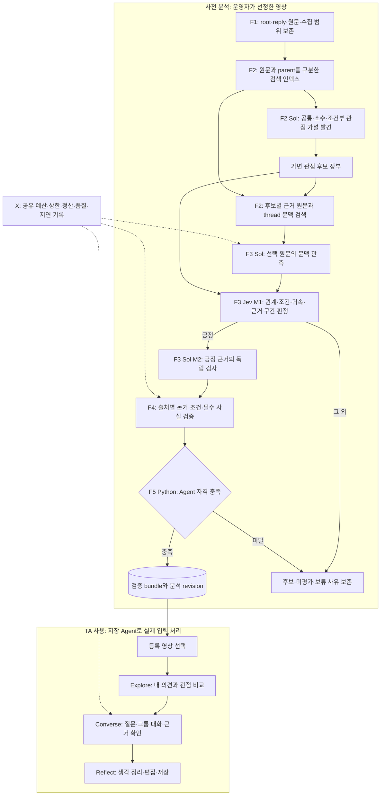

# 사전 분석 영상과 관점 발굴 중심 MVP 설계

2026-11-10. REQ-001~010, TASK-005/017/018/012, DEC-008/009/010.
대조 코드: main `036cd2f`. 사용자 승인: 선정 영상 사전 분석 → 저장 Agent로 TA의 세 과업 지원.
사용자는 노이즈 전수 분류보다 근거 있는 다양한 관점 발굴을 우선하라고 명확히 했다.

**확정한 것은 운영 방식과 책임 경계다.** TASK-018의 첫 opt-in은 후보별 선택 검증·가용 parent
vector 검색·소수 가설·명시적3천 registry 상한을 구현하고 무료 검사했다. 실제 의미 품질/전체 처리 성능의
채택은 미완료다. 과거 실제 입력을 사용한 무료 계획 검사와 새 모델 실행도 구별한다.
기본 Sol 및 opt-in Jev M1의 현재 구현과 새 목표 흐름을 구별한다.
정식 r5/755분모·453활용/G1~G4와 총$50·기존 trial/owner 장부는 유지한다.

## 1. 제품의 성공과 운영 범위

선정 영상은 고정된 관점 정답표가 아니다. 실제 댓글에서 자동 발견하고 검증한 관점으로
Agent를 만들고, TA는 영상 선택 뒤 자기 의견/질문으로 Explore→Converse→Reflect를 수행한다.
사전 처리 시간/비용과 사용 중 응답 시간/비용을 각각 측정한다. 저장 응답 재생과 새 질문 응답도 구별한다.
지원 영상 목록·분석 revision·처리 범위를 표시하며, 임의 영상 즉석 분석은 이 MVP 경로에 추가하지 않는다.
선정 영상 개수/각 영상 ID는 실제 자격·예산을 확인한 manifest에서 확정한다. 현재 여러 영상 준비가 끝났다는 뜻은 아니다.

발굴할 대상은 입장만이 아니라 출처별 이유·조건·반론까지 포함한 대화 가능한 관점이다.
댓글을 모두 의미 없음/찬성/반대 중 하나로 분류할 필요는 없다. 검토하지 않은 것은 미평가다.
짧은 동의, 조건부 주장, 소수 입장도 길이·좋아요·검색 점수로 버리지 않는다.
관점 수 K는 자료에서 결정하며 부족한 Agent를 합성하지 않는다.

선택 검증으로 확보한 지지 수는 **검증한 출처 수**다. 영상 전체의 관점 점유율이나 여론으로
해석하지 않는다. 공식 전체 r5 활용률은 고정 평가 자료를 따로 처리해야 계산할 수 있다.
발견 우선 prototype의 성공을 기존 전체 품질 합격으로 보고하지 않는다.

## 2. 현재 댓글이 군집이 되는 방식

1. 원문/부모/ID를 보존한다. 정규화는 현재 `(정규화한 본문, parent_id)` 기준 duplicate alias를 만든다.
2. 현재 all-HTTP 경로는 **댓글 본문만** 외부 `text-embedding-3-small`에 보낸다.
   긴 본문은 UTF8 6,000바이트 조각으로 나누고 전체 조각을 결합한다. 부모는 이 벡터 입력에 없다.
3. `shared_claims.batches`는 ID로 seed를 고르고 남은 댓글을 cosine 유사도로 정렬해 최대12개씩 묶는다.
   각 댓글이 한 묶음에 들어간다. 이 묶음은 최종 관점 군집이나 thread가 아니다.
4. Sol이 묶음을 읽고 최소2원문에 공통인 단일 주장을 최대4개 제안한다. 후보의 nominee는 미검증 가설이다.
   전체 후보 수 K는 가변이다. shared 경로의 후보 병합은 정확한 문구 중심이다.
5. 후보 문장도 embedding하고, 댓글별 상위3후보+nominee 후보를 검색한다. 이후 미검토 상위3개를 확장할 수 있다.
   현재 후보가6개 이하인 shared 전체 scope는 사실상 N×K 비교로 이어질 수 있다.
6. Sol 기본 M1 또는 opt-in Jev M1이 각 원문↔후보 관계를 판정한다. 긍정은 독립 Sol M2를 거친다.
   검증된 지지 원문들이 관점의 지지 집합이다. 원문은 여러 관점과 관계를 가질 수 있다.
7. 기존 출처별 논거/조건/사실 검사와 Python Compiler를 거쳐 적격 Agent를 만든다.

따라서 후보가 준비되면 Jev를 바로 연결할 수 있고 이미 opt-in 구현이 있다.
아직 기본 전환을 보류한 근거는 [11건 실측](JEV_MEMBERSHIP_RESULT.md)의 누락/관계 오류다.
embedding 자체가 지지·반대·근거 귀속을 판정하지 않는다.

현재 약점은 본문만 embedding한 짧은 답글의 검색 누락, 묶음당2원문 조건의 소수 후보 누락,
많은 댓글에 대해 문맥/관계 판정을 수행하는 비용·직렬 시간이다. 검색 실패와 판정 오류를 각각 측정한다.

코드: [입력/embedding](../../src/commentscope/factory/minimal_pipeline.py),
[묶음/공통 제안](../../src/commentscope/factory/shared_claims.py),
[후보별 검색](../../src/commentscope/factory/candidate_consolidation.py),
[원문별 검증](../../src/commentscope/factory/pipeline_work.py).

## 3. root·reply·thread·관점은 다른 단위

| 단위 | 의미와 판정 |
| --- | --- |
| root comment | 독립 원문 출처. 자기 입장·이유·조건을 검토 |
| reply | 별도 원문 출처. 자기 본문을 판단하며 parent는 지칭/명시적 동의 해석에 사용 |
| thread | root와 reply의 출처 연결. 한 thread가 한 관점이라는 뜻은 아님 |
| perspective candidate | 여러 thread에서 발견될 수 있는 주장 가설 |
| support relation | 해당 원문이 완전한 후보를 실제 지지하는지의 별도 판정 |
| Agent | 충분한 유효 지지와 논거/조건/사실/실행 검사를 충족한 관점의 대화 인터페이스 |

합성 예시: root가 “버스는 무료여야 한다. 통근비를 줄일 수 있다.”라고 말한다.

| 답글 | 가능한 처리 |
| --- | --- |
| “무료화에는 동의합니다.” | 해당 주장에 대한 명시적 동의인지 확인; root의 통근비 이유를 자기 이유로 복사하지 않음 |
| “병원 예산을 줄이지 않을 때만 찬성합니다.” | 조건 없는 무료화의 무조건 지지로 세지 않음; 조건 있는 별도 가설은 보존 가능 |
| “무료화는 반대합니다.” | 같은 주제지만 반대 관계. root와 같은 지지 군집에 넣지 않음 |
| “비용이 줄어든다는 근거가 뭔가요?” | 이유에 대한 질문만으로 정책 전체의 반대/찬성을 단정하지 않음 |
| “@다른사람 그 말에 동의합니다.” | 실제 지칭 대상이 불명확하면 보류; parent=root라는 사실만으로 root 동의로 바꾸지 않음 |

현재 `source_packet`은 자기 원문+직접 parent 한 개만 제공한다. 전체 thread나 특정 sibling reply의
자동 지칭 해결은 없다. `author_id=A0...`는 요청 안의 원문 alias이며 검증된 고유 사용자 ID가 아니다.
수집기는 고유 작성자 식별을 요청하지 않으므로 댓글 지지 수를 사람 수로 보고하지 않는다.
같은 문구/parent의 duplicate alias 정책 역시 원래 댓글 개수와 canonical 출처 수를 구별해 표시한다.

YouTube 공식 API는 현재 top-level comment에 대한 답글을 제공한다. API parent는 사용자가 실제
대화에서 지칭한 다른 답글을 보장하지 않는다. `commentThreads`에 포함된 replies는 일부일 수 있어
전체 답글 수집에는 `comments.list(parentId=...)`의 pagination이 필요하다.
[Comments.list](https://developers.google.com/youtube/data/reference/rest/v3/comments/list),
[CommentThreads](https://developers.google.com/youtube/data/reference/rest/v3/commentThreads).
현재 수집기는 별도 reply pagination과 수집 중단/부분 상태를 기록한다. 설정 상한 안의 수집은 전수 수집이 아니다.

## 4. 목표 역할 계층과 발굴 흐름

| 계층 | 책임 | 배정/상태 |
| --- | --- | --- |
| F1 원문 장부 | 댓글/parent/thread·원문 구간·수집/분석 상태 보존 | Python, 기존 경계 유지 |
| F2 발견·검색 | 전체 원문의 저비용 인덱스, 다양한 관점 가설·조건, 후보별 근거 검색 | 외부 embedding+Sol 생성; 첫 선택 검색 opt-in 구현/무료 검사 |
| F3 관계 검증 | 선택 원문에 필요한 문맥 관측, 원문↔후보 판정, 긍정 독립 근거 검사 | Sol 관측+Jev M1 목표+Sol M2; 기본 배정 전환은 별도 검증 |
| F4 논거·사실 | 출처별 이유/조건 구성, 귀속·필수 전제·외부 사실 검증 | 기존 GPT-5.2 생성+Sol 검증 |
| F5 조립 | 유효 지지/완전성/조건/사실 검사, 불변 bundle 생성 | Python; 최소3유효출처와 모든 기존 자격 유지 |
| P 제품 | 등록 영상 선택, Explore/Converse/Reflect·근거·저장 | 기존 UI/API/Controller+GPT-5.2 |
| X 실행 | 원 장부·요청 예약/정산·단계상한·자원·재개·실측 | Python, 모든 경로 공통 |

아래는 **목표 흐름**이다. 첫 후보별 선택 검색과 가용 parent vector 검색은 opt-in으로 연결했다.
scope 밖 parent의 추가 embedding/특정 sibling 지칭 해결·실제 모델 채택은 완료하지 않았다. 기본 실행은 유지한다.
Mermaid 원본: [prepared-video-mining.mmd](diagrams/prepared-video-mining.mmd).

<!-- MINING_DIAGRAM_START -->

<!-- MINING_DIAGRAM_END -->

### 선택 검증의 구체적 계약

첫 opt-in `candidate-first-evidence-search-20261110-v1`은 다음 closed policy를 plan에 고정한다.
숫자는 합성 검사 예시이며 실제 실행 권한/최적값이 아니다.

```json
{"version":"candidate-first-evidence-search-20261110-v1","sources_per_candidate":12,"maximum_pairs":60,"maximum_sources":30,"maximum_snapshot_comments":3000}
```

sources_per_candidate는1~64, maximum_pairs는1~1000000, maximum_sources와 maximum_snapshot_comments는
1~3000이며 maximum_sources는 maximum_snapshot_comments 이하다. 실제 snapshot이 선언 상한을 넘으면
시작 전에 거절한다. 기존 경로의1000 상한은 유지한다. 새 선택 경로만 명시한 상한을 쓴다.
후보별 nominee/본문/가용 parent vector 검색을 수행하고 thread를 번갈아 골라 큰 thread 쏠림을 줄인다.
후보는 nominee가 나온 thread 수/원문 수로 검색 우선순위를 정하고, 후보별 한 묶음씩 예산을 배정한다.
모든 후보에 한 쌍씩만 분산해 어느 후보도 Agent 최소지지를 모으지 못하는 구조를 피한다.
한 후보의 상한은 sources_per_candidate이고, 후순위 가설은 미평가로 보존한다. 이것은 검색 순서이며 의미 승인이 아니다.
총 source/pair/후보별 상한 때문에 빠진 nominee도 미평가로 기록한다. parent vector가 없으면
없는 값을 만들지 않고 자기 본문과 알려진 지칭문맥만 사용한다.
새 discovery protocol `original-mining-hypotheses-20261110-v4`는 최대4개의 단일유형 가설과
최소1개 원문 nominee를 허용한다. 기존 COMMON_TYPED의 최소2원문 계약은 변경하지 않는다.

- 발견은 전 원문을 정해진 묶음/예산 안에서 넓게 읽는다. 명시적인 원문1개에 있는 소수/조건부 가설도
  후보로 보존할 수 있게 새 discovery protocol을 분리한다. 후보 보존과 Agent 자격은 다르다.
- 후보마다 관련 원문을 검색해 한정된 순서로 검증한다. 먼저 모든 원문을 값비싼 source-context/world로
  분류하지 않고, 실제 검증할 원문의 관측만 같은 실행에서 정확한 입력별로 재사용한다.
- reply의 자기 본문 벡터와 parent 문맥 검색을 분리한다. parent의 후보/검색 결과는 검사할 후보를
  넓히는 데만 사용하며 parent의 지지·이유를 reply에 넘기지 않는다. 두 벡터를 무조건 평균하지 않는다.
- 다른 thread/조건/반론/소수 가설을 살피는 탐색 범위를 계획에 고정한다. 큰 thread·좋아요 상위·유사도
  상위만으로 전체 관점을 대표한다고 주장하지 않는다. unresolved/미처리 목록과 발견 누락 평가를 남긴다.
- 후보별 검색 원문 수·총 비교쌍·질문/packet·검증 source/node·추가 발견 회차·금액·시간 상한을 동결한다.
  충분한 유효 근거로 Agent 자격을 확인하거나 한도에 닿으면 종료한다. 미달 후보는 보존한다.
- 최초 구현은 자동 추가 발견 R=0이다. 불확실한 모든 결과를 Sol로 자동 재판정하지 않는다.
  Jev 긍정의 기존 독립 M2는 유지한다. 실패 재과금이나 개별 사례 유료 수정 반복은 추가하지 않는다.
- 공개할 Agent의 모든 사용 근거를 검사한다. 검색에서 뽑힌 원문 수나 Jev confidence로 승인하지 않는다.

## 5. 2천~3천 댓글에서 바꿔야 할 것

기본 `framed_corpus.sources`는 snapshot 댓글이1,000개를 넘으면 거절한다.
수집 설정은9,999까지 지정할 수 있지만 기본 총1,000/root400/reply당100이고, 수집 설정 확장만으로
Factory가3천개를 지원하지는 않는다. 새 mining policy만 최대3천의 명시적 registry 상한을 선택한다.
합성3천의 장부/선택 검사와 실제3천의 전체 Agent 생성·품질/시간 검증은 다르다.
수집 원본 N, 중복 정리 canonical N, 의미 분모, 실제 발견/검증 대상과 미평가 수를 각각 기록해야 한다.

| 전댓글 판정 방식의 명목 workload | N=2,000 | N=3,000 |
| --- | ---: | ---: |
| 최대12댓글 발견 묶음 | 167 | 250 |
| 모든 source의 context+world | 4,000호출 | 6,000호출 |
| 후보20개를 모두 대조 | 40,000쌍 | 60,000쌍 |
| 댓글당6후보만 대조하는 가정 | 12,000쌍 | 18,000쌍 |

마지막 행은 nominee/thread 후보 추가·여러 packet·후속 검증을 제외한 예시다. 새 발굴 설계는 N보다
**후보별로 실제 검증한 source V와 비교쌍 P**를 핵심 비용 변수로 삼는다. 여러 후보에 겹친 source는
문맥 관측을 재사용하지만 각각의 지지는 독립 판정한다. P가 자동으로 작아진다고 가정하지 않는다.

기존 실제5건 M1 평균은 Jev2.03초/과거Sol4.13초였다. 이를18,000쌍에 단순 적용하면 Jev M1만
직렬 약10.1시간이다. 관점 발견/문맥/독립 근거/논거/사실은 별도다. 이는 설계 위험을 보여주는
산술 예시이며3천개 실측이나 처리시간 예측이 아니다. 사전 분석은 사용자 대기를 줄이지만 총 작업량을 없애지 않는다.

그래서 단순 상한 해제와 전송 병렬화보다 선택할 쌍/반복 관측을 줄이는 경로를 먼저 구현한다.
현재 전역 단일 호출/SQLite 예산 경계는 유지한다. 제한 병렬화는 예약/원trial 상한/재개/부분 실패의
동시성 안전을 검증한 별도 변경으로 다룬다. 전체 비용은 발견+관측+M1+M2+논거+사실+runtime을 포함한다.

## 6. 구현과 검증 순서

1. **TASK-018 무료 계약/회귀:** parent가 있는 짧은 명시적 동의, parent 이유 반박, 조건부 동의,
   sibling 지칭 불명, root/reply 반대, 여러 주장, 한 source 소수 가설, thread 간 같은 관점을 고정한다.
   원문/parent 변경은 새 identity, 검색 후보가 달라도 지지는 독립, 미평가는 비지지와 구분한다.
2. **새 opt-in selector:** 기존 shared/Sol/JeV 경로를 보존하고 후보별 원문 검색·문맥 관측 지연 실행·
   처리 장부를 연결한다. synthetic2천/3천에서 유실/중복/parent 연결/후보 수/요청 상한을 무료 검사한다.
3. **고정 소규모 실제 실행:** 코드/모델/입력/기대값/전체 비용·시간 계획을 동결한다. 남은 원trial/
   owner/global 상한과 기존 정식 admission을 통과한 범위만 실행한다. 이번 문서화로 대량 실행을 시작하지 않는다.
4. **선정 영상 전체 사전 준비:** 근거 있는 서로 다른 Agent·모든 사용 근거·실제 답변을 검토하고
   등록 manifest를 만든다. 실패/미달 결과도 보존한다. 각 영상의 총비용과 미처리 범위를 표시한다.
5. **M4 반복 E2E:** TA 경로에서 새 의견/질문으로 세 과업을 수행한다. 첫 응답/최종 완료·중앙값/
   p95·실패/보류·세션 비용을 기록한다. 반복 수가 작은 경우 p95 수치를 일반 성능으로 주장하지 않는다.

성공 기준은 실제 근거의 정확성, 발견한 입장·이유·조건의 다양성, 대화 유용성, 세 과업의 일관성이다.
검증한 지지의 정확도와 유효 지지 누락을 함께 보고, 독립 사람 평가와 개발자 대조도 구별한다.
최종 새 모델 채택/속도 목표/실험 횟수/서비스 단가와 전체 r5 완료는 각각의 증거로 확정한다.

## 7. 이번 구조 대조와 구현 증거

사용자의 컨텍스트 혼선 우려에 따라 요약을 구현 사실로 쓰지 않고 역할마다 원본 코드를 대조했다.
이 검토는 개발 에이전트의 코드/계약 대조이며 독립 사람 의미 평가가 아니다.

| 확인한 경계 | 이번 결과 |
| --- | --- |
| 현재/새 경로 | 기본 shared/Sol은 유지. 새 closed policy가 있어야 MINING 발견/후보별 선택/명시적 registry 상한 실행 |
| 발견/지지/Agent 분리 | 1원문 가설을 후보로 보존, 검색/nominee는 지지 아님; 기존 M2·논거/사실·Compiler 유지 |
| 선택/문맥 | 새 원문별 전수 nomination pass 없이 선택쌍만 judge로 보내 문맥 관측도 선택 source에만 실행 |
| root/reply | parent vector는 검색 점수용, 원문 지지/이유 전이 없음; 가용한 parent만 사용 |
| 입력 전체성 | policy 상한·원문 hash·벡터 inventory 불일치 거절; 미선정 원문과 미평가 쌍 수 보존 |
| 실행 환경 | CLI/회귀는 현재 ROOT/src를 고정. 무료 보관자료 검사도 실제 module 파일 경로를 확인 |
| 예산/품질 | 새 정책도 전체 cost gate·원trial/owner/global을 공유. 새 후보/모델의 성적을 과거 성적으로 승계하지 않음 |

첫 집중17개/관련54개 후, 후보별 근거 묶음 배정과 예산 extension까지 포함한 최종 Factory727개,
집중18개/예산·재개·명세34개가 통과했다(범위 중복).
Mermaid 구문과 embedded/원본 동일성도 확인했다. 합성 end-to-end는2Agent/각3지지와
M2 veto·실패 Jev 보류·같은 proposal/cost gate 재개를 검사했다. 합성2천/3천은 source 목록/선택 상한을 검사했다.

현재 실제96개의 원래 embedding 영수증과5개 후보를 검증해 무료로 새 검색 계획을 계산했다.
설정은 위 예시12/60/30/3000이다. 최종 후보별 배정으로 **30source·58쌍·28개 thread 문맥**,
reply10개를 선택했고422쌍은 미평가로 남겼다. 이는480쌍 원래 계획과의 작업량 비교이며 비용 절감률이나 새 정확도가 아니다.
이96 scope에는 선택 reply의 parent vector가 없어 parent similarity 적용은0쌍이었다.
parent 텍스트는 기존 원문 packet에 남지만, 추가 parent embedding과 실제 효과는 아직 검증하지 않았다.

증액 전 무료검토 시 동일 원trial 잔여는$0.125529638였다. 새96 선택 계획도 측정된 단계의 역사적 단가로 계산한 부분만
$0.2474024425이고 M1 packet/논거/사실/runtime 등은 미측정이다. 따라서 비용 gate가 거절했다.
**신규 모델 호출0/추가 지출$0.** 총계정 보수잔여$33.939361082와 별개로 기존trial1.50 상한을 유지했다.
이 무료검토의 비용 거절을 보존한다. 이후 사용자가150 증액/실행 및 테스트 확대를 지시한
[고정 통합 검증](MINING_EXPERIMENT.md)은 별도 누적 extension과 전체3.00 상한으로 진행한다.
실제96/3천/새 production 배정의 성능 채택은 아직 하지 않았다.

비공개 증거는 `runs/perspective-mining-20261110-v1/`의 검사 로그, archive-readiness,
원본입력 fingerprint/선택 장부/cost-readiness다. 원문·벡터·개인 장부는 공유하지 않는다.
