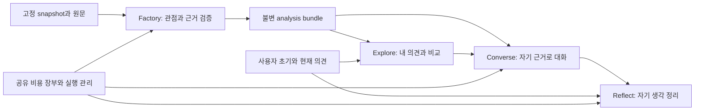

# MVP 상세 설계

설계 버전: `commentscope-detailed-design-20261113-v69`. B1 구현 병합 기준: `b361afce`, 완료된 확대 실행 코드: `096cb98`.
연결: REQ-001~REQ-010, TASK-001~026, DEC-001~028.
상태: **구현 후보의 구체적 설계**. 문서 작성·PR 병합은 새 알고리즘의 품질/원가 채택이 아니다.
이전 S1/S2 host 계약은 opt-in 구현과 실패한 실제 진단을 보존한다. 새 B1의 채택 근거가 아니다.
설계 검토 관측을 전체 core 유형·지지·사실 승인으로 사용하지 않는다.

**현재 구현 계약:** [1출처 관점과 토론 논거 확장](SEEDED_PERSPECTIVE_DEBATE.md). 사용자 승인 DEC-028/TASK-026이며 legacy3출처와 새제품1출처·AI추론/외부문헌 경계를 구별한다.

**최신 이력/실제 배정 감사:** [과거 시행착오와 Jev 비용/품질](PIPELINE_HISTORY_AND_JEV_AUDIT.md), [현재 실행 Mermaid](diagrams/factory-history-audit-current-20261113.mmd). 기존 PR76 범위와 B1 전역 complete/B2 유보·TASK023 검색 유보를 구별했다. 신규호출0·구조변경미구현이며 정확도/원가 채택은 아니다.

**현재 진입점:** [실제999 이후 설계 검토](MVP_DESIGN_REVIEW.md) → [원문 증거 계약](SOURCE_EVIDENCE_GRAPH.md)
→ [구현·검증·비용 작업표](MVP_REDESIGN_PLAN.md). DEC-013/014는 제안. [B1 첫 구현](SOURCE_EVIDENCE_IMPLEMENTATION.md)의 무료회귀 후 TASK-022의 [실제 원문 비교](SOURCE_EVIDENCE_TRIAL.md)는 예산 보호로 중단됐다([결과](SOURCE_EVIDENCE_TRIAL_RESULT.md)).
기존 F1~F5/P/X를 유지하며 B1 표현 계약만 opt-in 비교한다. DEC-015는 세 arm 합산5달러/7시간의 제한 profiling이며 구조·모델의 의미품질 채택은 아니다. 구현/합성 검사/실제 품질을 구별한다.

현재 [CNBC 첫 기능 실행 결과](FIRST_FUNCTIONAL_VIDEO_RESULT.md)는 고정96개/501요청·2.151337702달러에서 Agent0개/질문0턴으로 실패했다.32후보 중15미평가,19source→8graph complete→4candidate record complete의 손실과 후보별 veto의 source 전파를 구별했다. source8f07ab0의 Factory910·양OS2713은 코드 검사이며 의미 품질 합격이 아니다. 새 유료 작업 없이 저장 응답으로 배분·오류 격리 계약을 먼저 검토한다.

현재 TASK-022의 무료 후속은 [발화 역할별 필드 적용](SOURCE_ROLE_APPLICABILITY.md)과
[실행별 정산 영수증 결합](EXECUTION_RECEIPT_BINDING.md)이다.
원 C14개 저장 그래프의 별도 재검증은 완료7→8, 새1개는 후보 관측 대기이며
Agent는 PR97의 무료 재변환과 같은1개/유효 지지4개다. 이후 [고정3질문](FIXED_PROFILE_RUNTIME_CHECK.md)의 실제 입장/이유 응답·없는 수치 보류를 확인했으며 최소2Agent/r5는 미완료다.
[검색 확대 준비](SOURCE_SEARCH_EXPANSION.md)는 같은6후보/999풀에서 신규104쌍/69출처를
원 임베딩으로 계산했다. 실제 호출·새 지지 판정은 없다.

과거 v1 비교 중단·v3/v4 실패·v5 B/C 생성 비교와 비용은
[원 결과/무료 재검사](SOURCE_FIDELITY_RESULT.md)와 추적표에서 보존한다.
주석 exact equality→대조 감사, 일반/필요 조건 분리, quote 주소 결합의 설계 근거도 해당 결과에 연결한다.
현재 팀 누적150달러와 과거 차감은 유지하며 종료된 실행 plan·기한을 다시 사용하지 않는다.

새 protocol만 명시적으로 고르며 기본 legacy는 유지한다. 실제 품질·원가 채택은 미검증이다.
[이전 Factory 구조안](FACTORY_STRUCTURE.md)은 당시 현재/제안을 구별한 이력이다. 최신999 사용모델·결과를 그 당시 도식으로 대체하지 않는다.

**완료된 실험 설계:** 사용자 입력 풀 확대 지시에 따른 [등록999 전체 검증](WIDE_MINING_EXPERIMENT.md).
실행은1 Agent/이유 부족으로 완료됐다. 이후 v1 F4 비교도 별도 owner·원 지출 계승 아래 예산 중단됐다.
이전 누적150달러 실행은 완료됐으며, 고정3질문의 새 runtime 실행은 완료됐고 현재 활성 유료 작업은 없다. 이전 owner·원 기한은 보존한다.
이전 MINING_EXPERIMENT의 합성12/실제24 범위는 종료된 소규모 계획이다. snapshot3000 상한을
실제 입력3000개로 오해하지 않는다. 새 실행기는999개 전체 입력과 형식적 gate 불승격을 검사한다.

사용자 승인한 선정 영상 사전 분석·관점 발굴 우선 운영, 현재 embedding/군집화와 root/reply 처리,
새 선택 검증/2천~3천 규모의 구현 경계는 [발굴 중심 MVP](PREPARED_VIDEO_MINING.md)를 따른다.
운영 방향과 새 알고리즘의 실제 채택/품질 증거를 구별한다.
현재 확대 범위·추가상한15.00/7시간·누적 장부 계승은 [전체 댓글 풀 계획](WIDE_MINING_EXPERIMENT.md)을 따른다.
진행 단계·확정 비용·자원 중단은 [중간 결과](WIDE_MINING_EXPERIMENT_RESULT.md)에 기록한다.
종료된 공급자 오류를 원 예약 전액 정산·재호출 없는 항목 보류로 이어가는
[복구 계약](TRANSPORT_RECOVERY.md)은 원 실행 코드와 구별한 별도 launcher/manifest로 검증한다.
이전 추가3.00/각배정1.50 범위의 동일 설정 합성 fresh2회와 실제24 development는
[종료된 계획](MINING_EXPERIMENT.md)과 [당시 결과](MINING_EXPERIMENT_RESULT.md)로 보존한다.
실행 완주와 정식 품질 합격은 다르다.
실제24/상세12의 표본·검색상한은 생성 품질의 인과 해석을 제한한다. 무료 상한 대조와
미검사 nominee의 정정도 같은 결과 문서에 기록했다. 더 넓은 입력의 실제 생성 성공은 아직 미검증이다.

## 1. 무엇을 결정하는가

[제품 명세](../MVP_SPEC.md)는 만들 제품과 기존 합격 조건을 정의한다.
이 설계는 모듈별 책임, 데이터, 알고리즘, 호출, 상태, API, 실패·복구와 구현 순서를 정의한다.
작업 상태는 [추적표](../mvp-traceability.json) 한 곳에서 관리한다.

| 구현 질문 | 읽을 문서 | 산출물 |
| --- | --- | --- |
| 관점 수를 모르는 상태에서 어떤 구조로 만들까? | [Factory 구조 정본](FACTORY_STRUCTURE.md) | 현재/추천 도식, 책임·입출력·모델·미대응·원가·이전순서 |
| 현재 무엇이 반복되고 무엇을 재사용하나? | [현행 기준선](BASELINE.md) | 코드/호출/비용/실패와 교체 표 |
| 어떤 판단에 어떤 모델을 쓰며 실패하면 어떻게 하나? | [Decision 계층](DECISION_LAYERS.md) | 12개 논리 책임, 5개 논거 과제, 역할별 배정·transport·확률·오류·비용·채택 |
| Jev로 raw membership을 판정하려면? | [Jev membership](JEV_MEMBERSHIP.md) | M1 opt-in·전체 질문/근거·Sol M2 유지·고정 component 비용/정확도 |
| Jev 전제 관측을 기존 audit와 어떻게 결합하고 검증하나? | [audit 연결](JEV_AUDIT_INTEGRATION.md) | 기존 검증 보존·blind graph·새 scoped 예산·전이→G1→G2/G3 |
| 로컬 모델 없이 Sol로 검증하려면? | [외부 검증 실행](REMOTE_VERIFICATION.md) | 생성/검증 역할 배정·외부 임베딩·기존 장부·새 사실 평가 |
| 세부/일반 후보의 검색 누락을 어떻게 줄이나? | [상하위 검색](HIERARCHY_RETRIEVAL.md) | 실제 직접 지지 후보의 부모를 검색에만 추가 |
| 갱신999와 전체 실행은 어떻게 구분하나? | [자료 갱신/전체 실행](COHORT_COMPLETION.md) | 원r5 유지·새자료 revision·G4 권한/예산 경계 |
| 댓글에서 어떤 데이터와 절차로 Agent를 만드나? | [Factory 설계](FACTORY.md) | F-01~06, 데이터 계약, 모델 요청과 host 검사 |
| 비교·1:1·그룹·성찰은 어떻게 동작하나? | [상호작용 설계](INTERACTIONS.md) | I-01~07, API, 상태·저장·동시성·화면 연결 |
| 비용·캐시·평가·마이그레이션은 어떻게 통제하나? | [실행·검증 설계](EXECUTION.md) | X-01~06, 합성 사례, 비용식, 채택/폐기·배포 순서 |

TASK-004의 고정 S1/S2 입력·통제군·공유 cycle 비용·중단조건은 [소규모 진단 계약](SOURCE_DIAGNOSTIC.md)을 따른다.

Compact 후 전체 실험 이력을 읽는 대신 해당 TASK의 `design_refs`와 이 표의 담당 절을 읽는다.
공개 명세는 비공개 댓글·키·사용자 대화·장부를 담지 않는다. 설계 예시는 모두 합성이다.

## 2. 변경하지 않는 제품 흐름

Before Use → Explore → Converse → Reflect. 시청자의 의견 변화는 성공 조건이 아니다.
관점 수는 자료에 따라 달라지고 서로 반대할 필요가 없다. 그룹은 Converse의 대안 경로다.
기존 자동 결과의 제품 기능 연결은 개발 범위로 구현했다. Figma 프론트/API 연결과 제한된 실제 모델 E2E를 구현했다. Factory 정식G1~G4와 사용자 검증은 별도다.

모든 생성·분석 호출은 같은 실행 관리 경계를 지난다. 사용자 의견/대화는 공개 댓글의 지지 수에 들어가지 않는다.
영상 전체 분석은 질문마다 반복하지 않는다. analysis revision은 대화 도중 교체하지 않는다.

## 3. 구현 형태와 의존성

- Python 3.12+ 단일 애플리케이션과 기존 provider/Factory/Agent 모듈을 유지한다.
- Factory는 명시적 계획으로 실행하는 준비 작업이다. HTTP 요청에서 전체 Factory를 동기 실행하지 않는다.
- 기본/legacy MiniLM·NLI 경로는 보존한다. 현재 선택한 all-HTTP 경로는 외부 embedding·Sol 검증을 사용하며 로컬 모델 가중치를 로드하지 않는다.
- MVP 실행 worker는 한 개다. 전역 공유 장부의 직렬 예약 규칙을 유지하며 다중 worker/분산 큐를 도입하지 않는다.
- 분석 artifact는 불변 파일로, 새 상호작용 상태는 SQLite 저장소로 관리한다. 지출 장부와 앱 저장소는 별개다.
- 기존 `/api/session` 등은 그대로 유지한다. 새 `/api/v1/...`와 버전 있는 adapter를 추가할 후보 설계다.
- 팀 프론트·Figma를 재작성하지 않는다. 기존 화면의 상태/행동을 새 계약에 연결한다.

입력은 등록된 연구 snapshot/analysis다. 임의 URL의 무제한 댓글 수집·자동 공개 서비스는 이번 상세 설계로
추가 승인하지 않는다. 영상 선택 화면은 등록 자료를 찾고, 없으면 준비되지 않은 상태를 보여준다.

## 4. 결정별 선택과 검증 상태

아래 선택은 구현할 후보를 구체화한 것이다. 추적표의 DEC 상태는 `proposed`이며 실측 합격은 별도다.

| 결정 | 이번 설계의 선택 | 채택 전 필요한 증거 |
| --- | --- | --- |
| DEC-001 판정 중복 | 원문 해석/검토, 후보 설명, 관계 판정/검토, 논거 연결/검토로 요청 계약을 통합. 기존 개별 검사를 대체하는 adapter로 구현 | 정상·부정 회귀, 동일 작업의 실제 비용 비교, fresh G1~G4 |
| DEC-002 그룹 | host Controller의 제한된 opening/reply round, 발화자·응답 대상·자기 근거 분리, 턴 경계에서 pause | 상태·중복·부분 실패 검사, 실제 상호 응답의 원문 검토 |
| DEC-003 성찰 | 사용자 원문과 AI 제안·채택본 분리, 네 범주와 정확한 대화 ID 연결 | 변화 없음·빈 범주·허위 인과·없는 대화 검사 |
| DEC-004 온라인 감사 | 초기 구현은 기존/강화한 host 계약 검사와 검증 bundle을 사용. 별도 LLM 수정 루프는 기본 비활성 | 남는 의미 오류가 실제로 줄고 추가 비용/지연을 감당하는 비교가 있을 때만 별도 채택 |
| DEC-005 비용·재사용 | 호출 수가 아닌 총 실청구로 비교. 불변 분석 버전의 재열람만 재사용, 영향 범위 불명인 증분은 전체 재검증 계획으로 승격 | 최초/재열람/증분/질문/그룹/성찰 각각의 비용·품질 측정 |
| DEC-006 언어 | 기존 Figma의 영문 UI를 기본으로 유지. 한국어·영어 입력 원문 보존, 답변은 자기 원문 주장 표시. 생성 번역은 별도 검증 전 비활성 | 한국어·영어의 조건/귀속/수량/시점 부정 사례 및 팀 화면 확인. 한국어 UI 안내는 정적 번역의 팀 검토로 추가 |

DEC-007의 [Decision 계층](DECISION_LAYERS.md)은 현재 단일 deployment와 후보 role map을 구별한다.
최초 J4 논거 component의 비교 계약과 기록은 보존한다. 현재 shared 실행은 Sol이며,
새 raw membership Jev 배정/소수 가설 발견의 추천 순서는 DEC-009와 [구조 정본](FACTORY_STRUCTURE.md)을 따른다.
모든 새 배정은 무료 adapter 회귀·고정 정상/부정·제한 비교·fresh gate로 구현/채택 범위를 구분한다.

특정 외부 모델을 영구 선택하지 않는다. `factory_extract / factory_review / interaction` 역할별 deployment를
계획에 고정하며, 기본 비교에서는 같은 모델을 써서 구조 효과부터 구별한다. 더 저렴한 모델의 배정은 별도 비교다.
이 세 이름은 상위 역할이다. 구체적인 decision·허용 입력·모델 후보와 현재 미구현인 route 계약은
[Decision 계층](DECISION_LAYERS.md)을 따른다. 모델명만 바꿔 범용 호출기로 보내지 않는다.

## 5. 인터페이스와 책임

| 경계 | 구현할 인터페이스(제안) | 책임 |
| --- | --- | --- |
| FactoryRunner | `prepare(snapshot, deployment_map, limits) -> Plan`; `execute(plan) -> RunResult` | 입력/계획/비용 고정과 stage dispatch |
| SourceInterpreter | `propose(source) -> SourceRecord`; `review(source, proposal) -> SourceReview` | 원문 해석 제안과 독립 요청의 대조 |
| RelationAssessor | `judge(source, target) -> Relation`; `verify_positive(...) -> Review` | 최종 문구에 대한 실제 원문 지지 |
| AgentCompiler | `compile(map, arguments, facts) -> Bundle` | 현재 `grounded_inputs`로 연결할 버전 adapter |
| AnalysisRepository | `get(id, revision)`; `publish(validated_artifact)` | 불변 bundle·기한·hash 검증 |
| JobExecutor | `submit(operation, request_id, body)`; `recover(job_id)` | 중복·영수증·비용·저장/게시 순서 |
| ConversationController | `open / next / pause / resume / ask / close` | 발화 순서와 bounded 실행, 의미 생성은 Agent에 위임 |
| ReflectionService | `analyze(opinion_revisions, message_ids)`; `save(user_draft)` | 비교 제안과 사용자의 채택 분리 |

이 이름은 계획된 인터페이스다. 빈 서비스를 미리 만들거나 이름만 바꿔 현재 코드가 교체됐다고 보고하지 않는다.

## 6. 기본값과 확정 조건

수치는 사용자 품질 기준이 아닌 초기 공학 기본값이다. 변경은 DEC·계획 버전과 함께 기록한다.

| 항목 | 후보 기본값 | 의미 |
| --- | --- | --- |
| source당 제안 | 최대 16, 초과는 partial/보류 | 원문·조건을 자르거나 평가 분모에서 제외하지 않음 |
| 최초 후보 검색 | 기존 top3+모든 nomination, 필요 시 추가3 | 미검색은 반대가 아닌 미평가 |
| 의미 task의 물리 묶음 | 기본 1; 같은 source 내부 계약만 통합 | 과거 batch4를 비용 개선으로 자동 채택하지 않음 |
| 그룹 참여자 | 2~3, 화면에서 선택 | 전체 Agent 수나 Factory 최소 수를 제한하지 않음 |
| 자동 그룹 턴 | opening 1회+reply 1회, 참여자당 각1발화 | 무한 자율 토론 금지, 이후 사용자 입력 대기 |
| 그룹 세션 상한 | Agent 발화 18개와 별도 금액 한도 중 먼저 도달 | 변경은 room plan에 고정, 재접속으로 초기화 불가 |
| 질문당 게시 항목 | 기존 최대 3개+필수 전제 closure | 필수 조건/전제는 출력 길이 때문에 삭제하지 않음 |
| 입력 길이 | 초기 의견 500, 현재 의견 제안 2,000, 질문 1,000 Unicode code points | 초과는 입력 오류로 반환, 조용히 절단하지 않음 |
| 모델 재시도 | 0 | 전송/형식/길이 실패와 과금 불확실을 보존 |

초기 서비스 원가 $0.50/1,000댓글·$0.02/두 관점 질문은 이전 제안값이다. 새 공식 합격 기준으로 고정하지 않는다.
같은 예산으로 품질 게이트를 완료할 수 있는지와 서비스 단가 검증은 [X-01](EXECUTION.md#x-01-비용-모델)에서 분리한다.

## 7. 구현 순서

TASK-016은 decision 상세 설계·참조 확인 범위로 완료했다. 첫 Jev 진단용 adapter/관측 비교는 TASK-005의 부분 구현으로 확인했으며 전체 라우터/Factory 연결이나 모델 채택은 미완료다.
TASK-005의 첫 Jev-only2관측/4선언 통제는 기대와 일치했다. 다음은 기존 audit 연결의 오프라인 검증과 미사용 전이·고정 paired 비교이며 fresh G1 성공을 승계하지 않는다.

TASK-001/002/003은 기준선·상세 설계·첫 source adapter의 완료 이력이다.
TASK-004/013/014의 새 의미 역할 진단/채택은 보류한다. 초기 adapter를 원가 개선으로 채택하지 않았다.
TASK-015/008/009/010은 기존 자동 생성 결과로 제품 API/개발 화면을 연결한 범위다.
현재 TASK-020/021의 무료 평가자료·B1 opt-in 구현/회귀 후 TASK-022의 제한 profiling은 예산 중단됐다. 후속 무료 수정과 남은 전체 비교·전이를 구별한다. TASK-017/018의 실제 이력과 미완료 품질은
deferred로 보존한다. TASK-021~024와 기존 TASK-005~007/012 연결은 새 작업표와 추적표를 따른다.
자세한 입력·정상/부정·동일cycle 실행 계약은 [Factory 실제 실행](FACTORY_DELIVERY.md)을 따른다.
TASK-011은 기존 제품 개발 화면/API 연결 범위에서 완료됐으며 조원 프론트 전체 완성이나 실제 사용자 검증을 뜻하지 않는다.
TASK-012의 전체 과업/원가/사용자 효과는 별도 검증이며 개발 화면이나 CI로 완료 처리하지 않는다.

제품 API와 현재 확인 범위: [실행/API](../PRODUCT_API.md), [구현 결과](../PRODUCT_DELIVERY_RESULT.md),
[기존 개발 연결의 기록](PRODUCT_DELIVERY.md).

TASK-017의 [실제24개 개발 실행](ACTUAL24_DEVELOPMENT.md)은 사용자rr로 승인됐다. 별도artifact·상한1.50·원8/총50 장부를 사용하며 정식admission을 만들지 않는다.

TASK-005 [후보별 원문 완전성](CANDIDATE_SOURCE_COVERAGE.md)은 bound typed 관측을 host에서 다시 결합하는 opt-in 수정이다. 새 모델 역할이나 기존 raw 지지 오류의 승인으로 사용하지 않는다.

사용자 ㄱㄱㄱ에 따른 [공통입장 계약 연결](SHARED_DISCOVERY_DELIVERY.md)은 기존 공통제안 구현과 방향성소유권/typed감사를 연결한다. 합성검사 후 새 실제24개 개발 실행은 합계1.50 상한이며 정식r5 합격은 별도다.

- TASK-017 / REQ-008·009: [개발 제품 시험의 동일 trial 예산](PRODUCT_TRIAL_BUDGET.md). 실제96 결과와 분리한 실행 준비이며 제품 완료 증거가 아니다.

- 현재책임계층의정본: [구조v1와Mermaid](ARCHITECTURE_BASELINE.md), [전체단계비용계획](FACTORY_COST_PLAN.md). DEC-008은역할/입출력고정이며모델/의미품질/단가채택은별도다.

원문별 전송 최적화 계약과 채택 조건은 [membership batch](SOURCE_MEMBERSHIP_BATCH.md)를 따른다. 구조v1의 책임은 유지한다.

Sol chat/Jev의 논거 전송 용량 책임과 무료 회귀 결과는 [전송 용량 분리](CHAT_DEPENDENCY_CAPACITY.md)를 따른다.

현재 TASK-022의 [제한된 실제 F4 비교](SOURCE_EVIDENCE_TRIAL.md)는 사용자 구현/테스트 지시에 따라 별도 신규5달러/7시간으로 등록한다. 과거plan기한을 연장하지 않고 전체48/전이/999와 구별한다.

후속 무료 구현: [공유 한정어의 원문 인용 변환](SCOPED_SOURCE_QUOTES.md)은 DEC-021의 후보 계약이다. C 원결과Agent0과 별도 replay를 구별한다.

후속 무료 계약: [발화 역할별 적용 의무](SOURCE_ROLE_APPLICABILITY.md), [실행별 정산 영수증 결합](EXECUTION_RECEIPT_BINDING.md). 원 C/B 결과와 종료된 유료 기한을 유지하며 전체 저장 응답의 재검사는 fresh 품질 합격이 아니다.

동일6후보의 [출처 검색 확대 준비](SOURCE_SEARCH_EXPANSION.md)는 원 임베딩을 재현한 무료 계획이며 새 모델 지지 판정이나 유료 실행은 아니다. 신규104쌍/69출처와 원1536시도쌍 제외를 별도 실행 계약에 연결한다.

[고정1Agent의 실제3질문 검증](FIXED_PROFILE_RUNTIME_CHECK.md)은 저장응답replay와구별한별도runtime실행이다. 원C기한을바꾸지않고현재계속지시의한정된시간권한/같은누적금융장부를결합한다.

현재 신규 구현: [고정104쌍 출처 검색 확대 실행](SOURCE_SEARCH_EXECUTION.md). 정확한원관측재사용과새평가를분리하고같은누적150을유지한다. 기존단일Agent/실제3질문과전체2Agent/r5목표를구별한다.

[104신규관계 확대 결과](SOURCE_SEARCH_EXPANSION_RESULT.md): 실제276회/0.917447514USD, compiler2개(5/4지지), 둘 다 찬성·3출처 중복·이유1보류. 실질2관점/전체r5/MVP 완료와 구별한다.

[영상 성격별 후보와 QA 계획](VIDEO_SELECTION_QA.md)은 공식API/실제댓글 예비검토로 기능·조건·문맥·사실·편향·규모/초행사용 사례를 나눈다. Agent 준비/QA 실행/기존999/r5 완료를 뜻하지 않는다.

[CNBC 첫 기능 영상 실행](FIRST_FUNCTIONAL_VIDEO_TRIAL.md)은96처리/24확인·192검색쌍/48출처·동일누적150/새3h·UKRI근거·기존3+기능4질문을고정한다. 원999/r5/MVP완료와구별한다.
