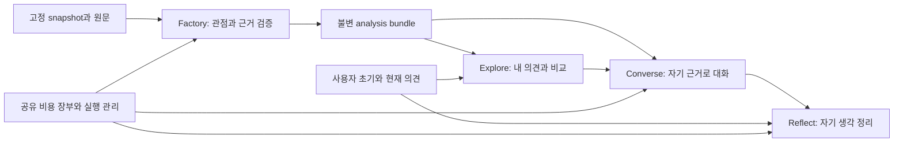

# MVP 상세 설계

설계 버전: `commentscope-detailed-design-20261109-v17`. 대조 코드: `fff2260`.
연결: REQ-001~REQ-010, TASK-001~016, DEC-001~007.
상태: **구현 후보의 구체적 설계**. 문서 작성·PR 병합은 새 알고리즘의 품질/원가 채택이 아니다.
첫 S1/S2 host 계약은 opt-in으로 구현하며 상태·검증 범위는 추적표로 확인한다.
이 단계의 검토 관측을 전체 core 유형·지지·사실 승인으로 사용하지 않는다.

## 1. 무엇을 결정하는가

[제품 명세](../MVP_SPEC.md)는 만들 제품과 기존 합격 조건을 정의한다.
이 설계는 모듈별 책임, 데이터, 알고리즘, 호출, 상태, API, 실패·복구와 구현 순서를 정의한다.
작업 상태는 [추적표](../mvp-traceability.json) 한 곳에서 관리한다.

| 구현 질문 | 읽을 문서 | 산출물 |
| --- | --- | --- |
| 현재 무엇이 반복되고 무엇을 재사용하나? | [현행 기준선](BASELINE.md) | 코드/호출/비용/실패와 교체 표 |
| 어떤 판단에 어떤 모델을 쓰며 실패하면 어떻게 하나? | [Decision 계층](DECISION_LAYERS.md) | 12개 논리 책임, 5개 논거 과제, 역할별 배정·transport·확률·오류·비용·채택 |
| Jev 전제 관측을 기존 audit와 어떻게 결합하고 검증하나? | [audit 연결](JEV_AUDIT_INTEGRATION.md) | 기존 검증 보존·blind graph·새 scoped 예산·전이→G1→G2/G3 |
| 로컬 모델 없이 Sol로 검증하려면? | [외부 검증 실행](REMOTE_VERIFICATION.md) | 생성/검증 역할 배정·외부 임베딩·기존 장부·새 사실 평가 |
| 댓글에서 어떤 데이터와 절차로 Agent를 만드나? | [Factory 설계](FACTORY.md) | F-01~06, 데이터 계약, 모델 요청과 host 검사 |
| 비교·1:1·그룹·성찰은 어떻게 동작하나? | [상호작용 설계](INTERACTIONS.md) | I-01~07, API, 상태·저장·동시성·화면 연결 |
| 비용·캐시·평가·마이그레이션은 어떻게 통제하나? | [실행·검증 설계](EXECUTION.md) | X-01~06, 합성 사례, 비용식, 채택/폐기·배포 순서 |

TASK-004의 고정 S1/S2 입력·통제군·공유 cycle 비용·중단조건은 [소규모 진단 계약](SOURCE_DIAGNOSTIC.md)을 따른다.

Compact 후 전체 실험 이력을 읽는 대신 해당 TASK의 `design_refs`와 이 표의 담당 절을 읽는다.
공개 명세는 비공개 댓글·키·사용자 대화·장부를 담지 않는다. 설계 예시는 모두 합성이다.

## 2. 변경하지 않는 제품 흐름

Before Use → Explore → Converse → Reflect. 시청자의 의견 변화는 성공 조건이 아니다.
관점 수는 자료에 따라 달라지고 서로 반대할 필요가 없다. 그룹은 Converse의 대안 경로다.
기존 자동 결과의 제품 기능 연결은 개발 범위로 구현했다. 현재는 cluster→Agent 실제 생성·품질·비용을 확인한 후 프론트를 구현한다.

모든 생성·분석 호출은 같은 실행 관리 경계를 지난다. 사용자 의견/대화는 공개 댓글의 지지 수에 들어가지 않는다.
영상 전체 분석은 질문마다 반복하지 않는다. analysis revision은 대화 도중 교체하지 않는다.

## 3. 구현 형태와 의존성

- Python 3.12+ 단일 애플리케이션과 기존 provider/Factory/Agent 모듈을 유지한다.
- Factory는 명시적 계획으로 실행하는 준비 작업이다. HTTP 요청에서 전체 Factory를 동기 실행하지 않는다.
- 기존 MiniLM 검색과 NLI 사실 검사 부품은 재사용한다. 로컬 생성 모델이나 새 대형 다운로드를 요구하지 않는다.
- MVP 실행 worker는 한 개다. 전역 공유 장부의 직렬 예약 규칙을 유지하며 다중 worker/분산 큐를 도입하지 않는다.
- 분석 artifact는 불변 파일로, 새 상호작용 상태는 SQLite 저장소로 관리한다. 지출 장부와 앱 저장소는 별개다.
- 기존 `/api/session` 등은 그대로 유지한다. 새 `/api/v1/...`와 버전 있는 adapter를 추가할 후보 설계다.
- 팀 프론트·Figma를 재작성하지 않는다. 기존 화면의 상태/행동을 새 계약에 연결한다.

입력은 등록된 연구 snapshot/analysis다. 임의 URL의 무제한 댓글 수집·자동 공개 서비스는 이번 상세 설계로
추가 승인하지 않는다. 영상 선택 화면은 등록 자료를 찾고, 없으면 준비되지 않은 상태를 보여준다.

## 4. 결정별 선택과 검증 상태

아래 선택은 구현할 후보를 구체화한 것이다. 추적표의 DEC 상태는 `proposed`이며 실측 합격은 별도다.

| 결정 | 이번 설계의 선택 | 채택 전 필요한 증거 |
| --- | --- | --- |
| DEC-001 판정 중복 | 원문 해석/검토, 후보 설명, 관계 판정/검토, 논거 연결/검토로 요청 계약을 통합. 기존 개별 검사를 대체하는 adapter로 구현 | 정상·부정 회귀, 동일 작업의 실제 비용 비교, fresh G1~G4 |
| DEC-002 그룹 | host Controller의 제한된 opening/reply round, 발화자·응답 대상·자기 근거 분리, 턴 경계에서 pause | 상태·중복·부분 실패 검사, 실제 상호 응답의 원문 검토 |
| DEC-003 성찰 | 사용자 원문과 AI 제안·채택본 분리, 네 범주와 정확한 대화 ID 연결 | 변화 없음·빈 범주·허위 인과·없는 대화 검사 |
| DEC-004 온라인 감사 | 초기 구현은 기존/강화한 host 계약 검사와 검증 bundle을 사용. 별도 LLM 수정 루프는 기본 비활성 | 남는 의미 오류가 실제로 줄고 추가 비용/지연을 감당하는 비교가 있을 때만 별도 채택 |
| DEC-005 비용·재사용 | 호출 수가 아닌 총 실청구로 비교. 불변 분석 버전의 재열람만 재사용, 영향 범위 불명인 증분은 전체 재검증 계획으로 승격 | 최초/재열람/증분/질문/그룹/성찰 각각의 비용·품질 측정 |
| DEC-006 언어 | 기존 Figma의 영문 UI를 기본으로 유지. 한국어·영어 입력 원문 보존, 답변은 자기 원문 주장 표시. 생성 번역은 별도 검증 전 비활성 | 한국어·영어의 조건/귀속/수량/시점 부정 사례 및 팀 화면 확인. 한국어 UI 안내는 정적 번역의 팀 검토로 추가 |

DEC-007의 [Decision 계층](DECISION_LAYERS.md)은 현재 단일 deployment와 후보 role map을 구별한다.
J4 논거 검토부터 비교하며 비용0 adapter 회귀·고정 정상/부정·미사용 전이·fresh gate를 거쳐 배정을 판단한다.

특정 외부 모델을 영구 선택하지 않는다. `factory_extract / factory_review / interaction` 역할별 deployment를
계획에 고정하며, 기본 비교에서는 같은 모델을 써서 구조 효과부터 구별한다. 더 저렴한 모델의 배정은 별도 비교다.
이 세 이름은 상위 역할이다. 구체적인 decision·허용 입력·모델 후보와 현재 미구현인 route 계약은
[Decision 계층](DECISION_LAYERS.md)을 따른다. 모델명만 바꿔 범용 호출기로 보내지 않는다.

## 5. 인터페이스와 책임

| 경계 | 구현할 인터페이스(제안) | 책임 |
| --- | --- | --- |
| FactoryRunner | `prepare(snapshot, deployment_map, limits) -> Plan`; `execute(plan) -> RunResult` | 입력/계획/비용 고정과 stage dispatch |
| SourceInterpreter | `propose(source) -> SourceRecord`; `review(source, proposal) -> SourceReview` | 원문 해석 제안과 독립 요청의 대조 |
| RelationAssessor | `judge(source, target) -> Relation`; `verify_positive(...) -> Review` | 최종 문구에 대한 실제 원문 지지 |
| AgentCompiler | `compile(map, arguments, facts) -> Bundle` | 현재 `grounded_inputs`로 연결할 버전 adapter |
| AnalysisRepository | `get(id, revision)`; `publish(validated_artifact)` | 불변 bundle·기한·hash 검증 |
| JobExecutor | `submit(operation, request_id, body)`; `recover(job_id)` | 중복·영수증·비용·저장/게시 순서 |
| ConversationController | `open / next / pause / resume / ask / close` | 발화 순서와 bounded 실행, 의미 생성은 Agent에 위임 |
| ReflectionService | `analyze(opinion_revisions, message_ids)`; `save(user_draft)` | 비교 제안과 사용자의 채택 분리 |

이 이름은 계획된 인터페이스다. 빈 서비스를 미리 만들거나 이름만 바꿔 현재 코드가 교체됐다고 보고하지 않는다.

## 6. 기본값과 확정 조건

수치는 사용자 품질 기준이 아닌 초기 공학 기본값이다. 변경은 DEC·계획 버전과 함께 기록한다.

| 항목 | 후보 기본값 | 의미 |
| --- | --- | --- |
| source당 제안 | 최대 16, 초과는 partial/보류 | 원문·조건을 자르거나 평가 분모에서 제외하지 않음 |
| 최초 후보 검색 | 기존 top3+모든 nomination, 필요 시 추가3 | 미검색은 반대가 아닌 미평가 |
| 의미 task의 물리 묶음 | 기본 1; 같은 source 내부 계약만 통합 | 과거 batch4를 비용 개선으로 자동 채택하지 않음 |
| 그룹 참여자 | 2~3, 화면에서 선택 | 전체 Agent 수나 Factory 최소 수를 제한하지 않음 |
| 자동 그룹 턴 | opening 1회+reply 1회, 참여자당 각1발화 | 무한 자율 토론 금지, 이후 사용자 입력 대기 |
| 그룹 세션 상한 | Agent 발화 18개와 별도 금액 한도 중 먼저 도달 | 변경은 room plan에 고정, 재접속으로 초기화 불가 |
| 질문당 게시 항목 | 기존 최대 3개+필수 전제 closure | 필수 조건/전제는 출력 길이 때문에 삭제하지 않음 |
| 입력 길이 | 초기 의견 500, 현재 의견 제안 2,000, 질문 1,000 Unicode code points | 초과는 입력 오류로 반환, 조용히 절단하지 않음 |
| 모델 재시도 | 0 | 전송/형식/길이 실패와 과금 불확실을 보존 |

초기 서비스 원가 $0.50/1,000댓글·$0.02/두 관점 질문은 이전 제안값이다. 새 공식 합격 기준으로 고정하지 않는다.
같은 예산으로 품질 게이트를 완료할 수 있는지와 서비스 단가 검증은 [X-01](EXECUTION.md#x-01-비용-모델)에서 분리한다.

## 7. 구현 순서

TASK-016은 decision 상세 설계·참조 확인 범위로 완료했다. 첫 Jev 진단용 adapter/관측 비교는 TASK-005의 부분 구현으로 확인했으며 전체 라우터/Factory 연결이나 모델 채택은 미완료다.
TASK-005의 첫 Jev-only2관측/4선언 통제는 기대와 일치했다. 다음은 기존 audit 연결의 오프라인 검증과 미사용 전이·고정 paired 비교이며 fresh G1 성공을 승계하지 않는다.

TASK-001/002/003은 기준선·상세 설계·첫 source adapter의 완료 이력이다.
TASK-004/013/014의 새 의미 역할 진단/채택은 보류한다. 초기 adapter를 원가 개선으로 채택하지 않았다.
TASK-015/008/009/010은 기존 자동 생성 결과로 제품 API/개발 화면을 연결한 범위다.
현재는 TASK-005~007에서 **기존 기본 cluster→Agent 생성 경로의 실제 작동**을 먼저 확인한다.
자세한 입력·정상/부정·동일cycle 실행 계약은 [Factory 실제 실행](FACTORY_DELIVERY.md)을 따른다.
사용자가 별도 프론트는 아직 없다고 확인했다. 생성 경로 확인 후 TASK-011에서 Figma 기준 프론트를 구현한다.
TASK-012의 전체 과업/원가/사용자 효과는 별도 검증이며 개발 화면이나 CI로 완료 처리하지 않는다.

제품 API와 현재 확인 범위: [실행/API](../PRODUCT_API.md), [구현 결과](../PRODUCT_DELIVERY_RESULT.md),
[기존 개발 연결의 기록](PRODUCT_DELIVERY.md).
