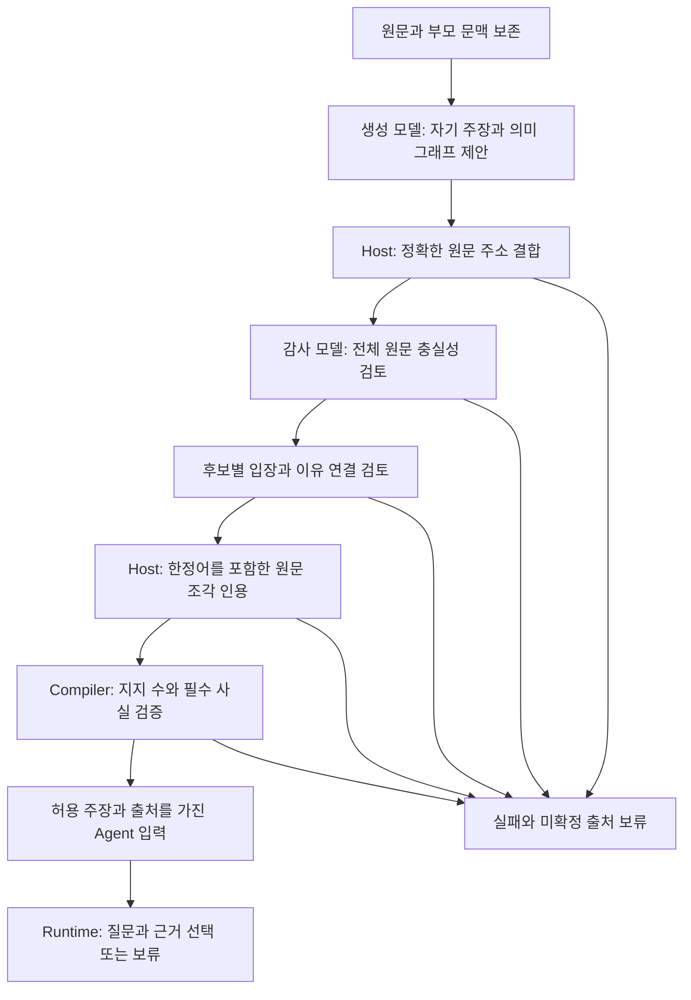

# 절 밖의 한정 표현을 보존하는 원문 인용

TASK-022 / REQ-001·003·010 / DEC-021. 후보 구현이며 의미 품질 채택은 아니다.

v5 C는 19개 출처 중 그래프 7개가 감사를 통과했고, 후보 연결 7개 중 4개가
완료됐다. 추가 2개는 모든 의미 검사를 통과했으나 마지막 변환에서 보류됐다.
한 문장의 여러 절이 공유하는 가능성·희망 표현이 해당 절의 own_spans 밖에
있으면 기존의 단일 연속 인용으로 전달하지 못하기 때문이다. 원 C 결과는 변경하지 않는다.

## 변환 계약

- 입력은 검증된 전체 그래프와 후보별 증서다. 원문·모델 응답·의미 판정을 수정하지 않는다.
- 하나의 연속 own_span을 가진 value/prediction에 한해, 그래프가 이미 연결한
  polarity/modality/quantifier/population/world/comparison/change/qualifier 원문 구간을 함께 표시한다.
- 같은 작성자의 구간만 원문 순서로 정렬한다. 겹치는 구간과 사이가 공백뿐인 구간은 합친다.
  생략된 원문이 있으면 ` […] `로 표시한다. 문장·대명사·접속사·한정어를 생성하거나 교정하지 않는다.
- 모든 조각의 원문 위치와 텍스트를 evidence에 보존하며 독립 surface 계약 버전과 입력 refs를 기록한다.
  인용은 원문의 조각이며 새로 작성한 완결 문장이나 검증된 사실이 아니다.
- 사실의 불연속 재구성, 불연속 own_spans, 600자 초과, 중첩 조건은 계속 보류한다.
  부모는 새 한정어·근거를 제공하지 않는다. 의미 감사/후보 의무의 fail·unknown을 해제하지 않는다.
- 기존 필수 사실·출처별 근거·최소 지지3·최소 Agent2와 r5 기준은 유지한다.

## 검증과 재사용

이 그림은 선택된 F4 경로다. 앞단의 발견/병합/지지 판정을 대체하지 않으며,
생성 배정은 원 B의 GPT5.2 또는 원 C의 Sol, 의미 감사는 Sol이다. Jev 채택을 뜻하지 않는다.

합성 검사로 공유 희망/예측/부정 표현, 겹침·공백·Unicode 위치, 부모 유입 금지,
사실·길이·중첩·불연속 보류, 변조 거부와 Compiler 전달을 확인한다.
이후 종료된 C의 전체 7개 기록을 별도 artifact에 다시 변환하고 동일 core 검사를
재결합한다. 원래의 graph/candidate 모델 응답을 재사용하는 오프라인 replay이며 fresh gate가 아니다.
다른 arm의 성공 출처를 섞거나 실패 출처만 재생성하지 않는다. 새 사실/질문 호출이
필요하면 별도 고정 요청·기존 money owner/기한/누적 장부를 먼저 결합한다.

정상 인용이 게시되어도 새로운 Agent2개, 전체999·3000개, 서비스 단가 또는 MVP 완성을 뜻하지 않는다.

## 현재 검증 결과

관련 합성 검사와 실제 C의7개 전체 저장 기록 replay에서 완료 출처4→6, Agent0→1(유효 지지4개/허용 항목7개)을 확인했다. 새 모델 호출0/청구0이며 의미 실패1개는 보류를 유지한다. 새 runtime·독립 gold·최소2 Agent·전체 r5 합격은 아니다. 최종 CI/검사 수는 PR97 결과에 연결한다.
