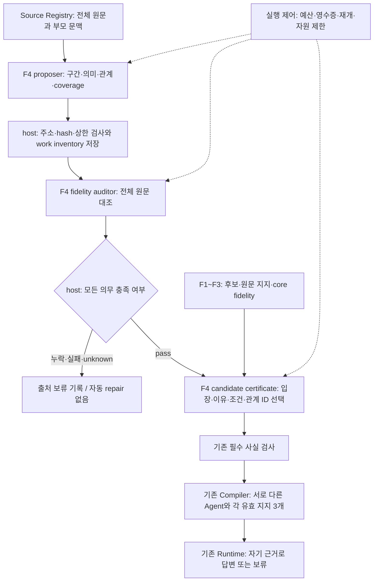

# F4 v3 원문 대조 감사와 희소 관계 검증

TASK-025 / DEC-013·016 / REQ-001·002·003·008·010.
코드 계약: `source-evidence-graph-20261112-v3`. `source_evidence_protocol`에 이 값을 명시한 경로만 선택한다.
사용자2026-11-12 동의에 따른 **opt-in 구현/무료 검증 계약**이다. 실제 모델 품질 채택이나 유료 실행 권한이 아니다.
v1의 Agent0개·v2의 무료 수정·기존 비교 예산 중단은 [이전 결과](SOURCE_EVIDENCE_TRIAL_RESULT.md)에 보존한다.

## 책임과 호출 순서

F1~F3/Compiler/Runtime/실행 제어는 유지한다. `source_evidence_protocol`으로 고른 v3 F4만 변경한다.

1. proposer: 전체 원문/부모 문맥 → 원문 구간·의미·희소 관계·coverage 제안. 후보/기존 지지 판정은 보지 않는다.
2. fidelity auditor: 전체 원문 + 제안 전체 → 단위별 의미 보존/누락,제안 관계별 충실성,coverage/전제 누락 판정.
3. candidate certificate: 전체 원문 + 승인 조건을 충족한 graph + 후보 문구 → 자기 입장·이유·조건·필수 사실 연결.
4. host/Compiler: 원문·주소·질문 전체성·의존 closure·필수 사실·최소 지지·게시 경계 검사.

기존 source observer 호출을 대조 감사로 교체한다. 별도 adjudicator/repair 호출을 추가하지 않는다.
auditor는 제안된 type/scope/edge를 보므로 blind 재추출이라고 부르지 않는다. 별도 요청/모델이
오류 독립성을 보장하지 않으며,제안에 동조하는 위험은 고정 반대 사례/전이로 측정해야 한다.

## 바꾸는 승인 계약

원문 구간/인용은 여전히 정확한 Unicode 주소·hash로 검사한다.
서로 다른 주석의 구간 목록/enum을 같게 요구하지 않고,실제 제안이 원문 의미를 보존했는지를 감사한다.
`unit_observations`는 모든 unit ID에 정확히 하나씩 다음 필수 verdict를 갖는다.

`boundary_fidelity, typing_fidelity, ownership_fidelity, modality_world_fidelity, scope_fidelity,
qualifiers_complete, reasons_complete, conditions_complete, premises_complete, concessions_complete`.

모든 verdict는 pass/fail/unknown/unassessed이며 pass만 승인 조건을 충족한다.
typing은 fact/value/prediction·speech act·assertion mode를,modality/world는 확신 강도와 세계를,
scope는 주체/지칭/부정/수량/집단/시간/비교/변화·상태를 원문과 대조한다.
부모의 입장/이유 차용·조건 삭제·희망을 실제 사실로 변경·반문을 noise로 숨김을 허용하지 않는다.
단위별 missing-premise 질문은 fact0개·edge0개에서도 필수다.

`edge_observations`는 제안된 모든 edge ID에 정확히 하나의 `fidelity` verdict를 갖는다.
각 unit의 이유/조건/전제/양보 누락 검사와 source 전체 dependency coverage를 별도로 요구한다.
누락 unit/edge는 source를 보류한다. 감사자가 제안한 누락 내용을 host가 자동 추가/수정하지 않는다.
`missing_edges`는 기존 unit endpoint·relation·cue_refs·interpretation만 기록하며 새 edge ID를 발급하지 않는다.
unknown·미해결 Issue·순환·mixed·미해석 단위를 제거해 source를 구제하지 않는다(B2 제외).

## 의미 축과 주소

v3의 `epistemic`은 categorical/possible/probable/not_applicable/unknown의 강도 축이다.
`world`는 actual/hypothetical/desired/unspecified/unknown으로 분리한다.
규범적 희망은 desired 세계와 categorical 강도를 함께 가질 수 있다. 이 조합을 경험적 사실로 승격하지 않는다.
fact/prediction의 세계가 unspecified/unknown이면 보류하며,비실제 세계의 asserted fact는 기존 runtime에 게시하지 않는다.
conditional antecedent는 만족된 사실이 아니라 기존 scope annotation이다.
nonpropositional context는 non_assertive mode를 쓸 수 있지만 자기 assertion의 타입을 not_applicable로 회피하지 못한다.

unit U1..U32,edge E1..E64와 원 source ID를 닫힌 주소로 제공한다.
candidate certificate는 기존 dependency edge ID를 선택하고 host가 원 edge를 복원한다.
이미 bound된 관계의 cue 구간을 다시 생성해 정확 일치하는지 비교하지 않는다.
선택 누락·잘못된 ID·개인 사실을 core의 공통 전제로 승격하는 경우는 계속 보류한다.

## 검증량과 비용

source당 단위 U≤32,관계 E≤64,coverage K≤64와 후보8개 단위 batch 상한을 유지한다.
감사 verdict 수는 `10*U + E + K + 3`이며 모든 U² 단위 쌍을 만들지 않는다.
모델이 누락 관계를 찾아야 하므로 정확도/실제 계산시간의 선형성을 보장하는 식이 아니다.
고정 work inventory를 API 이전에 산출하고,wire bytes/output/reasoning/실측 profile을 별도로 검사한다.
단위 수는 proposal 전에는 미정이다. bound proposal 직후 `source-evidence-workloads/<source_id>`를
저장한 뒤 auditor를 호출한다. proposal 자체의 wire/예산 검사는 기존 실행 제어가 담당한다.
새 protocol의 profile이 없으면 비용은 null이며 v1/v2의 단가를 새 protocol 실측으로 승계하지 않는다.
기존 shared5달러 계획은 닫힌 상태다. 이번 구현/검증의 신규 유료 호출은0이다.

## 먼저 통과할 통제

- 원문 해석 정보가 그대로여도 대조 감사에 반대/누락/unknown이 있으면 게시 차단.
- normative desired/categorical 조합과 동등한 scope 표현을 허용하는 계약; desired empirical claim→실제 fact는 차단.
- 부정·수량·대상집단·시점·변화/상태·조건·인용/부모 귀속 왜곡을 각각 fail로 관측하면 차단.
- 제안 edge0/fact0에서도 누락된 필수 전제/관계 보류; 미관측/중복 ID/누락 질문은 invalid.
- candidate가 선택한 edge ID를 정확 복원하고 필수 closure/이유 누락·잘못된 core fact/world는 차단.
- 단위가 늘어도 필수 감사 질문이 U²로 늘지 않는 inventory,새 protocol/비용 profile 및 old receipt 거절.
- 합성 전체 파이프라인2 Agent/각3지지/자기 이유와 기존 부정 통제,legacy 기본값 불변.

이 검사는 host와 scripted model 응답의 계약 검사다. 실제 auditor가 왜곡을 찾거나 원문 이유를 보존한다는
증거는 아니다. Task022의 새 비용/자료/프로토콜 동결·개발48/전이·기존 r5 검증이 후속으로 필요하다.

## 구현과 확인 범위

`source_evidence_graph.py`는 v3 원문 대조 요청·closed 주소·의무 전체성·world/strength·work inventory를,
`source_evidence_requests.py`는 기존 edge ID 선택/복원을, `source_evidence_adapter.py`는 기존 Compiler 연결과
비실제 asserted fact 게시 보류를 구현한다. 기존 불연속/외부 qualifier/중첩 조건 표현 불가 보류는 유지한다.
인용·남의 가정처럼 문맥으로만 보존한 비실제 fact는 실제 사실로 게시하지 않으며,
world 값만을 이유로 전체 source를 불필요하게 보류하지 않는다. 필요한 사실 전제로 쓰면 계속 보류한다.
`cost_planning.py`와 `plan_factory_cost.py`는 graph stage의 frozen plan/request/profile protocol을 결합한다.
태그 없는 v1/v2 비용 기록은 옛 protocol로만 남고 v3 비용 추정에는 쓰지 못한다.

새 테스트8개를 먼저 실행했을 때 구형 schema 오류7개와 stale 비용 profile 재사용 실패1개를 재현했다.
구현 후 관련59개가 통과했고, profile 영수증/실행 inventory 통제를 추가한 관련52개도 통과했다.
첫 전체 Factory808개 통과 후 문맥 전용 가정을 과도하게 보류하는 정상 반례를 실패 재현하고 수정했다.
이후 명세 검사까지 포함한 관련80개가5.156초에 통과했다.
이는 scripted 응답을 주는 host 회귀다. 실제 auditor가 의미 왜곡을 탐지했다는 결과가 아니다.
최종 전체 Factory809개가278.773초에 통과했다. 양OS CI는 PR의 정확한 head에서 확인하며,
그 전까지 TASK-025는 진행 중으로 남긴다. 작업 추적표와 PR에 결과를 연결한다.

## 다음 실제 검증의 선행 조건

기존5달러 비교를 재개하거나 잔액을 새 실행 권한으로 사용하지 않는다. TASK-022는 미완료/보류 이력이다.
후속 유료 검증에는 새 protocol·prompt/schema·코드·원문/후보·가격·상한·중단 규칙을 먼저 동결해야 한다.
현재 v3 profile이 없으므로 전체 비용을 아는 것처럼 새 전체 실행을 승인하지 않는다.

먼저 고정 정상/반대 사례에서 auditor가 조건·부정·귀속·희망/실제를 실제로 구별하는지 측정한다.
개발48/전이 자료와 이전19출처 진단을 구별하고, 같은 실패 사례를 수정하며 반복 지출하지 않는다.
비교 시 생성모델을 고정한 legacy/v3 차이와 생성모델 변경 효과를 분리한다.
필요 보류·과도한 보류·누락된 관계·지원 출처 유효성·모든 생성 Agent의 이유 답변을 함께 기록한다.
coding-agent 주석/모델 자체 감사/독립 사람 평가를 구별한다. 판정된 출처0건은 정확도100%가 아니다.
개발 통과도 기존 G1~G4·고정755/유효453·서로 다른2 Agent/각 유효 지지3개를 대체하지 않는다.
